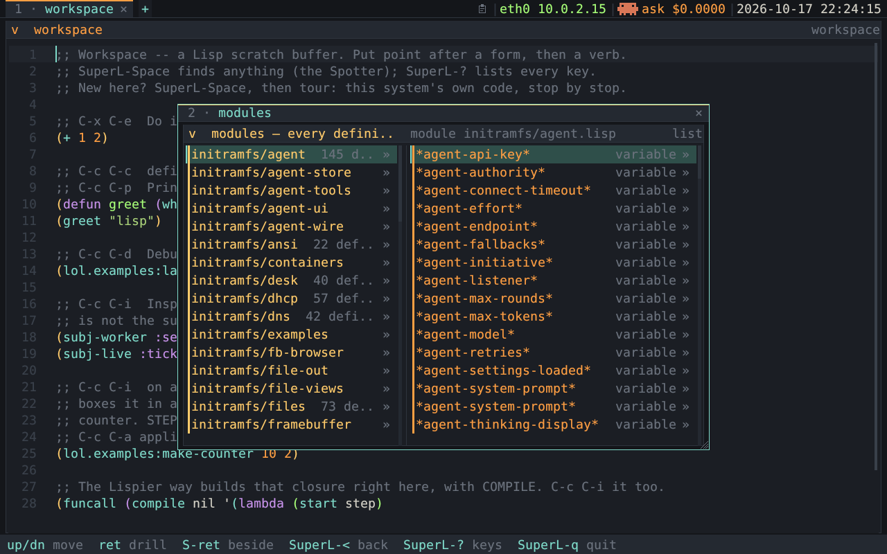
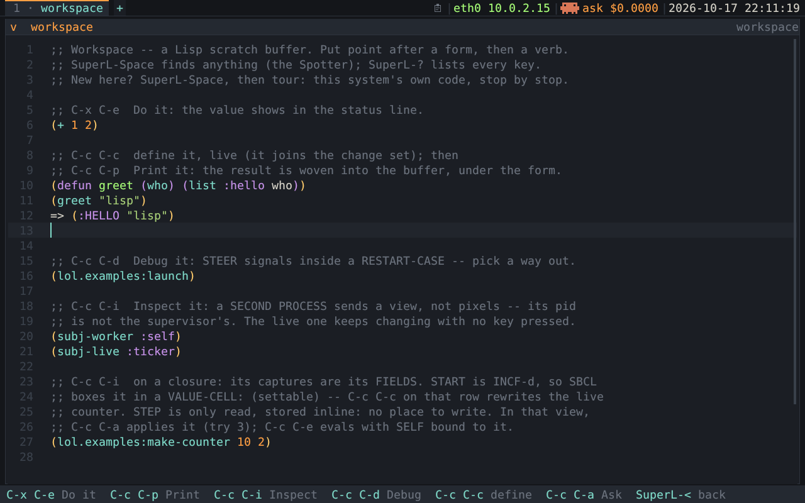
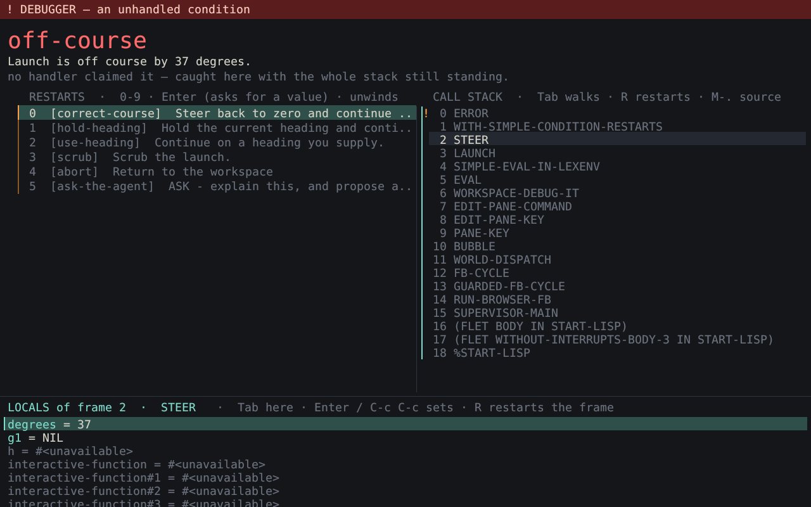
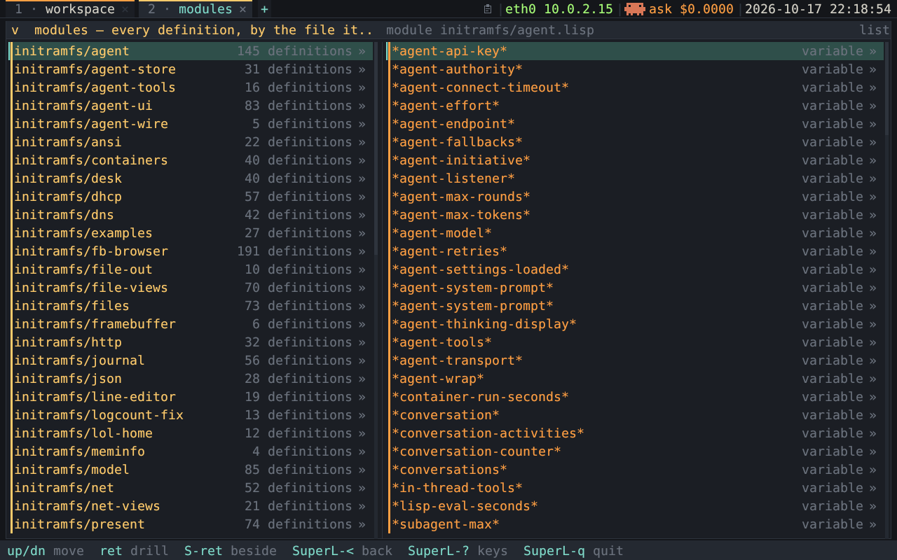
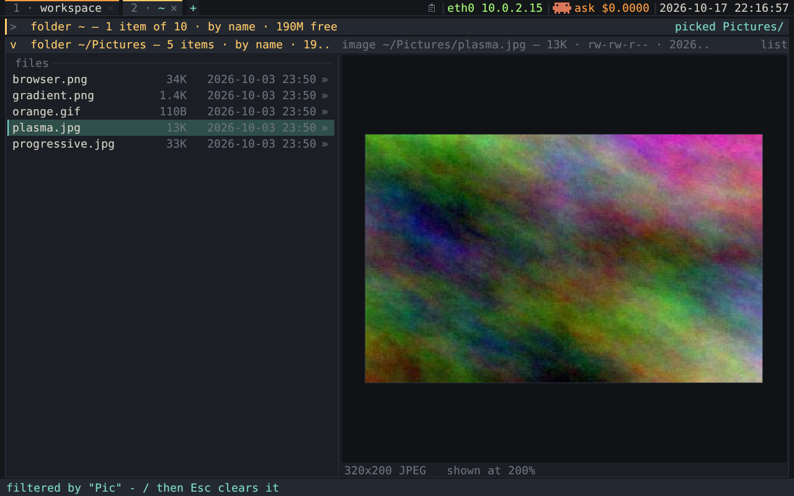
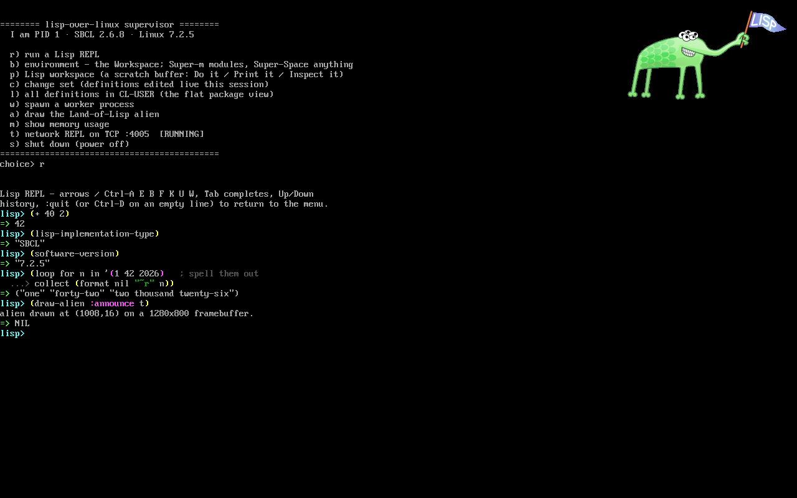

#+TITLE: lisp-over-linux (LoL) — a live, Smalltalk-style Lisp environment that is the whole machine
#+STARTUP: showall

LoL is an *environment you work inside*, in the tradition of the Lisp Machines and
Smalltalk: one live Common Lisp image that holds your code, your tools and the
desktop they are drawn on. Every part of it can show you its own source, be
inspected, be debugged with its stack standing, and be redefined while it runs:
the code browser, the debugger, the window system, the terminal, the editor you
are typing in. There is no separate "IDE" and "system". The tool you use to look
at something is made of the same stuff as the thing.

It runs as the whole userland of a bare Linux kernel. SBCL is *PID 1*: no shell, no
systemd, no X server, no toolkit. The machine boots straight into the environment,
which draws every pixel itself on the framebuffer.

/As it boots, under QEMU: the *Workspace* tiled across the screen, a Lisp scratch
buffer whose lines are verbs, and the *module index* (=Super-m=) torn off into a
window with =Super-g=. Both are morphs in one world, drawn by the Lisp from TrueType
outlines it rasterises itself. Across the top: tabs, then the systray (network, the
agent and what it has spent, the clock)./

* Working in it

*Everything is a subject you can drill into.* One protocol, =present=, turns any
object into a view of drillable rows: a module, a package, a class, a generic
function and its dispatch matrix, a condition and who signals it, a closure and
what it captured, a file, a process, a web page. =↵= opens the next pane on the
selection, so a trail of panes reads as the path you took. =Super-Space= (the
Spotter) finds anything by name, and =Super-?= lists every key.

/Live definition: =C-c C-c= on line 10 has compiled =greet= into the running image
and recorded it in the change set; =C-c C-p= printed =(greet "lisp")= under itself.
The status bar names the verbs: Do it, Print, Inspect, Debug, define, Ask./

- *Change it while it runs.* Any source pane is live. Edit a definition, =C-c C-c=,
  and it is compiled into the image and becomes the source the browser shows next.
  Each change is first tried in a throwaway child process, so a definition that
  hangs or kills its process is refused before it reaches yours.
- *A real debugger.* An error stops with the stack still standing: restarts, an
  =sb-di= backtrace, frame locals you can change, a frame you can restart, =M-.=
  into any frame's source. One restart asks the agent to explain the error.
- *An inspector with the old powers*: every instance of a class (a heap walk), why
  an object is still alive (the path from a root), evaluation with =self= bound to
  the object, a closure's captured variables as settable fields
  ([[file:doc/inspector-history.org][inspector-history.org]]).
- *A window system in the same image* (Morphic). Everything on screen is a CLOS
  morph in one world. =Super-g= tears a tab off into a window you move and resize;
  the middle button's halo acts on whatever is under the pointer; a row, a field or
  a name drags from one view into another (=Super-p= picks it up, =Super-d= drops
  it) ([[file:doc/morphic.org][morphic.org]]).
- *A session that survives power-off.* Every =C-c C-c= is journalled and replayed at
  the next boot; tabs, windows and the Workspace text come back; the journal view's
  =F= files the edits back into the source files. It all lives under one =~/.lol/=
  tree ([[file:doc/session-persistence.org][session-persistence.org]]).

/The debugger, from the Workspace's =C-c C-d=: the condition, its restarts (the last
one asks the agent), the call stack, and the selected frame's locals; =degrees= is
settable./

** The tools around the code

- *A terminal* (=Super-↵=): a login shell in a user-namespace container over the
  host's own Debian, so =git=, =ruby=, =rails= and Postgres work without growing the
  image. The pty, the VT parser and the cell grid are Lisp.
- *A web browser* (=Super-b=): the host's Chrome, headless in a container, driven
  over the DevTools protocol; its frames are decoded and drawn by the Lisp, and our
  keys and clicks become its input. A page is a tab like any other, or a window.
- *A file manager* (=Super-f=) with previews (PNG, GIF, JPEG, archives, ELF, hex),
  and the Spotter reads paths.
- *An agent*: an LLM client written in Lisp and living in the image, whose tools are
  the image's own introspection. Every write it wants (an eval, a definition, a
  file, a command) is a condition with restarts, which you approve on screen, and
  C-g stops it.
- *Networking in Lisp* (DHCP, DNS, SNTP, HTTP/HTTPS, IPv6, Wi-Fi), a clipboard with
  history, runtime font scaling.
- *It explains its own freezes*: a session log with a heartbeat, stall reports
  carrying every thread's backtrace, the kernel's log copied to disk
  ([[file:doc/diagnostics.org][diagnostics.org]]).

/The module index: every definition in the image, grouped by the file it came from,
beside the selected module's contents. It is the only view that shows the whole
system, the toolkit included (it lives in its own =lol.*= packages)./

/The file manager, filtered to =~/Pictures=, with a JPEG previewed beside the
listing./

* Trying it

Build the image and boot it in a QEMU window you can type into (the prerequisites
are under "Rebuilding the environment from scratch" below):

#+begin_src sh
  ./build.sh --interactive
#+end_src

It opens on the Workspace. Put the point after a form and use a verb (=C-x C-e= Do
it, =C-c C-p= Print, =C-c C-i= Inspect, =C-c C-d= Debug). =Super-Space= then "tour"
walks the system's own code, stop by stop. To learn the code from outside, start at
[[file:doc/tour.org][tour.org]], the index of an offline HTML guide with diagrams and reading paths.
The design and phase tracker of the environment is [[file:doc/code-browser.org][code-browser.org]].

* How it began, and what is underneath

The project started as a lesson in booting: the smallest Linux a UEFI laptop can
start from a USB stick, with no bootloader (EFISTUB, [[file:doc/micro-distro.org][micro-distro.org]]). Then SBCL
replaced everything above the kernel ([[file:doc/sbcl-init.org][sbcl-init.org]]). Then the Lisp learned to
draw, and the environment grew from a code browser into the place where the
work happens. The boot chain is still all there, and still small:

firmware → the kernel (it *is* the EFI application) → a small C =preinit= → SBCL.
It boots from a USB stick or from an entry in the host's GRUB. =preinit= mounts the
laptop's disk read-only except for =/home=, drops to the user with five
capabilities, and =execve=​s the Lisp, which stays PID 1 for the life of the machine.
Leave the environment (=Super-q=) and you land on the supervisor's console menu,
with a REPL of its own:

/The supervisor's menu and its REPL on the framebuffer console, with the Land of
Lisp alien (the "LoL" is also a nod to Land of Lisp). Screenshots are archived
per date under =media/screenshots/=; =./refresh-screenshot.sh= re-captures them
from a headless QEMU./

Every kernel option and why is in [[file:doc/kernel-config.org][kernel-config.org]]. This is a learning
project: the =.org= docs are the deliverable, written to be read, and the code is
meant to be understood as much as run.

* What is in this repo (and what is NOT)

Tracked here: the *sources and docs* — the C preinit, the Lisp supervisor, the
initramfs description, =build.sh=, =deps.sh=, every =.org= write-up, and a pinned
snapshot of the kernel =.config= under =kernel/=.

*NOT* tracked (too big, version-specific, per-machine): the *Linux kernel source
tree* and the *SBCL source tree*. The build reaches them through two *gitignored
symlinks* in the project root:

#+begin_src
  ./linux  ->  a Linux kernel source tree   (e.g. linux-7.2.5)
  ./sbcl   ->  an SBCL source tree (already built)
#+end_src

=build.sh= locates itself and uses =./linux= and =./sbcl= — nothing hardcodes a
home path, so the whole project folder is relocatable and clone-able by anyone.

* Rebuilding the environment from scratch

You need three things present: the two symlinks above (pointing at real trees)
and the host toolchain. Use =deps.sh= to create the symlinks.

** 1. Host packages (Debian/Ubuntu)

#+begin_src sh
  sudo apt install build-essential bc kmod cpio flex bison \
       libncurses-dev libelf-dev libssl-dev dwarves rsync \
       qemu-system-x86 ovmf dosfstools mtools gdisk musl-tools
#+end_src

** 2. The Linux kernel tree  (./linux)

If you ALREADY have a kernel source tree:
#+begin_src sh
  ./deps.sh link linux /path/to/linux-7.2.5
#+end_src

From nothing (downloads into =./sources/=, symlinks, applies our pinned config):
#+begin_src sh
  ./deps.sh kernel 7.2.5       # version defaults to the one we pin in kernel/
#+end_src

The pinned config lives in =kernel/config-7.2.5= (see [[file:doc/kernel-config.org][kernel-config.org]] for what
every option is and why). =deps.sh kernel= copies it to =linux/.config= and runs
=make olddefconfig= for you.

** 3. The SBCL tree  (./sbcl)

If you already have a *built* SBCL checkout:
#+begin_src sh
  ./deps.sh link sbcl /path/to/sbcl
#+end_src

From nothing (clones; you must then build it — SBCL needs an existing Lisp to
bootstrap):
#+begin_src sh
  ./deps.sh sbcl
  cd sbcl && sh make.sh && cd ..
#+end_src

=build.sh= expects =sbcl/src/runtime/sbcl= and =sbcl/output/sbcl.core= to exist.

** 4. Build

#+begin_src sh
  ./deps.sh status        # sanity: both symlinks resolve
  ./build.sh              # preinit + lisp-init + initramfs.cpio   (seconds)
  ./build.sh --kernel     # ALSO rebuild the kernel + BOOTX64.EFI  (minutes)
  ./build.sh --run        # build, boot HEADLESS in QEMU/OVMF, screenshot it
  ./build.sh --interactive  # build, boot in a QEMU WINDOW you can type into
#+end_src

Use =--interactive= (=-i=) to actually *drive* the supervisor menu and the Lisp
REPL: PID 1's console is the framebuffer VT (=tty0=), so you type in the QEMU
window while the launching terminal mirrors the serial/kernel log. =--run= is the
non-interactive path (boots, screenshots, kills QEMU) for quick checks/CI.

Then write the USB / boot on real hardware — see [[file:doc/micro-distro.org][micro-distro.org]].
Or skip the stick: =./build.sh --install-host= puts both files in the host's
=/boot/lisp= for a one-time GRUB entry ([[file:doc/micro-distro.org::Booting from the host's GRUB][micro-distro.org → Booting from the host's GRUB]]).

* Upgrading the kernel version

The symlink is the whole trick: point =./linux= at the new tree and rebuild.
#+begin_src sh
  ./deps.sh kernel 6.19          # download + extract + symlink + apply config
  # if 6.19 has no pinned snapshot yet, configure, then:
  #   cp linux/.config kernel/config-6.19   (commit it)
  ./build.sh --kernel
#+end_src
Nothing in the project needs editing — only the symlink moves.

* The docs (read these)

** The environment

| File | What it covers |
|------+----------------|
| [[file:doc/tour.org][tour.org]]          | *Start here to learn the code.* Index of the HTML guide ([[file:doc/guide/index.html][doc/guide/]]: diagrams of the boot, build, module graph, =present=, pixels and input; reading paths; glossary; exercises — its =file:line= references are generated by =doc/guide/regen.lisp=) and of the in-image tour (=SuperL-Space= "tour"). |
| [[file:doc/code-browser.org][code-browser.org]]  | The design and phase tracker of the environment: the pixel-native, Smalltalk-style code browser: the =present= drill-down protocol, the accordion shell, trails/tabs/Spotter, live editing, the debugger. Design + phase tracker. |
| [[file:doc/morphic.org][morphic.org]]       | Morphic, the code browser's Phase 7, BUILT: morphs as CLOS objects in one world, damage repair, trail windows (=SuperL-g=), the halo acting on morphs, overlays and stepping as morphs, every pane and its body a morph, drag and drop through the hand. |
| [[file:doc/session-persistence.org][session-persistence.org]] | What a session creates and how it is kept: the per-Accept journal replayed at boot, the desk (tabs, windows, Workspace text), file-out into the checkout, the leave menu — all under =~/.lol/=. |
| [[file:doc/inspector-history.org][inspector-history.org]] | What inspectors could do on Interlisp-D, the Lisp Machines, Smalltalk, CLIM and SLIME, and the four powers built here: all instances, why an object is alive, eval in its context, settable frame locals. |
| [[file:doc/agent.org][agent.org]]         | An LLM client native to the image — JSON/SSE and the Messages protocol in Lisp, the introspection layer as its tool surface, gated writes as a condition with restarts, =C-c C-a= Ask it. BUILT (A0–A2, tested against a mock API); TLS comes from the networking track. |
| [[file:doc/terminal.org][terminal.org]]      | The terminal pane (=SuperL-↵=): a login shell in the default container, in a tab like any other. What a pseudo-terminal is, sessions and controlling terminals (why =posix_spawn= and not =run-program :pty=), why escape sequences, Williams' parser, the cell grid, keys as bytes, the mouse and bracketed paste, repainting only the rows a program changed. vim, less, htop, readline. |
| [[file:doc/web-browser.org][web-browser.org]]   | The web browser, BUILT: =SuperL-b= opens a page in a tab of the environment. The host's Google Chrome runs headless in a container and is driven over the DevTools protocol on a pipe; its screencast JPEGs are decoded and drawn by the Lisp, and our keys and clicks become its input events. Why Chrome over WPE; the WPE/Nyxt exploration kept as an appendix. |
| [[file:doc/file-manager.org][file-manager.org]]  | The file manager (=Super-f=): folders and files as subjects, the operations, safe save, the Spotter's path grammar. Previews: [[file:doc/previews.org][previews.org]]. |
| [[file:doc/containers.org][containers.org]]    | Running a real distro's projects (a Rails app) without growing the image: a user-namespace container over the host's own Debian at =/mnt/host=, per-directory overlays, you inside as yourself. BUILT at tag #26: the =lol-ct= helper, containers in the Spotter, =x= runs a command streamed live into a pane; ruby, rails, a private Postgres, git and curl verified in the guest. The terminal pane is built: [[file:doc/terminal.org][terminal.org]]. |
| [[file:doc/processes.org][processes.org]]     | Concurrent components sharing the screen: why only one process may write =/dev/fb0=, sending a *view* vs sending *pixels*, two processes and one mouse, fork/exec vs COW — plus the =sb-posix= audit (§6, DONE). |
| [[file:doc/fonts.org][fonts.org]]         | How a character becomes pixels in our own renderer — a TrueType outline rasterised in pure Lisp, or the Cozette bitmap fallback — and how the size changes at run time (=SuperL-= / - / 0=). |
| [[file:doc/diagnostics.org][diagnostics.org]]   | Why a frozen screen happens and what the machine now writes down about it: the session log, stall reports with every thread's backtrace, the kernel log, crash-then-reboot, Magic SysRq and pstore. How to read it from Debian. |

** The machine underneath

| File | What it covers |
|------+----------------|
| [[file:doc/micro-distro.org][micro-distro.org]]  | The base EFISTUB boot chain, USB creation, real-hardware boot. |
| [[file:doc/sbcl-init.org][sbcl-init.org]]     | SBCL as PID 1: the preinit shim, the supervisor, the build. |
| [[file:doc/kernel-config.org][kernel-config.org]] | Every kernel option we enable and why (single source of truth). |
| [[file:doc/framebuffer.org][framebuffer.org]]   | Framebuffer → efifb → fbcon, /dev/fb0, fonts, drawing the alien. Also: why there is no GPU driver here. |
| [[file:doc/storage.org][storage.org]]       | The laptop's disk: NVMe + ext4, found by reading superblocks, mounted read-only but for =/home=; PID 1 drops to the user with five capabilities, =lol-rootd= keeps root for two jobs. |
| [[file:doc/networking.org][networking.org]]    | The network layer in Lisp: DHCP, the default route, a DNS resolver, SNTP, HTTP/1.1 and HTTPS (the host's OpenSSL, loaded at run time), IPv6, Wi-Fi through the host's =wpa_supplicant=, and the TCP REPL. |
| [[file:doc/line-editing.org][line-editing.org]]  | Readline-class REPL editing in pure Lisp (implemented). |
| [[file:doc/x11.org][x11.org]]           | The pure-Lisp X11 *client* (309 lines, no Xlib): why "supporting X" is just a socket protocol, and how the browser gets a window on your dev host. |

** Background and inspiration

| File | What it covers |
|------+----------------|
| [[file:doc/steps.org][steps.org]]         | *Inspiration.* VPRI's STEPS and Piumarta & Warth's /Open, Extensible Object Models/ (2008): the paper summarised, what LoL shares and doesn't, and the =loc.sh= split of our code into /ours/ vs /conformance/. |
| [[file:doc/background/learn-clos.org][learn-clos.org]]    | From-scratch tutorial: CLOS (multiple dispatch, method combination) and the MOP — the Lisp the code browser is built out of. |
| [[file:doc/background/learn-networking.org][learn-networking.org]] | From-scratch networking tutorial (progress tracker + code links). |
| [[file:doc/background/background.org][background.org]]    | Background theory: UEFI handoff, x86 modes, USB-HID, multicore. |
| [[file:AGENTS.md][AGENTS.md]]         | Working notes / conventions for AI agents in this repo. |

* Layout

#+begin_src
  build.sh                 one-step build (userland, --kernel, --run)
  deps.sh                  fetch/link/update the ./linux and ./sbcl trees
  check-links.sh           verify every [[file:...]] link in the .org docs resolves
  refresh-screenshot.sh    re-capture the screenshots (headless QEMU, driven over QMP)
  loc.sh                   lines of code/prose, by language and by origin (ours vs conformance)
  kernel/                  pinned .config snapshots (config-<version>)
  initramfs/               preinit.c, the Lisp modules (*.lisp), the cpio list, alien assets
  poc/                     the code browser's pixel toolkit — canvas, text view, X11 client,
                           the accordion shell, the Cozette font blob. Host-runnable from a
                           plain sbcl, AND baked into the image (build.sh loads it in place)
  media/                   screenshots (archived per date) + the HTML design mock-ups
  host-client/             HOST-side tools (NOT in the image): the network-REPL client
  iso_root/                build output: BOOTX64.EFI + initramfs.cpio (gitignored)
  README.org               this file (the only .org in the root)
  doc/                     all other documentation (*.org); doc/background/ = theory + tutorials
  linux -> …  sbcl -> …    gitignored symlinks to the external source trees
  sources/                 (optional) where deps.sh downloads trees (gitignored)
#+end_src

* Licensing

This project's *own* code — =preinit.c=, =supervisor.lisp=, =build.sh=,
=deps.sh=, the =.org= docs, and the =kernel/config-*= snapshots — is released
under the *MIT License* (see [[file:LICENSE][LICENSE]]).

Why MIT and not GPL, given we build on Linux: this repository does *not*
redistribute the Linux kernel (its source and the compiled =bzImage= are
gitignored; the tree is fetched separately via =deps.sh=), and our userland
talks to the kernel only through *system calls* — which the kernel's own license
explicitly excludes from being a derivative work. So our code is ours to license.

Third-party components you obtain/build separately keep their own licenses:

| Component | License | How it reaches you |
|-----------+---------+--------------------|
| Linux kernel | GPLv2 | fetched by =deps.sh= from kernel.org; never redistributed here |
| musl libc | MIT | statically linked into =preinit= (you build it) |
| SBCL | public domain + BSD-style | the runtime your image embeds (you build it) |
| GNU C Library (glibc) | *LGPL-2.1-or-later* | copied *verbatim into the initramfs* — the SBCL binary is dynamically linked, so =ld-linux-x86-64.so.2=, =libc.so.6= and =libm.so.6= are taken from your host and shipped (see =initramfs/initramfs.sbcl.list=) |
| Intel Wi-Fi firmware (=iwlwifi-*.ucode=) | Intel's binary-redistribution licence (=LICENCE.iwlwifi_firmware= in linux-firmware; Debian's copyright file calls it =binary-redist-Intel=) | copied by =build.sh= from *your host's* =/lib/firmware= (Debian's =firmware-iwlwifi=) into the initramfs only; *never committed here*; card-keyed, =LOL_WIFI_FIRMWARE=0= leaves it out ([[file:doc/networking.org][networking.org]] §7) |
| =regulatory.db= (+ =.p7s=) | ISC (wireless-regdb) | likewise copied from your host's =/lib/firmware= (the upstream-signed =regulatory.db-upstream=), never committed |
| OpenSSL 3, =wpa_supplicant= | Apache-2.0; BSD-3-Clause | *not shipped at all*: the image loads/runs the host's own copies from =/mnt/host= at runtime ([[file:doc/networking.org][networking.org]] §2e, §7) |
| Cozette (font) | MIT | *committed here* as =poc/cozette.lolf= (our 6×15 blob, regenerated from the upstream BDF) with the upstream license beside it in =poc/cozette-LICENSE.txt=; it also ships inside the image, as the fallback font |
| DejaVu Sans Mono (font) | Bitstream Vera licence (DejaVu's own changes: public domain) | *never committed*: =build.sh= copies it from the build host (Debian's =fonts-dejavu-core=, =/usr/share/fonts/truetype/dejavu/=) into the image at =/usr/share/lol/mono.ttf=. The licence permits redistribution with its notice (=/usr/share/doc/fonts-dejavu-core/copyright= on the host). =LOL_FONT= ships another file instead — then that file's licence applies |

*Important if you ever distribute a bootable image/USB.* Two obligations come
along for the ride, and neither affects your own MIT code:

- *The kernel (GPLv2).* The image contains the compiled =bzImage=. To comply you
  must make the *corresponding kernel source* available (it is unmodified upstream
  linux-7.2.5 from kernel.org) together with the exact =.config= used — which we
  already keep under =kernel/=.
- *glibc (LGPL-2.1+).* The image also carries the glibc loader and libc/libm as
  unmodified binaries. The LGPL asks that you say which version you shipped, pass
  its license text along, and make its source obtainable — and that the user be
  able to *relink* against a modified glibc, which here is satisfied by the fact
  that SBCL is dynamically linked and the =.so= files are ordinary replaceable
  files in the initramfs.
- *Wi-Fi firmware.* If your image carries the Intel firmware (the default when the
  build host has it), Intel's licence permits redistribution in binary form on its
  own terms — read =LICENCE.iwlwifi_firmware= (Debian: =/usr/share/doc/firmware-iwlwifi/copyright=)
  and pass it along, or build with =LOL_WIFI_FIRMWARE=0=.

Everything else is aggregation: your MIT userland merely sits alongside these on
the medium and is unaffected. (This is a plain-English summary of what the
licenses cover, not legal advice — read them if you intend to ship.)

** Artwork

The alien sprite (=initramfs/alien256.png= and the derived =initramfs/alien.rgba=)
is the *Lisp alien logo by Conrad Barski, M.D.* — https://www.lisperati.com/logo.html
— released into the *public domain* ("anyone may use these freely for any purpose
and in any way"). Attribution is not required but is appreciated, so: thanks,
Conrad. The logo is also the namesake nod behind "LoL" / *Land of Lisp*.
