#+TITLE: The Code Browser — a Smalltalk browser that is honest about Lisp
#+STARTUP: showall

A browser for navigating, understanding and *changing* the running system from
inside itself — what a Smalltalk/Pharo browser gives you — without pretending
Common Lisp is Smalltalk, and without a window system that would dwarf the rest of
the project.

*Status: built.* Phases 0–7 are done ([[#phases][Phases]] is the authoritative per-phase status).
The browser runs full-screen on =/dev/fb0= as PID 1 — the image boots into it, and
=b= at the supervisor menu reopens it. It browses and *edits* its own source,
carries a live debugger, and sits on a widget toolkit. Phase 7 (Morphic,
[[file:morphic.org][morphic.org]]) made it the first window of a Lisp window system: everything on
screen, down to each pane's body, is a morph, with drag and drop through the hand.
The screenshots are captured from the running system ([[#phases][Phases (each independently demoable — this repo likes screenshots)]], "Reproducible
screenshots").

Related docs:
[[file:sbcl-init.org][sbcl-init.org]] (the Lisp userland) ·
[[file:framebuffer.org][framebuffer.org]] (pixels) ·
[[file:line-editing.org][line-editing.org]] (the editor toolkit) ·
[[file:networking.org][networking.org]] (the TCP REPL) ·
[[file:kernel-config.org][kernel-config.org]] (the options it needs) ·
[[file:background/learn-clos.org][background/learn-clos.org]] (the CLOS/MOP background assumed here) ·
[[file:inspector-history.org][inspector-history.org]] (what historical inspectors could do, and the four
powers that were cheap here).

* 0. The two findings that decide the whole design

Both were checked against the actual tree, not assumed.

** 0.1 The source code is NOT in the image (the keystone problem)
:PROPERTIES:
:CUSTOM_ID: source-code-image
:END:

=build.sh= bakes the =.lisp= files into =lisp-init= with =save-lisp-and-die= and
ships *only the binary*: the sources aren't in the cpio (=build.sh= [[#model-layer-unit-code][The model layer — what is a "unit of code" in Lisp?]],
=initramfs.sbcl.list=). And =sb-introspect='s source locations record the *build
host's* path:

#+begin_src
  #P"/home/<user>/lisp-over-linux/initramfs/framebuffer.lisp"
#+end_src

That path doesn't exist in the booted guest, so a browser that reads files has
*nothing to read*.

This is the fork in the road. Smalltalk's browser works because *the image owns the
source* (=.sources= / =.changes=) and a compiled method knows where its text is. A
file-based browser is an editor with a directory tree; an image-based browser is a
*view onto a living system*.

*Decision: the image owns the source.* At build time we capture the verbatim text
of every top-level form into a table frozen into the heap beside the code. The
browser reads *that*, never a file ([[#model-layer-unit-code][The model layer — what is a "unit of code" in Lisp?]]). This one decision, about 60 lines, is what
makes everything else Smalltalk-shaped rather than Emacs-shaped.

** 0.2 The cross-reference database already works
:PROPERTIES:
:CUSTOM_ID: cross-reference-database-already
:END:

SBCL usually records xref (=who-calls= and friends) during =compile-file=, and
=build.sh= uses plain =load=. Without xref we'd lose *Senders/Implementors*, the most
valuable thing in the Smalltalk browser. Tested against =./sbcl= with this project's
load strategy:

| query                             | plain =load= (what build.sh does) | =compile-file= + load |
|-----------------------------------+-----------------------------------+-----------------------|
| =who-calls=                       | works                             | works                 |
| =who-specializes-directly=        | works                             | works                 |
| =find-definition-sources-by-name= | works (host path)                 | works (host path)     |
| =function-lambda-list=            | works                             | works                 |

*No build change needed.* =sb-introspect.fasl= is in =sbcl/obj/sbcl-home/contrib/=
and is baked in with =(require :sb-introspect)= in the generated build script, as
=sb-bsd-sockets= is.

* 1. Framebuffer or X? — the question, answered
:PROPERTIES:
:CUSTOM_ID: framebuffer-x-question-answered
:END:

*Build on the framebuffer; never run an X server.* The insulation you need is an
abstraction layer, not a technology choice.

** Why not X

- *No DRM.* =CONFIG_DRM is not set=. X.org wants DRM/KMS; its old fbdev path is
  deprecated. "Add X" starts with "add a GPU driver stack", which
  [[file:framebuffer.org][[[file:framebuffer.org::#limits-efifb-vs-drm][framebuffer.org, Limits: efifb vs DRM/KMS]]]] rejects as vendor-specific.
- *No userland for it.* X.org is a C server plus drivers, xkb, fontconfig, shared
  libraries and a =/usr=. We have a static musl =preinit=, one frozen SBCL heap, no
  shell, no dynamic-library userland. Several hundred thousand lines of C against a
  Lisp userland would stop being this project.
- *Nothing to gain.* The browser needs a rectangle of pixels, a font, a keyboard
  and a mouse. We have all four.

** Why the framebuffer doesn't trap you

The real lock-in is *code that calls =format t= and emits escape sequences from
inside the browser's logic* — the same lock-in whatever the backend. So the rule,
from line one:

#+begin_quote
*The browser never prints, and it never touches =/dev/fb0=.* It draws into an
off-screen pixel buffer it owns. A =DISPLAY= backend does exactly two things:
*present* that buffer, and *deliver events*. Nothing else knows what kind of screen
it's talking to.
#+end_quote

With that rule, porting to another display is one new file.

** Rejected: a text-mode / character-cell browser

Rendering into the 160x50 fbcon grid first (reusing [[file:../initramfs/ansi.lisp][ansi.lisp]] and the raw-mode
line editor) was considered and rejected:

- *No faster to iterate.* A pixel backend prototypes on the *host* just as easily
  ([[#host-dev-loop][The host dev loop (build this first)]]), with no QEMU.
- *It forfeits the point.* The Smalltalk browser was pixel-native from day one, on a
  1-bit 606x808 Alto: proportional fonts, a real caret, selection, scrollbars, a
  mouse. That *is* the idea, and a character grid can't express it.

Pixel-native doesn't mean GPU compositing. It means a bitmap and good taste.

** The architecture: one pixel buffer, two backends

The browser renders — in pure Lisp, with its own font blitter and primitives — into
a 32-bit off-screen buffer. Presenting it is the *only* thing a backend does:

#+begin_src
   browser · widgets · text editing · fonts · layout      <- ALL pure Lisp,
        |                                                    backend-blind
        v
   [ off-screen ARGB pixel buffer + dirty rectangles ]
        |
        +--> (present buffer dirty)  ---> BACKEND
        <--  (next-event)            <---
                                       |
             +-------------------------+--------------------------+
             |                                                    |
        /dev/fb0                                    X11 client (pure Lisp, TCP)
        (in the guest)                              (host dev loop; also lets the
         present = mmap/memcpy                       GUEST display on the HOST)
                                                     present = PutImage
#+end_src

Both backends receive a *finished* picture, so the interface is about two
functions and everything interesting is in the portable half.

** An X client, not an X server

We never needed an X *server*. We need an X *client*, and X11 is a socket protocol
we already speak (=sb-bsd-sockets=). CLX proves a Lisp client needs no C, and since
we do all our own drawing we need only a slice of the protocol: the handshake,
=CreateWindow=, =MapWindow=, =CreateGC=, =PutImage=, and decoding =KeyPress= /
=ButtonPress= / =MotionNotify= / =Expose=. A few hundred lines, not a port of CLX
([[file:../poc/x11.lisp][poc/x11.lisp]], [[file:x11.org][x11.org]]). It buys:

1. *A real dev loop.* The browser runs in a window on the desktop from a plain host
   =sbcl= — no QEMU, no reboot.
2. *Remote display.* The booted guest can put its browser on the host's X server
   over the TCP link that already exists.
3. *No new C*, and no kernel change.

The endgame is a window system of our own on the framebuffer — Morphic. /Smalltalk
was never an X application; Smalltalk was the window system./ Phase 7 ([[#phases][Phases (each independently demoable — this repo likes screenshots)]]) built it.

* 2. The model layer — what is a "unit of code" in Lisp?
:PROPERTIES:
:CUSTOM_ID: model-layer-unit-code
:END:

Smalltalk's browser rests on the =CompiledMethod=: one class, one category, one
source string, a version history. Lisp has no such object, so we build one.

** The definition registry

From [[file:../initramfs/registry.lisp][registry.lisp]]:

#+begin_src lisp
  (defstruct defn
    name          ; a symbol, or (SETF sym)
    kind          ; :function :macro :generic-function :method :variable :constant
                  ; :class :condition :struct :type :package :compiler-macro
    source        ; the verbatim text, comments and formatting intact
    file          ; build-time provenance (the host path — for reference only)
    label         ; for methods: qualifiers + specializers, to tell them apart
    versions      ; previously-accepted source strings, most-recent first (Smalltalk Versions)
    package       ; the package its text was READ in (a name), so Accept reads it there too
    born)         ; T when Accepted into being at runtime rather than edited (see The Stage, "Beat 4")
#+end_src

Entries are keyed by kind and name, *not* by name alone: one symbol can be a
function, a variable, a class and a type at once. Smalltalk never faces this, and the
browser shows it plainly rather than hiding it. Categories aren't stored; they're
computed ([[#smalltalk-lisp-concept-map][The Smalltalk → Lisp concept map]], "categories").

** Build-time source capture (the keystone, ~60 lines)

The generated build script calls =(load-recording "foo.lisp")= instead of =load=:

#+begin_src lisp
  (defun load-recording (path)
    (load path)              ; execute first: packages now exist
    (record-source path))    ; then a read-only pass captures the text
#+end_src

- *Load first, then read.* =LOAD= runs the file unchanged (behaviour, compilation and
  xref are as before). A separate pass then =READ=s it with =*read-eval*= off, so it
  runs no code, and records each form's text. That pass follows =in-package=, so
  every definition is filed under its real package. A capture failure only means
  "that form isn't in the registry", never a broken build.
- *Exact spans.* =file-position= on a string stream is an exact character index.
- *Comments above go with the form.* The comment block above a =defun= falls inside
  that form's span, which is where it belongs. Leading blank lines are trimmed.
- *Trailing comments stay with their own form.* A comment after a form on its last
  line (=(defparameter *x* 1)   ; what x is=) and its indented continuation lines
  would otherwise open the *next* definition. [[file:../initramfs/registry.lisp::defun trailing-comment-end][=trailing-comment-end=]] extends each
  span past them; a comment at column 0 still goes with the form below. Trap:
  =READ= consumes the one whitespace character after a form, so the position can
  already be on the next line — the function steps back over it first.
- *Definitions are recorded by their head.* =register-source= asks
  =defn-name-and-kind=, which knows =defun=, =defmacro=, =defgeneric=,
  =define-compiler-macro=, =defmethod= (with its qualifier/specializer label),
  =defvar= / =defparameter=, =defconstant=, =defclass=, =define-condition=,
  =defstruct=, =deftype= and =defpackage=. Other top-level forms aren't recorded.
- *Live edits take the same path.* Accept (=accept-source=) reads the edited text,
  evals it, pushes the old text onto =versions= and updates the entry — or creates
  one, marked =born=, for a definition that didn't exist. That build/runtime
  symmetry is the whole trick.

*=load-recording= is a no-disk shim; it doesn't generalise to third-party
libraries, and needn't.* It exists for our own code, frozen into a binary whose
sources never ship. =source-of= layers, cleanest first:

1. *A registry hit* — our baked, editable code.
2. *The source location on disk.* =sb-introspect= knows the pathname and character
   offset of any compiled definition (ours, third-party or SBCL's). If the file is on
   disk, read the form on demand — SLIME's =M-.=, library-agnostic. Built for SBCL's
   own source (tag #25): [[file:../initramfs/sbcl-source.lisp][sbcl-source.lisp]], below. Third-party libraries would take
   the same road.
3. *Reference only* (=show-reference=).

To bake a third-party library's source without a disk, wrap =compile-file= / =load=
/ ASDF's =perform= once, globally — never per library. The disk makes even that
unnecessary.

*One form, many definitions.* =defstruct= makes a constructor, a predicate, a copier
and N accessors; =defclass= makes accessor generic functions. The registry doesn't
store derived entries; it asks SBCL:

- *defstruct functions.* =(info :function :source-transform name)= is =(dd . dsd)= for
  an accessor and =(dd . :constructor/:predicate/:copier)= for the others;
  [[file:../initramfs/registry.lisp::defun structure-defining][=structure-defining=]] turns that into the struct's name, and =present= on the
  =subj-defn= shows the struct's recorded =defstruct=. So =M-.= on =view-kind= opens
  =struct view=.
- *defclass accessors* need nothing: they're generic functions with recorded methods.
- *Pitfall.* A text search can't find a defstruct accessor's definition: the form
  spells =kind=, never =view-kind=, so the old last-resort fallback landed on the
  first *caller* that names it. =sbcl-definition-source= now looks for the struct by
  name first, for SBCL's own structs too.

** Two kinds of subject: your code vs. the builtins (SBCL source read from the disk)

The browser tells the truth about the difference rather than faking uniformity
([[file:../initramfs/registry.lisp][registry.lisp]]):

- *Your code* — the =initramfs/*.lisp= and =poc/*.lisp= modules, captured by
  =load-recording=. Editable source, Accept, senders, versions.
- *A CL/SBCL builtin* — =car=, =mapcar=, =if=, =sb-introspect:who-calls=, … A
  *reference* subject:
  - *Its text isn't in the image.* =function-lambda-expression= returns NIL.
  - *Its location is known.* =car= → =SYS:SRC;CODE;LIST.LISP=; since tag #25 the
    =./sbcl= tree is on the disk, under the mounted =/home=.
  - *Always shown:* lambda list (=sb-introspect:function-lambda-list=), docstring,
    *disassembly*, home package, the recorded location — and the source text when
    the tree is on disk. =who-calls= on a builtin returns nothing: xref covers our
    code only.
  - *Never a dead end.* =show-source= falls back to =show-reference=.

*Can you redefine a builtin?* In layers:

- *Special operators* (=if=, =let=, =quote=, =setq=, …): no. =special-operator-p= is
  T; the compiler owns them.
- *Standard CL functions and macros:* package-locked. =(defun mapcar …)= signals
  =symbol-package-locked-error= with a =CONTINUE= restart, and
  =(sb-ext:without-package-locks (defun mapcar …))= works (undefined per ANSI; SBCL
  permits it). Two catches: *inlined* builtins (=car=, =+=) ignore the redefinition at
  already-compiled call sites, and this is *PID 1*, so breaking a load-bearing
  function panics the machine.
- *SBCL internals* (=sb-impl::…=): the same.

So a builtin's view may offer an *experimental redefine*, clearly marked: it needs
=without-package-locks=, may miss inlined sites, and can crash PID 1 — unlike Accept
on your own code.

*** SBCL's source, read from the disk

Nothing is baked into the heap (the src tree is 34 MB; its =.lisp= files 25 MB). The
source is read on demand from the =./sbcl= tree the image was built from, which lives
under the =/home= the guest mounts ([[file:storage.org][storage.org]]).
[[file:../initramfs/sbcl-source.lisp][sbcl-source.lisp]] does it in four steps:

1. *Logical → physical.* SBCL records =SYS:SRC;CODE;LIST.LISP=. The core's =SYS= host
   pointed at the build tree when =./sbcl= was built; a =defvar=
   (=*sbcl-source-root*=) freezes that root into the image at our build. It's
   settable, to read another checkout of the same version.
2. *Find the form.* For functions and macros SBCL keeps the character offset where
   the top-level form's text begins — just past the previous form, so comments come
   first and are skipped. For classes, structures and variables it keeps only the
   form's index in the file.
3. *Cut it out textually.* The module never =READ=s SBCL's source: those files need
   SBCL's internal packages and build features (=#+sb-xc-host=). A small scanner that
   knows strings, =;= and =#| |#= comments, =#\(=, =|sym|= escapes and =#+feature=
   prefixes finds the form's end.
4. *Check it names the symbol*, else fall back: a line-initial =(def… NAME= (package
   prefix allowed — =(sb-xc:defmacro loop=), then the first top-level form mentioning
   the name. That's how a condition's slot reader (=cell-error-name=) lands on its
   =define-condition=.

It shows the *top-level form*, honestly: =mapcar= isn't a =defun= in SBCL but one line
of a =macrolet= in =list.lisp= that stamps out all six mappers. Against 2.6.8
(=poc/sbcl-source-test.lisp=, 23 checks), *893 of the 935* defined external CL symbols
resolve. The 42 that don't are 39 special operators and built-in types (SBCL records
no location; the view says so) and three =defstruct=-generated names
(=random-state-p=, =synonym-stream-symbol=, =broadcast-stream-streams=) that never
appear in the text. A diskless boot, or a tree outside =/home=, keeps the
reference-only view and says why ("not on this disk").

The source is appended *below* =show-reference='s facts, read-only, in a
=:reference= pane — =M-.= on =mapcar= in the Workspace opens this (=--scene
sbcl-source=; asserted in the guest by [[file:../check-files.lisp][check-files.lisp]]):

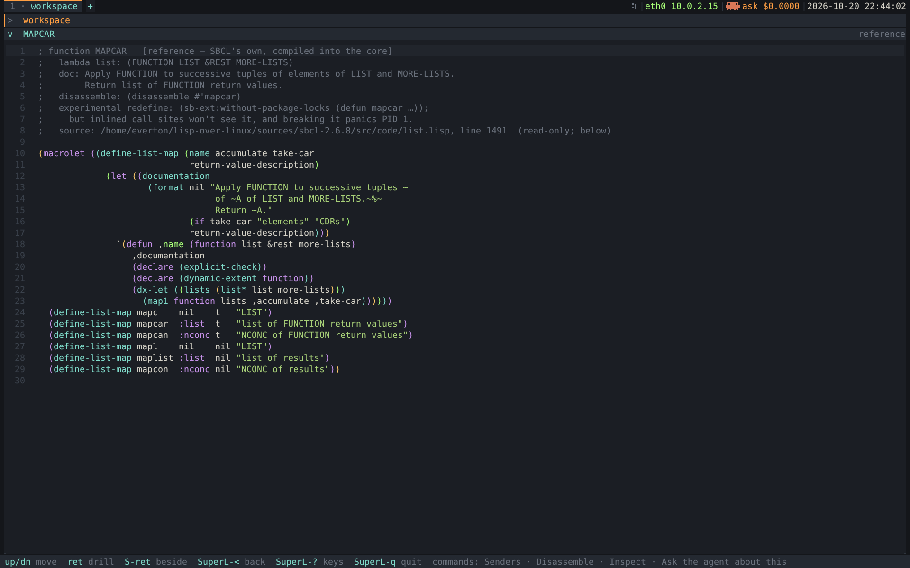

* 3. The Smalltalk → Lisp concept map
:PROPERTIES:
:CUSTOM_ID: smalltalk-lisp-concept-map
:END:

Some concepts translate, some invert, some have no counterpart either way. The honest
translation is what makes this worth building instead of cloning.

** What must survive from Smalltalk (non-negotiable)

| Smalltalk / Pharo                                                        | In our system                                                                                                                                                                      |
|--------------------------------------------------------------------------+------------------------------------------------------------------------------------------------------------------------------------------------------------------------------------|
| The image is live; accept compiles into the running system               | =eval=/=compile= are *always* in an SBCL image. The frozen heap can't load fasls, but it can compile. This is the whole point.                                                     |
| Source lives in the image                                                | The definition registry ([[#model-layer-unit-code][The model layer — what is a "unit of code" in Lisp?]]). Without it there is no browser.                                                                                                                      |
| Senders / Implementors / References                                      | =sb-introspect:who-calls=, =who-references=, =who-binds=, =who-sets=, =who-macroexpands=, =who-specializes-directly=. Verified working ([[#cross-reference-database-already][The cross-reference database already works]]). Arguably *richer* than Smalltalk's. |
| Do it / Print it / Inspect it                                            | On any selection, anywhere in the browser.                                                                                                                                         |
| The Inspector                                                            | A real object inspector: slots, sequence elements, hash entries, a symbol's cells; drill-down with a back-stack; and *mutation* ([[#environment-trails-spotter-tiled][The environment — trails, the Spotter, and the tiled shell]], "Editing a value from the inspector").      |
| The Debugger as a browser                                                | SBCL's condition system + restarts is *stronger* than Smalltalk's. Live backtrace, frame locals (=sb-di=), pick a restart, redefine, retry.                                        |
| Versions (per-method history)                                            | The =versions= slot. Free once source is in the image.                                                                                                                             |
| The change set / =.changes=                                              | The change set view, journalled per Accept and replayed at boot ([[#persistence-kernel-gap][Persistence — and the kernel gap]]).                                                                                                              |
| Class comments                                                           | Docstrings — native, and =(setf (documentation …))= works.                                                                                                                         |
| No dead ends: everything is browsable from everywhere                    | Every object printed anywhere is inspectable; every name is jumpable.                                                                                                              |
| The browser is written in the language it browses, and can browse itself | Browse the browser, edit it live, watch it change under you. The fixed point is the demo.                                                                                          |

** What Lisp has that Smalltalk does not — make these first-class

- *Macros → a Macroexpand pane.* =macroexpand-1=, full expansion, step through. No
  Smalltalk analogue at all. /Not built/ (=who-macroexpands= is wrapped as
  =macro-users=).
- *Disassembly.* =disassemble= is built into SBCL. Smalltalk browsers show bytecode;
  ours shows real x86-64, on a machine where Lisp is PID 1. Built: a function's view
  has a disassembly door.
- *Compiler notes.* The warnings and notes an eval produces: a live "why is this slow"
  channel. The Workspace collects them (=ws-compiler-notes=, one line per message); a
  dedicated pane isn't built.
- *Symbols as objects.* A symbol has a value cell, a function cell, a plist, a
  type/class. A symbol inspector showing all four has no Smalltalk counterpart.
- *Packages.* A symbol's export status is a native analogue of public/private
  protocol.
- *The rest of the dynamic environment.* Restarts, the reader/readtable, special
  variables: all browsable.

** The hard one: classes vs generic functions
:PROPERTIES:
:CUSTOM_ID: classes-vs-generic-functions
:END:

The deep impedance mismatch; the design stands or falls on it. A *visual design spec*
for the views below is [[file:../media/browser-views-design.html][media/browser-views-design.html]] (open it locally,
self-contained).

- *Smalltalk:* a method belongs to a class. One tree, and the browser is that tree.
- *CLOS:* a method belongs to a *generic function* and is specialised on a *tuple* of
  classes. A class doesn't own its methods. There is no tree.

A class-owns-methods tree would lie about the language; a GF-only browser would throw
away Smalltalk's spatial navigation. So do both, honestly. A generic function answers
*two different questions*, and each needs its own picture.

*** Question 1 — coverage: where do methods live across the class space?

- *The class side* (feels like Smalltalk). A class's "protocol" is *computed*: every
  method with this class in its specializers (=sb-mop:specializer-direct-methods=).
  Each entry shows its generic function and *full specializer tuple*, so a
  multi-method appears under *every* class it dispatches on. That's multiple dispatch,
  made visible.
- *The dispatch matrix* — the star. For a GF with two specialised arguments, a grid:
  the specializer classes (plus =T=) on the axes, methods in the cells. A cell that
  falls through to a =(… T)= default reads differently from an exact one, and a cell
  with *no* applicable method is a visible gap — a hole found statically instead of at
  runtime.
- *It degrades honestly.* One specialised argument → a plain ordered list; 3+ → fix
  the first specializer and matrix the rest; EQL specializers → their own labelled
  rows.

*** Question 2 — combination: what actually runs when I call it?

One call can run *many* methods, woven by method combination — invisible in the source.

- *The effective-method onion.* For one concrete call: =:around= (outermost) wrapping
  =:before= methods (most specific first), the primary chain threaded by
  =call-next-method=, and =:after= methods (least specific first). *The indentation is
  the call stack.* You see that a focus ring comes from a mixin =button='s author never
  thought about, and that the border paints before the label.
- *Built from* =compute-applicable-methods-using-classes=, sorted by qualifier and
  specificity.

*Coverage on top, combination below, in one place.* Clicking a matrix cell drills
the onion for that class pair. What dispatch needs is one *class* per required
parameter (it ignores optional/rest/keyword args, and standard specializers care only
about class), so a cell fully specifies a 2-argument call. When a cell can't — 3+
arguments, an =eql= specializer (dispatch on a *value*), a live object from the
Inspector — the tuple comes from elsewhere. =compute-applicable-methods-using-classes=
says when classes aren't enough: its second value is =nil= exactly when an =eql= method
could apply.

The class-shaped remainder: the superclass chain becomes the *class precedence list*;
the subclass graph (=sb-mop:class-direct-subclasses=) is a *DAG*, not a tree, and the
renderer handles that.

*** Built: the matrix and the onion

=COLLIDE= in [[file:../initramfs/examples.lisp][=examples.lisp=]] dispatches on both arguments, so its coverage is a
real grid: rows and columns are the specializer classes, each cell holds the
primary-method count, and a dim =·= is a genuine gap where nobody wrote a rule.

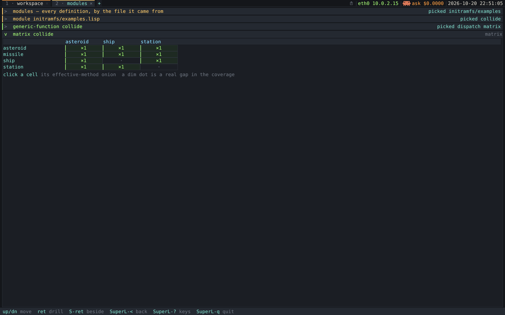

/The dispatch matrix for =collide=. =./refresh-screenshot.sh --scene matrix=./

A filled cell drills the onion for that pair. The =(missile ship)= pair carries the
full =:around= / =:before= / =:after= trio so the view has something to show.
=(effective-method-onion 'collide 'missile 'ship)= prints it from any REPL. (No
screenshot of the onion: a =:matrix= pane has no keyboard cell cursor —
=matrix-cell-click= in [[file:../poc/shell.lisp][=poc/shell.lisp=]] is the only way in — and the QMP harness
can't land a click on an absolute pixel through QEMU's relative PS/2 mouse. Stepping
the cursor in small increments would fix that.)

*** EQL specializers on an axis

An axis isn't always classes. =dispatch-axes= collects whatever specializer appears
at each position, and an EQL specializer is the LIST =(EQL OBJECT)=.

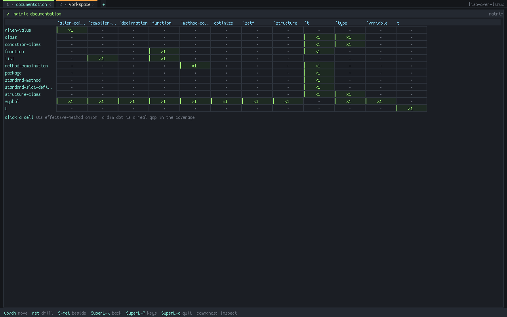

/=documentation='s matrix: eleven EQL columns beside the class =t=, and the gap at
=symbol= × ='t= is real. =sbcl --script poc/render-frame.lisp matrix:DOCUMENTATION -s
1280x800=./

=label-text= in [[file:../poc/widgets.lisp][=poc/widgets.lisp=]] draws axis labels:

- *It prints what =STRING= refuses.* Calling =STRING= on =(EQL ALIEN-CALLABLE)=
  signalled and took the whole frame with it: any GF with an =eql= method was
  unopenable as a matrix.
- *=(eql object)= is drawn as ='object=.* A heading is twelve characters and =EQL=
  spends five of them; the honest spelling clipped every column to =(eql compi..=.
  The quote costs one character and keeps ='t= distinct from the class =t=.
- *The object is printed with =PRIN1=.* =STRING= and =PRINC= drop the marks that say
  /which/ object it is: =stage-enact= dispatches on =(eql :hull-breach)=, and
  =STRING= would draw ='hull-breach=, a different specializer.
- *Only the drawing shortens.* =draw-grid='s hit map keeps the label it was handed,
  so the onion a click opens is titled =effective documentation (alien-value (eql
  alien-callable))=.

*** One label printer for methods

Every place that renders a specializer tuple — method rows in a GF view, the onion's
layers and title, a method pane's title, the degraded text matrix — goes through
=specializer-label= and =qualifier-label= in [[file:../initramfs/registry.lisp][=registry.lisp=]], the first module
loaded. =~a= used to drop keywords' colons, so =(eql :hull-breach)= read as =(eql
hull-breach)= and =:around= read as =around= (itself a legal, different qualifier).

The label is not only display text: it's the key =method-source= matches on, built in
two places — =defn-name-and-kind= from the recorded =defmethod= form and
=method-source-label= from the live method. Both now call =method-label=, and the
invariant is checkable: 40 recorded =:method= definitions, 40 live methods resolving
a source, 0 registry labels without a live match. Rules:

- *=(EQL (QUOTE X))= normalises to =(EQL X)=*, how the runtime reports what the
  source spells.
- *Matching labels print upper-case; displayed ones bind =*print-case*= to
  =:downcase=* rather than downcasing the finished text, which would also lower a
  string a method dispatches on.

** And "categories", which Lisp does not have
:PROPERTIES:
:CUSTOM_ID: categories
:END:

Smalltalk's method categories (=accessing=, =printing=, =private=) are metadata
attached to a method. =categorize= in [[file:../initramfs/model.lisp][model.lisp]] derives them:

- *By kind* — Functions / Macros / Classes / Generic Functions / Variables.
- *By file* — in this project *the files already are the categories*. This is
  =categorize='s default scheme and what the module index shows ([[#module-index-files-categories][The module index — our files ARE our categories  (DONE)]]).
- *By export status* — external vs internal ≈ public vs private.

User-assigned categories, recorded in the change log, would give Smalltalk's
protocols back by the same mechanism (metadata). Not built.

** The other hard one: the condition system
:PROPERTIES:
:CUSTOM_ID: condition-system
:END:

Not structure but *dynamic control flow*, invisible in the source. Its spec is beside
the generics one in [[file:../media/browser-views-design.html][media/browser-views-design.html]].

try/catch unwinds first and asks later. Lisp *signals without unwinding*: the
signaller's stack still stands while a handler decides, and collapses only when a
*restart* transfers control. "Search up, then jump down" — so the view is a picture of
the *running stack*, not of code.

*A two-sided spine.* The live call stack is a vertical spine, with:

- *handler clusters* on one side (=handler-bind= / =handler-case=), and
- *restart clusters* on the other (=restart-case= / =restart-bind=).

A signal *rises up the handler side* with the stack intact. Invoking a restart *drops
down the restart side* and unwinds everything below it. It also shows the
=handler-bind= / =handler-case= split: a =handler-bind= handler runs *before* the
unwind, on the signal rail; a =handler-case= handler is a restart in disguise on the
restart rail, running *after* the unwind.

*This view IS the debugger.* An unhandled condition is this picture made interactive:
the spine is the backtrace, the restart column is the clickable restart list. The live
spine is =sb-di= (what SBCL's own debugger uses) and the restart column is
=compute-restarts=, innermost first.

*The static face* mirrors Senders/Implementors:

- *Condition anatomy* — its place in the condition DAG (conditions are CLOS classes),
  slots and readers, report string.
- *Signallers* — who =signal=s / =error=s this type: the analogue of *Senders*.
- *Handlers* — every =handler-bind= / =handler-case= catching it or a supertype: the
  analogue of *Implementors*.

*** Built: the live debugger

=(lol.examples:launch)= with =C-c C-d= (Debug it) in the Workspace opens it: the
condition report, the restart column on the *left* (the way out, read first), the
=sb-di= stack innermost first on the *right*, and the selected frame's locals in a
strip along the bottom. The stack is *still standing* — =handler-bind=, not
=handler-case= — so a restart really transfers control.

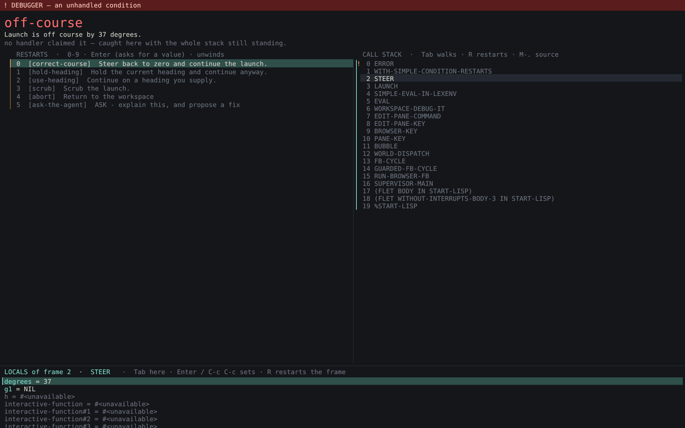

/The live debugger on =(lol.examples:launch)=. =./refresh-screenshot.sh --scene
debugger=./

- *A specimen with real restarts.* =STEER= signals =OFF-COURSE= inside a
  =restart-case=, so the rail offers four named ways out beside =ABORT=: correct the
  course, hold the heading, supply one (=Enter= prompts, since =use-heading= takes a
  value), or scrub. =(/ 1 0)=, whose rail is =ABORT= alone, can't make that point.
- *The whole chain.* =WITH-SIMPLE-CONDITION-RESTARTS → STEER → LAUNCH → EVAL →
  WORKSPACE-DEBUG-IT → RUN-BROWSER-FB → SUPERVISOR-MAIN → %START-LISP=, down to PID 1's
  entry point. =Tab= walks the frame cursor to =LAUNCH=, whose locals (=stage=, =fuel=,
  =drift=) are live.
- *Readable locals need debug info.* [[file:../initramfs/examples.lisp][=examples.lisp=]] declares =(optimize (debug
  3))= so its locals stay alive. Frame 0 reads =#<unavailable>=: it's SBCL's own
  compiled =WITH-SIMPLE-CONDITION-RESTARTS=, built without that debug info.

*The static half* is built too: =(present (subj-condition 'foo))= renders anatomy,
Signallers, Handlers and nearby restarts as one sectioned, drillable list, derived from
the registry's source ([[#phases][Phases (each independently demoable — this repo likes screenshots)]], Phase 4a).

* 3a. The Workspace — a scratch buffer with the editor's hands
:PROPERTIES:
:CUSTOM_ID: workspace-scratch-buffer-editor
:END:

Smalltalk's Workspace: the piece that makes the browser a place you *work*. It reuses
the source pane's text view ([[file:../poc/textview.lisp][poc/textview.lisp]]: caret, selection, kill ring, syntax
colour, auto-indent), but its verbs act on the selection or the form at point, not on a
whole definition:

- *Do it* (=C-x C-e=) — eval, value to the status line.
- *Print it* (=C-c C-p=) — eval and insert the printed result *inline*, after the
  form. The buffer accretes an editable, re-runnable session.
- *Inspect it* (=C-c C-i=) — eval and open the value in the Inspector, as the next
  pane of the Workspace's trail; =C-u C-c C-i= opens it in a new tab instead (and
  =SuperL-g= there makes it a window).
- *Debug it* (=C-c C-d=) — eval with the debugger armed ([[#smalltalk-lisp-concept-map][The Smalltalk → Lisp concept map]]).
- *Accept* (=C-c C-c=) — compile the top-level form at point as a definition ([[#stage-dispatch-happening-done][The Stage — dispatch, happening  (DONE)]],
  "Beat 4").

Which form the verbs take, and how output is captured, is in [[#phases][Phases (each independently demoable — this repo likes screenshots)]] (Phase 3a).

It is *not* the REPL. [[file:../initramfs/repl.lisp][repl.lisp]] is the *typewriter* (one form, history,
transcript); the Workspace is the *notebook* (multi-form, editable, results woven
in). Values from the matrix or a restart land here.

=p= at the supervisor menu opens it, and the environment boots onto it. The buffer opens
on a primer of one runnable form per verb (Do it, define with =C-c C-c=, Print it, Debug
it on =lol.examples:launch=, Inspect it on the stage, a worker's view and a closure),
plus a pointer to the Spotter and =SuperL-?=. It fits one 1280x800 screen at the
default font. The verbs also sit in the status bar:

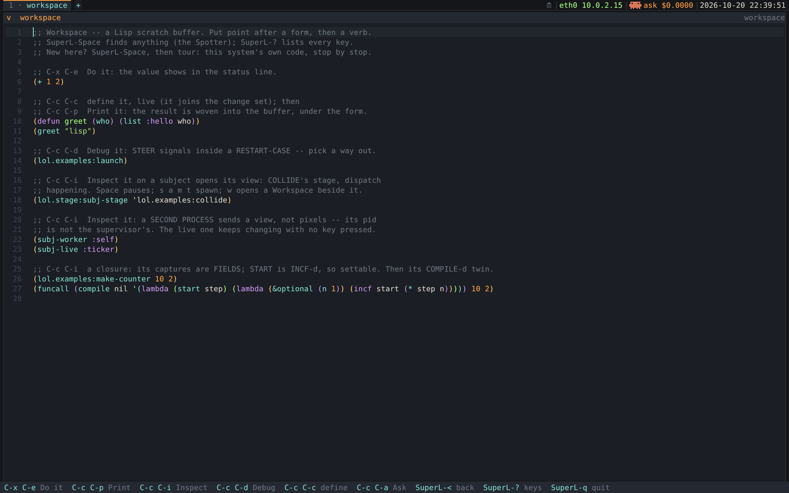

/The Workspace. =./refresh-screenshot.sh --scene workspace=./

* 3b. The Stage — dispatch, happening  [DONE]
:PROPERTIES:
:CUSTOM_ID: stage-dispatch-happening-done
:END:

The dispatch matrix ([[#smalltalk-lisp-concept-map][The Smalltalk → Lisp concept map]]) shows which collisions *have a rule*. The Stage shows
collisions *happening*: every sprite is a live CLOS instance from
[[file:../initramfs/examples.lisp][=examples.lisp=]], every contact a real =collide= call, and every hole in the matrix a
=no-applicable-method= that opens the debugger with the stack standing. Code:
[[file:../initramfs/stage.lisp][=stage.lisp=]]; design spec with a running prototype: [[file:../media/stage-design.html][media/stage-design.html]].

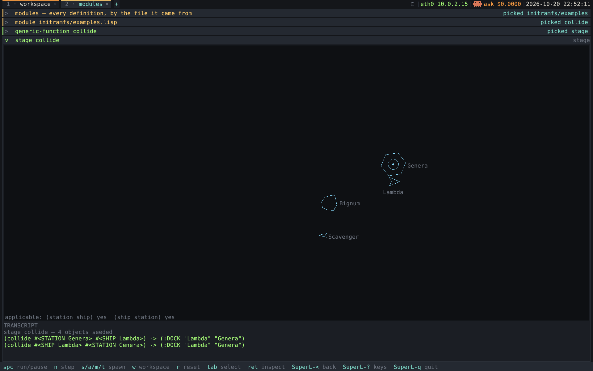

/The =Lambda= has just docked with =Genera=, and the transcript records BOTH directions
of the call agreeing. =./refresh-screenshot.sh --scene stage=./

*Why a moving picture.* Every other view answers /what is written/; the matrix counts
methods, a fact about the source. Watching a missile reach a ship and get
=(:DESTROYED "Lambda")=, then reach a station and get =(:DENTED "Genera")= from the same
call site, teaches multiple dispatch in one gesture. It's *not a game*: it's a
presentation of *instances*, the way a list presents definitions.

** Three rules

1. *The specimen stays pure.* =space-object= gains no slots: positions live in =body=
   structs in =stage.lisp=, and the instance is a slot OF the body.
   =(stage-find s "Lambda")= hands you an ordinary =ship=. The stage is a /client/ of
   =lol.examples= and lives in its own package, =lol.stage=, so =lol.examples='s
   package view lists only the specimen.
2. *Both directions, every contact.* Contact is symmetric and =collide= isn't, so the
   stage calls it *both ways* and records both. Symmetric pairs become legible
   (=(ship asteroid)= delegates to =(asteroid ship)=), disagreement shows in amber
   (=(asteroid asteroid)=: =:SHATTER= keeps its argument order), and since nothing
   specialises argument B on a missile, every missile hit prints one value and one "no
   applicable method". So *only a total absence signals*; one side answering is
   reported in the transcript only. Probe order is creation order, so a headless frame
   replays deterministically.
3. *=collide= returns data; =stage-enact= makes it happen.* =stage-enact= dispatches
   with =eql= specializers on the returned tag — =:destroyed= removes the target,
   =:dock= parks the ship on the station's rim, =:shatter= replaces both rocks with
   fragments. Redefining a method visibly changes the world without the stage knowing.
   *A =collide= call you make yourself enacts nothing*: only the tick's own call is
   passed on, so inspecting the system never perturbs it.

** The Workspace beside the stage reads in =lol.stage=

Its view says so (=view-package=, which the shell binds as =*package*= around a key —
=pane-package=). So its primer is bare words, a new rule is just =(defmethod
stage-enact ((tag (eql :near-miss)) stage a b) …)=, and Do it, Print it, Accept, =Tab=,
=M-.= and a drop agree on what a bare word means. Every other Workspace reads in
=CL-USER=. Host test: [[file:../poc/stage-workspace-test.lisp][=poc/stage-workspace-test.lisp=]] (17 checks, through the real
keys). The "stage" row in =collide='s view comes through present.lisp's
=*stage-subject-fn*= hook, which =lol.stage= sets.

** The restarts are the stage's own

=stage-signal= wraps the real call in =restart-case=, so the debugger's rail offers
=pass-through=, =remove-both=, =use-value= and =define-method= beside SBCL's =abort= —
the code that knows the recovery options establishes them. =define-method= drops a
=defmethod= template into the Workspace with the specializers filled from the two
arguments.

The step is *armed*: =step-stage-pane= ([[file:../poc/morphic.lisp][poc/morphic.lisp]]) wraps each step in a
=handler-bind= that hands the condition to =run-debugger-fb=, exactly as the
Workspace's Debug it does (nothing in the image sets =*debugger-hook*=). A
=handler-case= further out would catch by *unwinding*, dropping you at the supervisor
menu with the stack, restarts and browser gone; the =stage-debugger= scene is the
regression test.

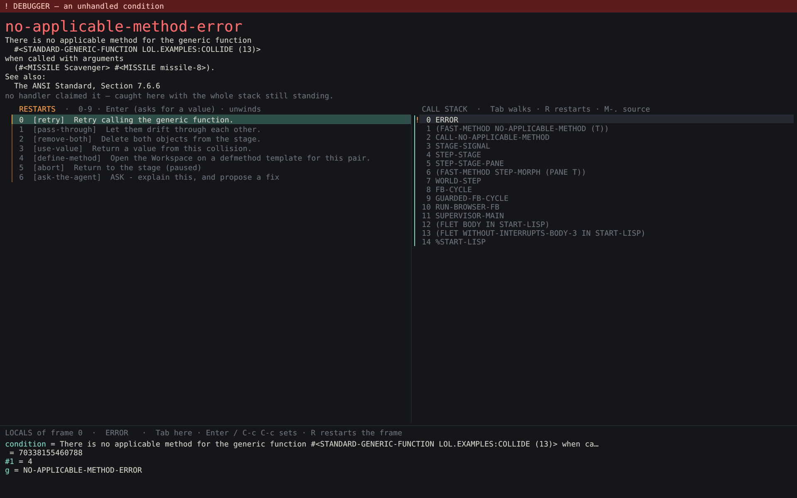

/Two missiles meet. =(missile missile)= is one of COLLIDE's three total absences, so it
signals: the stage's four restarts above SBCL's own, and the stack =STAGE-SIGNAL →
STEP-STAGE → STEP-STAGE-PANE → WORLD-STEP → FB-CYCLE → RUN-BROWSER-FB= down to PID 1.
=./refresh-screenshot.sh --scene stage-debugger=./

- *Abort pauses.* The bodies still overlap, so resuming would re-signal a second later:
  a modal that reopens on a timer is a trap. The other four restarts settle it.
- *=print-object= on =space-object=.* SBCL's report reads =(#<MISSILE Scavenger>
  #<MISSILE Sweep>)=. It prints the class-name *symbol* with =princ= (no package
  qualifier), not =:type t=, which would hand the printer one shared string twice and,
  under the locals strip's =*print-circle*=, render =#<#1=MISSILE Scavenger>=.

** How it runs

- *A step deadline only while it runs.* The loop sleeps until input when idle. A
  running stage on screen is a stepping morph (=pane-step-ms= →
  =+stage-frame-ms+=); drill away and the loop sleeps again.
- *Wall-clock ticking.* A full repaint in Lisp can cost more than a frame period, so
  one tick per frame would tie the world's speed to drawing cost.
  =step-stage-pane= steps the arrears since the last step, capped by
  =+stage-max-catchup+= so a stage left behind a modal debugger doesn't replay the
  whole pause.
- *Three canvas primitives* — =draw-line= (Bresenham), =draw-poly=, =draw-circle=. A
  sprite is a silhouette and a silhouette is lines.
- *=stage-resize=* scales positions /and velocities/ with the viewport, so timing holds
  at any size.
- *No new palette.* A sprite is =:class= blue (an instance of a class), the selected one
  the accent, an impact flashes =:method= green, a signal =:condition= red. Class
  identity is carried by *silhouette* (dart, chevron, ring, rock).
- *Layout.* The transcript is its own strip, so the Workspace holds only what you
  typed; the Stage is the one subject whose side pane accepts =C-c C-c=.

** Keeping the world alive

Left alone, the seeded scene ran down: eight events in 6000 ticks, all before tick
1200. Docking was permanent (and =:DOCK= is the opening scene's first event), and
nothing replaced what =:DESTROYED= / =:DEFLECTED= removed. So:

- *A docked ship undocks* after =+dock-ticks+=, pushed clear of the rim first (or it
  re-docks on the next tick) and heading away from the station.
- *=stage-replenish= keeps the population at =+stage-floor+=*, one arrival at a time,
  preferring whichever kind has run out, never a station (no method removes one).

That's a demo convenience and the docstrings say so. The same 6000 ticks now give 49
events, about one every four seconds, population steady at four. Both use the stage's
own RNG, so a headless frame still replays byte-identically (=stage:500= rendered
twice and diffed).

** The names

The sprites are named from this project's own world, one register per class:

| class      | register                          | names                                 |
|------------+-----------------------------------+---------------------------------------|
| =ship=     | Lisp machines                     | Lambda, CADR, Ivory, Dorado, Explorer |
| =station=  | the environments they docked with | Genera, Medley, Zetalisp              |
| =missile=  | garbage-collector phases          | Scavenger, Sweep, Compact, Reclaim    |
| =asteroid= | the numeric tower as debris       | Bignum, Flonum, Cons, Ratio           |

Each fits its class's docstring (a missile destroys a ship as a collector destroys an
unreferenced object; "a dumb rock, massive, unguided" is nearly a bignum), so the
transcript reads as a small history:

#+begin_src
(collide #<SHIP Lambda> #<STATION Genera>)         -> (:DOCK "Lambda" "Genera")
(collide #<MISSILE Scavenger> #<ASTEROID Bignum>)  -> (:DEFLECTED "Scavenger")
#+end_src

There is no alien class: inventing one to reference =draw-alien= would be unrelated
fiction. The names live in one =*stage-names*= table and the four seeds in
=make-collide-stage=. The environment itself keeps its name ([[#environment-trails-spotter-tiled][The environment — trails, the Spotter, and the tiled shell]], "Naming").

** Beat 4: the method you write from the debugger
:PROPERTIES:
:CUSTOM_ID: beat-4
:END:

The loop closes. =w= opens a Workspace *beside* the stage; =SuperL-o= or a click in
either half moves focus. =[define-method]= opens it holding the =defmethod= the debugger
knew how to write, specializers taken from the two objects that failed to dispatch.

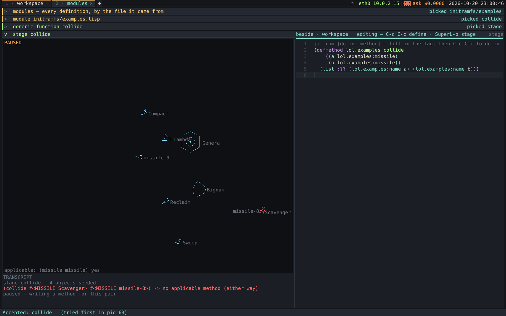

/Two missiles found the hole; =[define-method]= wrote the template and =C-c C-c=
compiled it — "Accepted: collide (tried first in pid 63)" (the definition ran in a
child process before PID 1 took it). =./refresh-screenshot.sh --scene stage-accept=./

- *It's its own buffer.* Presenting =subj-workspace= twice builds two independent
  buffers — the one place where presenting a subject twice doesn't give the same thing.
  That's deliberate: =[define-method]= *replaces* the buffer's text and mustn't destroy
  notes on another tab.
- *It opens on a primer for this pane.* =subj-stage-workspace= presents as =:kind
  :workspace=, so every verb behaves as anywhere else, but its text
  (=*stage-workspace-text*=) walks what you can only do here: reach a sprite by kind
  (=stage-any=) or name (=stage-find=); ask =compute-applicable-methods= what WOULD
  dispatch; make the call yourself and see it enacts nothing; spawn something; and
  Accept the =(ship ship)= method. Every form runs as written.
- *=w= hides, it doesn't close.* =pane-side-stash= holds the pane, so a second =w=
  brings back the same buffer, half-written =defmethod= included.
- *=C-c C-c= Accepts in a Workspace.* A source pane hands =accept-source= the subject's
  name/kind/label as fallbacks (the label especially, or an edited method would
  overwrite a sibling's source). A Workspace edits nothing, so the form is the only
  authority and the fallbacks are NIL.
- *The change set shows additions.* =accept-source= marks a record it creates =born=,
  and the view says "new this session" instead of a version count.
- *The world stops while you write.* Taking =[define-method]= pauses the stage; =spc=
  resumes it, which is when you see what your method changed.

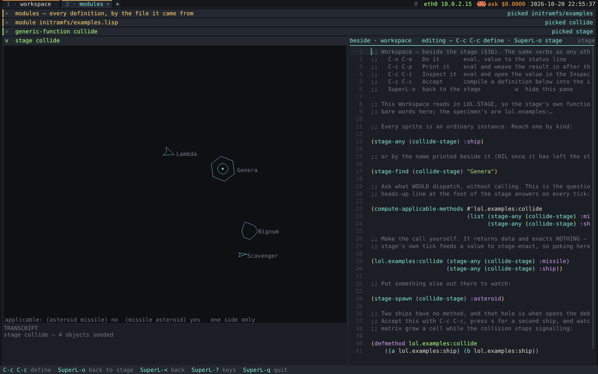

/=w= beside the stage. =./refresh-screenshot.sh --scene stage-workspace=./

** Selecting without a mouse

A sprite is a subject: =Enter= opens the Inspector on it, an ordinary object view.
=Tab= cycles the selection through the bodies; a click is an accelerator, not the way
in. That keeps the view usable without a pointer, and testable: a scripted =Tab= lands
over QMP where a scripted click can't.

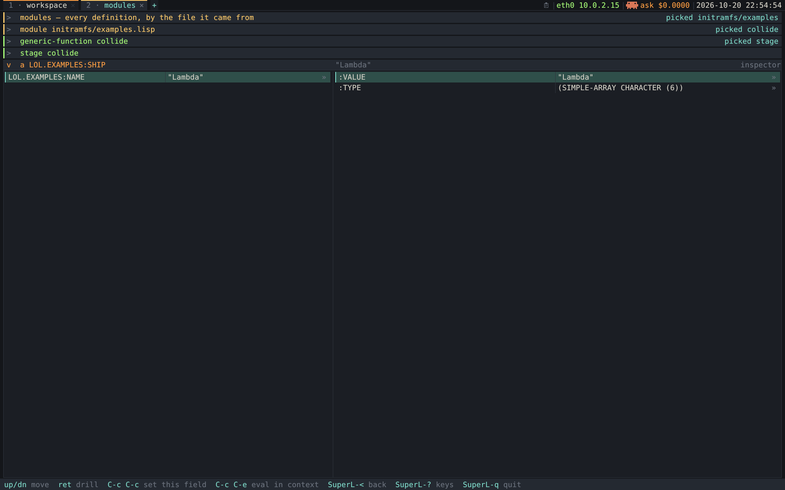

/=Tab= twice, then =Enter=: the Inspector on =#<SHIP Lambda>=, with =stage collide=
still in the trail behind. =./refresh-screenshot.sh --scene stage-inspect=./

* 4. The browser itself

The first design was a Smalltalk System Browser: fixed columns over one root axis.
[[#drill-down-protocol-present][The drill-down protocol — one =present=, everything browsable]]'s drill-down accordion replaced the mechanism; this section keeps the vocabulary.

** The one structural departure from Smalltalk: a switchable root axis

Smalltalk has *one* hierarchy (classes), so it can hardwire five panes. Lisp has
*several orthogonal* ones — packages, the class DAG, the generic-function/method graph,
files, the change set, a search result. Pretending one is "the" hierarchy is the
mistake every Smalltalk-in-Lisp browser makes.

So the root is a choice, and everything downstream of it is the same: pick =Classes=
and you get the DAG, the protocol, the methods; pick =Generics= and you get the
dispatch matrix and the onion ([[#smalltalk-lisp-concept-map][The Smalltalk → Lisp concept map]]); a =Search= result is a valid root too, as in
Pharo's Spotter. In the accordion ([[#drill-down-protocol-present][The drill-down protocol — one =present=, everything browsable]]) a "root axis" is simply which subject you
=present= first, and the columns are the first few drill levels.

** Interaction

Mouse and keyboard both, like the original: click to select, click to place the caret,
drag to select, right-click for the context menu — Smalltalk's *yellow-button menu*,
where Do it / Print it / Inspect it / Senders / Implementors live. Every menu item has
an Emacs-flavoured key. The current key tables are in [[#environment-trails-spotter-tiled][The environment — trails, the Spotter, and the tiled shell]].

* 4½. The drill-down protocol — one =present=, everything browsable
:PROPERTIES:
:CUSTOM_ID: drill-down-protocol-present
:END:

*This is the UI architecture.* It's Glamorous Toolkit's Miller-column browser (Pharo's
before it) and, underneath, an old Lisp idea — *CLIM presentations*: display an object,
and clicking it is a typed action on that object. Design spec (an accordion drilling
matrix → effective method → source): [[file:../media/browser-views-design.html][media/browser-views-design.html]].

*A drill-down accordion.* One panel is expanded at a time; each selection opens the
next panel while its parent collapses to a *breadcrumb bar* you click to re-expand. The
bars are the breadcrumb and the drill path at once. A flat panel showing everything at
once was rejected: it doesn't let you *drill*.

** Which package a name is in
:PROPERTIES:
:CUSTOM_ID: which-package-name
:END:

A bare name is ambiguous — =ship= could be anyone's — so every place that names a
definition says its package too, the way the reader would have to be told it from
=CL-USER= (the Workspace's package): =qualified-name= in [[file:../initramfs/present.lisp::defun qualified-name][present.lisp]] prints with
=*package*= bound to =CL-USER=, so a name of ours reads =lol.examples:ship= (one colon:
exported) or =lol.examples::armed-p= (two: internal), while =mapcar= and =CL-USER='s own
stay bare.

- *View titles*: a class, a definition's source or reference, a generic function —
  =class lol.examples:ship=.
- *The class view* opens with a *package* row; drilling it is the package view below.
- *The Spotter*: a definition row's detail ends with its package, as the builtins'
  always did — =class · lol.examples= (=name-package-tag=).
- *Tabs* drop the prefix again (=short-title=): the header keeps it, and a 16-character
  tab spent on it would clip the name.

** The package view

A package view is one expanded list with the selected definition's source beside it —
here =CL-USER= (=l= at the supervisor menu, =SuperL-l= in the environment):

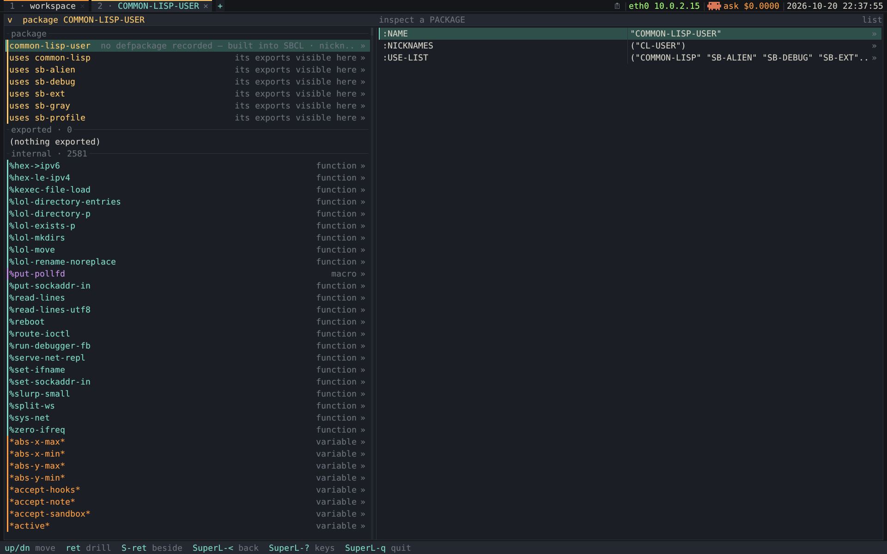

/The =CL-USER= package, kind-tinted, with =%serve-net-repl='s source beside it.
=./refresh-screenshot.sh --scene package=./

It reads top-down like the package itself, in counted sections:

- *package* — the =defpackage= row (its recorded source beside it; for a package SBCL
  made, the package object's inspector), then one =uses …= row per package whose
  exports are visible here unqualified.
- *exported · N* — complete: every external symbol, including those with no recorded
  definition (a builtin, an accessor, a symbol exported for its name), each saying
  what it's bound to (=symbol-meaning=) and, if re-exported, where from. A package that
  exports nothing says =(nothing exported)=.
- *internal · N* — the recorded definitions homed here and not exported. Not completed
  from the package: SBCL's packages hold thousands of internals with nothing to browse.
- *used by · N* — last, because =COMMON-LISP= is used by every package and forty rows
  would bury its API.

=(present (p package))= in [[file:../initramfs/present.lisp][=present.lisp=]]; =definition-items= takes the section as
=:group-of=. The module view groups by file, so there the API is a mark: a row whose
name its reading package exports ends in =· exported= (=:mark-exported=). "Exported"
means by /that/ package — a method on =print-object= isn't marked, nor is a
=defpackage='s keyword name.

Drill a few levels and parents collapse into stacked breadcrumb bars, each labelled on
the right with *what was picked from it* (=picked initramfs/examples=, =picked
collide=, =picked dispatch matrix=) — the matrix shot in [[#smalltalk-lisp-concept-map][The Smalltalk → Lisp concept map]] shows three.

** One generic function and one data rule

- =(present subject) → view= — a generic function dispatching on the subject's *type*,
  returning a *view*: an ordered set of *items*.
- Each item carries a *target* (another subject: selecting it opens =(present target)=
  in the next panel — a *drill*) or an *action* (invoke a restart, accept an edit — a
  *do*).

| =present= method                  | the view it returns                      | each item targets   |
|-----------------------------------+------------------------------------------+---------------------|
| =(present (p package))=           | its defpackage, then exported / internal | a definition        |
| =(present (gf generic-function))= | the dispatch matrix ([[#smalltalk-lisp-concept-map][The Smalltalk → Lisp concept map]])                 | a =dispatch-query=  |
| =(present (q dispatch-query))=    | the effective-method onion               | a method            |
| =(present (m method))=            | its source, editable                     | a called function   |
| =(present (r restart))=           | its report line                          | /action:/ invoke it |
| =(present (d directory))=         | its entries ([[file:file-manager.org][file-manager.org]])           | a file / subdir     |
| =(present (x t))=                 | a generic object inspector               | any slot value      |

Why it matters:

- *It unifies the browser.* Packages, classes, generic functions, files, folders on
  disk, a web page, a terminal are not bespoke browsers; they're =present= methods on
  subject types, drilled through one accordion.
- *To extend it, add a subject type and one =present= method.* Nothing else changes.
- *No dead ends.* =(present (x t))= always resolves to the inspector, so every value is
  drillable.
- *It fits any screen.* Only one panel is expanded, so the heavy view always gets the
  detail region while ancestors cost one line each.

Subjects with several useful *aspects* (a class as source, hierarchy, instances) could
take =(present subject aspect)= with a switcher on the panel header. Not built.
=present-preview= already lets the side preview differ from the drill.

** Content that talks back: affordances & =commands-for= (external side effects)
:PROPERTIES:
:CUSTOM_ID: content-talks-back
:END:

Some content needs to influence the *shell*: open a target in a NEW trail (like
=target="_blank"=), add menu entries, hang handles on a halo. Letting content call
=open-panel!= would break the invariant that makes =present= work (content is
backend-blind and side-effect-free). So:

#+begin_quote
*Content never PERFORMS a side effect and never COMMANDS the shell. It DECLARES what it
affords, as data; the shell — the one stateful layer that owns trails/tabs/menus/halos
— decides whether and how to realise it.* Content proposes; the shell disposes.
=present= stays a pure =subject → description=; the shell is the sole executor.
#+end_quote

Like =target="_blank"=: the link doesn't open a window, it states a preferred
disposition the browser may honour, a popup blocker veto, a middle-click override.

- *Items carry declarative affordances.* Beyond =target= (drill) and =action= (do), an
  item can carry a *disposition*: =:in-place= (default) · =:new-trail= · =:beside= ·
  =:replace=. It states a preference; it opens nothing.
- *A second generic: =commands-for=.* Type-level affordances ("every function has
  senders, can be disassembled") come from =(commands-for subject) → list of command=:

  : command = { label, do: (action | target+disposition),
  :             surfaces: {:menu :halo :palette :key}, key?, enabled? }

  The shell unions an element's item affordances, =(commands-for X)= and globals. This
  is CLIM's presentation types + commands, Glamorous Toolkit's =gtViewsFor:= beside
  =gtActionsFor:=, and Smalltalk's yellow-button menu.
- *One command, many surfaces.* Right-click → the commands filtered to =:menu=;
  middle-click → the same filtered to =:halo=; =M-,= Senders → the same command via its
  =:key=. A headless test shell offers no surface and ignores them all.
- *Where something opens — three votes, in precedence:* user gesture (=SuperL-click=
  forces =:new-trail=) > content hint (the disposition) > shell policy ("the Debugger
  opens as its own trail"). Content can never override the user.
- *Both generics are pure* (subject → data), REPL-testable headless. A new subject gets
  a =present= method and optionally =commands-for=; a new *surface* needs no content
  change.

*Liveness is separate.* "This content changed, re-render me" is the shell
re-presenting a subject, not a command. Since Morphic it's a morph's /signature/
changing ([[file:morphic.org::#damage-per-morph][morphic.org, Damage per morph]]).

** The right button and the halo

Both start from *what* is under the pointer, answered by
[[file:../poc/shell.lisp::defun pane-target][=pane-target=]] from what the pane recorded when it drew: a *row* (and the subject
it opens), a *word* in text (and the symbol it names), an *instance* on the stage, or
the pane itself — and by the tab strip for a *tab*. Each is asked by the morph the
press lands on ([[file:morphic.org::#routing-presses-keys][morphic.org, Routing presses and keys]]).

- *Right button* → [[file:../poc/shell.lisp::defun context-menu-entries][=context-menu-entries=]]: the obvious verbs for that kind of thing
  first (Cut / Copy / Paste / Paste the selection / Select all in text, then Go to
  definition / Senders / Inspect for a word naming a symbol; Open / Open in a new tab /
  Open beside / Copy name on a row), then the subject's own =:menu= commands, then the
  places you can always go (new Workspace, module index, Spotter, clipboard history,
  keys). The type-specific part is exactly =commands-for=, so a new subject type extends
  the menu by writing a method. [[file:../poc/shell.lisp::defun run-command][=run-command=]] executes one.
- *Middle button* → the *halo*, which is about *layers*.

*** The halo walks the layers under the pointer

- *Inspect means the instance.* =present= picks a view by type, so a value with a view
  of its own (every =SUBJ-*=, a pane) would never be shown field by field.
  [[file:../initramfs/present.lisp::defstruct (subj-object][=subj-object=]] wraps a value to mean "this, as an object", and
  [[file:../initramfs/present.lisp::defun inspect-subject][=inspect-subject=]] wraps exactly when the value's most specific =present= method
  isn't the =T= inspector. Functions, classes, packages and symbols keep their own
  richer views. Inside, fields keep drilling as objects, =C-c C-c= sets a field, =C-c
  C-e= evaluates with =self= bound ([[file:../initramfs/present.lisp::defun subject-value][=subject-value=]] unwraps it), and "Open its view"
  goes back.
- *Every thing on screen says who drew it.* Every pane, the tab strip, systray, status
  line, trail area and shell are morphs, and so is each pane's body (a text view: the
  =TEXT-BODY=, =tv-draw=; a list: the =LIST-BODY=, =draw-list-body= / =item->row= /
  =draw-list=; the grid; the stage and each sprite). The halo walks the tree under the
  point, each morph offering its instance and drawing functions — and, for a pane, what
  it shows.
- *One layer at a time.* [[file:../poc/morphic.lisp::defun halo-layers][=halo-layers=]] lists what's under the point, innermost
  first: the thing the pointer is *on* (the word and its symbol; what a row opens, then
  its =ITEM=; what a sprite stands for), then each morph out to the shell (or the
  window), each pane followed by what it *shows*.

For a word in the Workspace:

| layer             | object                 | handles ([[file:../poc/shell.lisp::defun halo-entries][=halo-entries=]])                                                                 |
|-------------------+------------------------+------------------------------------------------------------------------------------------|
| =greet=           | the symbol =GREET=     | Source, Senders, Inspect, Copy                                                           |
| text view         | the =TEXT-BODY= morph  | Inspect, Code: tv-draw, Code: tv-row-keys, Class: text-body, Copy                        |
| pane · workspace  | a =PANE= (a morph)     | Inspect, Code: draw-pane-expanded, Code: draw-panel, Code: pane-click, Class: pane, Copy |
| shows             | =SUBJ-WORKSPACE=       | Open its view, Inspect, Copy                                                             |
| trail · workspace | the =TRAIL-AREA= morph | Inspect, Code: layout-trail-area, Class: trail-area, Copy                                |
| the tiled shell   | the =SHELL-MORPH=      | Inspect, Code: layout-shell, Code: draw-morph, Class: shell-morph, Copy                  |

- *Walking.* =Up=, =Tab= or the middle button again walk *out* (Morphic's repeated
  middle-click), =Down= walks back *in*, =Left= / =Right= move between handles.
- *Shown, not described.* The current layer stays bright and outlined in the accent
  while everything else dims ([[file:../poc/shell.lisp::defun spotlight][=spotlight=]]); a caption lists every layer with the
  current one lit, then what it is ("text view — a LOL.TEXTVIEW:TEXTVIEW").
- *Handles don't cover the thing.* On a small element (a word, a row, a tab) they hang
  off its outline as a strip; on a large one (a pane) they ring the point clicked. Dots
  are coloured by what they open: amber an instance, teal code, blue a class, gold a
  view. A word naming nothing offers only Copy.
- *Code and Inspect are the two halves.* Code opens the drawing function's definition,
  editable; =C-c C-c= recompiles it, so every pane drawn by it changes on the next
  frame. Inspect, with settable fields, changes this one instance.
- *Headless preview:* =sbcl --script poc/render-frame.lisp workspace --halo 80,226,1=
  draws the halo there on layer 1 and lists the layers.

*** Buttons, gestures and the chooser

- *The middle button's two jobs.* X's PRIMARY paste ([[file:clipboard.org::#selections-clipboard-primary][clipboard.org, Two selections: CLIPBOARD and PRIMARY]]) and the halo
  both want it. [[file:../poc/shell.lisp::defun pane-middle-click][=pane-middle-click=]] splits by *place*: in editable text with
  something to paste, it pastes at the pointer; anywhere else (a row, a sprite,
  read-only text) it opens the halo; =SuperL=-middle forces the halo even in editable
  text.
- *Three buttons on a one-button pad.* A two-finger press is the middle button; a press
  in the bottom-right corner (or with three fingers) the right; Alt-click is middle
  too; the Menu key or Shift-F10 opens the menu at the caret or selected row
  ([[file:input.org][input.org]], "Three buttons on a pad with one"). Ctrl-click jumps to the
  definition, which is the halo's Source handle anyway.
- *One chooser.* Menu and halo are overlays drawn by the shell
  ([[file:../poc/shell.lisp::defun draw-context-menu][=draw-context-menu=]], [[file:../poc/shell.lisp::defun draw-halo][=draw-halo=]]) and read by
  [[file:../poc/overlays.lisp::defun run-chooser][=run-chooser=]], installed as the shell's =*chooser*= hook (as =*value-prompt*= is):
  arrows or hover move, Enter or a click picks, a digit picks directly, Esc or a click
  elsewhere leaves.
- *Tested* in the guest by [[file:../check-clipboard.lisp][check-clipboard.lisp]] with QEMU's real right and middle
  buttons, including walking a row's layers out to its =PANE=, inspecting it, and
  opening =tv-draw= from the Workspace's text view.

* 4⅔. The module index — our files ARE our categories  [DONE]
:PROPERTIES:
:CUSTOM_ID: module-index-files-categories
:END:

A package view answers *"what exists"* and is the wrong shape for *"where does this
live"*: rooted at =CL-USER= it's a 300-plus-row list. Smalltalk's class categories are
what Lisp doesn't give us ([[#smalltalk-lisp-concept-map][The Smalltalk → Lisp concept map]]) — but [[file:../initramfs/registry.lisp][=load-recording=]] stamps every =DEFN= with
its file, and [[file:../initramfs/model.lisp::defun categorize][=categorize=]] groups by it (=:file= is its default scheme). Two
subjects in [[file:../initramfs/present.lisp][=present.lisp=]] surface it:

- *=subj-modules= — the index.* One row per source file with a definition count,
  drilling into the file. =SuperL-m= opens it; the Spotter reaches it by name.
- *=subj-module= — one file's definitions*, in the same item shape as a package view
  (kind-tinted rows, a generic function as one row opening its matrix view). Both views
  come from one =definition-items= helper taking a predicate, so they can't drift apart
  in look, sort order or tinting.

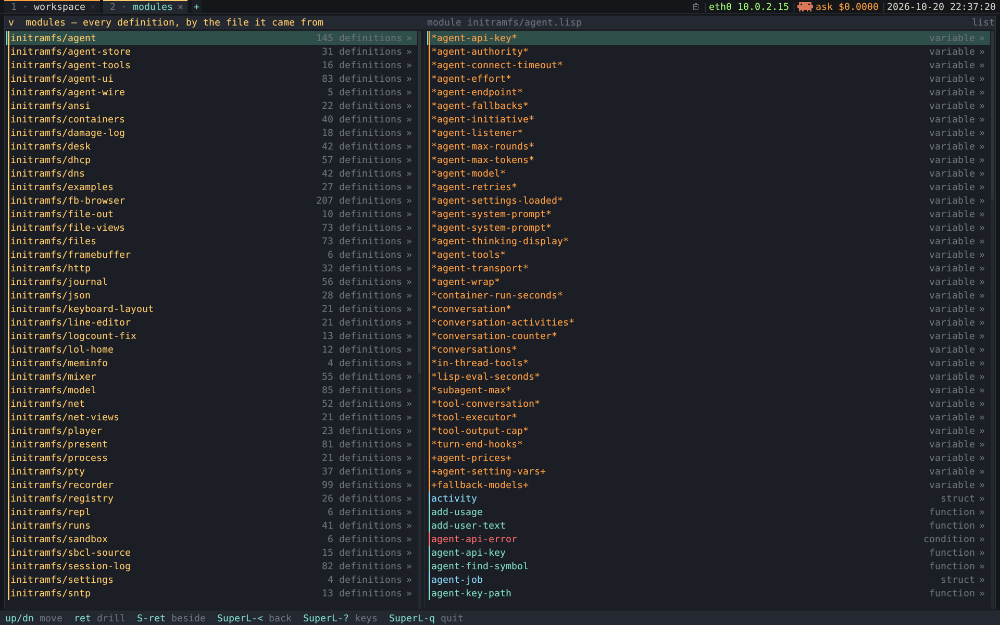

/The module index: each module with its definition count, the selected one previewed
beside. =--scene modules=./

- *Keyed by =directory/name=.* A bare basename would merge =initramfs/foo.lisp= with
  =poc/foo.lisp=; the qualified key keeps the two trees distinct and shows at a glance
  which modules are the shared =poc/= toolkit.
- *Keyed by provenance, not package.* A package root shows one package; the toolkit
  lives in =lol.canvas=, =lol.textview=, =lol.fb= and others, which a =CL-USER= root
  can't list at all. The index shows the whole system.
- *The answer to "one big =LOL= package?"* A single package would rename =CL-USER= and
  leave the same flat list. The grouping readers want is by module, and that needed a
  predicate, not a migration of hundreds of definitions.
- *The Spotter finds modules too*, so typing "net" finds =net.lisp= itself, not only
  the definitions in it.

*Known limits.* Definitions with no recorded file are skipped rather than bucketed
under =NIL= (currently none). Only Accepted definitions are recorded at runtime: a
definition merely evaluated with Do it appears in neither the index nor a package view.

* 4¾. The environment — trails, the Spotter, and the tiled shell
:PROPERTIES:
:CUSTOM_ID: environment-trails-spotter-tiled
:END:

The accordion ([[#drill-down-protocol-present][The drill-down protocol — one =present=, everything browsable]]) is *one investigation*. This section is the container above it:
how several investigations coexist, how you jump to something unrelated without losing
your place, and where the Workspace, Debugger and other surfaces live. First figure in
[[file:../media/browser-views-design.html][media/browser-views-design.html]].

*Tiled by default, keyboard first.* Tiled panes suit a keyboard-first machine and need
no window manager. The =present=/trail model underneath doesn't care, so with Morphic
([[#phases][Phases (each independently demoable — this repo likes screenshots)]], Phase 7) a trail can also be torn off into a draggable window.

*Three nested levels*, each keyboard-reachable:

| level | what it is                                                                                    | how you move                    |
|-------+-----------------------------------------------------------------------------------------------+---------------------------------|
| trail | one investigation (a drill-down accordion, [[#drill-down-protocol-present][The drill-down protocol — one =present=, everything browsable]]) — or a pinned surface: Workspace · Debugger · … | tabs · =SuperL-1…9=            |
| drill | a panel opened from the previous panel's selection                                            | =↵= · breadcrumb · =SuperL-←=   |
| item  | a presented thing with a =target= (drill) or =action= (do)                                    | click · =SuperL-click=          |

*Surfaces are trails, not a second mechanism.* A trail's root needn't be code:
=(present workspace)= is the Workspace, =(present condition)= the Debugger, =(present
object)= the Inspector. They live in the *same tab strip* as everything else; there's
no separate rail listing them twice. New surfaces arrive the same way — the process
view did: [[file:../initramfs/worker.lisp][worker.lisp]] runs a job in a second process and presents the view it sends
back, [[file:../initramfs/worker-live.lisp][worker-live.lisp]] keeps such a view live, and [[file:../initramfs/sandbox.lisp][sandbox.lisp]] tries every
Accept in a child first ([[file:processes.org::#scenario-peer-sends-view][processes.org, Scenario A — a peer that sends a VIEW]], [[file:processes.org::#worked-example-shot-worker][The worked example: a one-shot worker]], [[file:processes.org::#live-worker-handles-pipe][A live worker: handles, (:invalidate h), a pipe in the poll]], [[file:processes.org::#accept-tries-definition-child][Accept tries a definition in a child first]]).

*"I need to look at something else" has three answers, by intent:*

- /related/ (a function it calls) → *open beside* spawns a new trail there and keeps
  this one;
- /unrelated/ → the *Spotter* finds it and opens a new trail;
- /done here/ → the Spotter *replaces* the current trail.

The prior thing is always one click away: a tab, a breadcrumb, or a Spotter recent.

** The tab strip

A single strip of open trails across the top — numbered, each with a × and a
kind-coloured stripe, each labelled by its *subject* (=short-title=), not its view title,
since the kind is already the stripe. Where the kind isn't a Lisp one (a terminal, the
journal, an agent conversation, a folder, a file, an image) or the title can't carry it
(a web page's title is the page's), the tab draws a small *icon* and keeps its sixteen
characters for the name: =terminal bash= is the terminal icon and =bash=. A name's
package prefix is dropped too (=class lol.examples:ship= is the tab =ship=)
(=trail-label= and =+tab-icons+= in [[file:../poc/shell.lisp::defun trail-label][shell.lisp]]; a window's title bar shows the
same).

*More tabs than fit.* =draw-tabs= measures every tiled tab (=tab-metrics=) and, when they
don't all fit, shows the run =visible-tabs= picks: from the first tab while that holds
the active one, else the longest run ending at it, so =SuperL-Tab= walks the run along.
A =…N= button at each end says how many tabs it hides. Either button, or =SuperL-t=,
opens =open-tab-list=: every trail in tab order, a windowed one marked =(window)=.
Host-tested by =poc/morphic-test.lisp= ("more tabs than fit").

** The Spotter
:PROPERTIES:
:CUSTOM_ID: spotter
:END:

=SuperL-Space= summons a universal search *over subjects*. Everything is a subject, so
it's one search, and opening a hit is =(present hit)=. Pharo's Spotter, GT's search, a
browser omnibar, Emacs =M-x=.

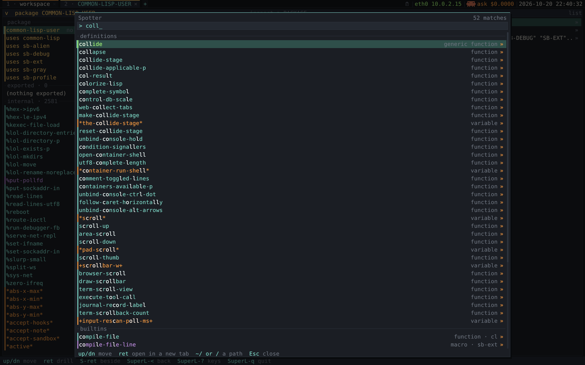

/The Spotter on "coll" — =collide= first, ahead of =collapse= and subsequence matches
like =colorize-lisp=. =./refresh-screenshot.sh --scene spotter=./

- *Candidates.* Every recorded definition, package and module, the named surfaces, and
  a *builtins* band (=builtin-spotter-candidates=, [[file:../initramfs/present.lisp::defun builtin-spotter-candidates][present.lisp]]): every external symbol
  of =COMMON-LISP= and =SB-EXT= naming a special operator, macro, function, constant,
  variable or class — 1198 on SBCL 2.6.8 (934 + 264), the package in the detail
  (=function · sb-ext=) so =gc= still matches exactly. A builtin opens its GF view,
  class view, or the reference with SBCL's source. A name the registry has
  (=print-object=) stays in the definitions band; a definition's detail names its
  package as well (=class · lol.examples=, [[#which-package-name][Which package a name is in]]). Building the
  list costs ~1.2 ms on the host.
- *Ranking.* Fuzzy *subsequence*, exact > prefix > word boundary > plain.
- *Banding doesn't disturb ranking.* =draw-spotter-card= ([[file:../poc/shell.lisp][poc/shell.lisp]]) bands results
  into recent / definitions / packages & files / surfaces; =spotter-band= keeps each
  group in rank order and orders groups by their best member, so the top row — the one
  =↵= opens — is still the best match.
- *Dense rows.* Kind-coloured, a live match count in the header, a footer saying what
  the keys do, and the matched characters lit in *white* (=*ui-lit*=) — not the accent,
  which is also every function row's colour ([[#looks-like-visual-conventions][What it looks like — the visual conventions]]).
- *An empty query opens on recents* (=note-recent=, filled by =trail-push= /
  =new-trail=): "where was I" is the one question an empty finder can answer.
- *Paths.* A query starting with =/=, =~=, =./=, =../= or =file://= lists the folder's
  entries completing the last component; =Tab= completes like a shell; =↵= opens the
  file manager there (on a file: its folder, with it selected). =./= is relative to the
  focused file manager's folder ([[file:file-manager.org::#spotter-reads-paths][file-manager.org, The Spotter reads paths]]).
- *Backend-blind.* The input is the =open-spotter= overlay ([[file:../poc/overlays.lisp][poc/overlays.lisp]]), so the
  palette renders on the host: =sbcl --script poc/render-frame.lisp modules --spotter
  coll=.

** Keys: two non-colliding layers
:PROPERTIES:
:CUSTOM_ID: keys-two-layers
:END:

=SuperL= (the window-manager modifier) owns *spatial* navigation; =Ctrl/Meta= own
*editing and semantic actions* inside the focused panel. Disjoint by modifier, they
never fight. =SuperL-?= summons a cheatsheet overlay styled like the Spotter, and each
tab's number badge maps to =SuperL-1…9=.

| =SuperL= — spatial                | does                                                                                                    |
|-----------------------------------+---------------------------------------------------------------------------------------------------------|
| =SuperL-1…9=                      | jump to trail /n/                                                                                       |
| =SuperL-⇧-n=                      | move this trail to slot /n/ (swap with whatever is there)                                               |
| =SuperL-Tab= / =SuperL-⇧-Tab=     | cycle to next / previous trail                                                                          |
| =SuperL-t= · a =…N= button        | every trail as a menu (its 1–9 are the tab numbers); pick one to focus it                               |
| =SuperL-Space=                    | the Spotter                                                                                             |
| =SuperL-m= / =SuperL-l=           | the module index / the flat =CL-USER= package                                                           |
| =SuperL-f=                        | the file manager ([[file:file-manager.org][file-manager.org]])                                                                     |
| =SuperL-b=                        | a web page, Chrome headless ([[file:web-browser.org][web-browser.org]]); on a web pane =SuperL-←/→= are the page's back / forward |
| =SuperL-↵=                        | a terminal: a shell in a new trail ([[file:terminal.org][terminal.org]])                                                       |
| =SuperL-⇧-↵= / =SuperL-click=     | open the selection in a NEW trail                                                                       |
| =↵=                               | drill in place (same trail)                                                                             |
| =SuperL-←= / =SuperL-→=           | back / forward in the drill history: forward puts back the same pane (scroll, edits); drilling elsewhere drops it |
| =↑= / =↓=                         | move the selection within a panel                                                                       |
| =→=                               | focus the RIGHT-hand column (below)                                                                     |
| a plain *click* in the other half | move focus there — the pointer's =SuperL-o= (below)                                                     |
| =SuperL-w= · =Esc=                | close the trail · dismiss the Spotter/overlay                                                           |

=Ctrl/Meta= — the semantic actions:

| key                 | does                                                                      |
|---------------------+---------------------------------------------------------------------------|
| =C-c C-c=           | *Accept* — compile the definition into the live image                     |
| =C-x C-e=           | Do it                                                                     |
| =C-↵=               | submit: Accept in a source pane, Do it in a Workspace or Lisp file, send in a conversation |
| =C-c C-p=           | Print it                                                                  |
| =C-c C-i=           | Inspect it (arrives as =C-c= then Tab, since Ctrl-I *is* Tab)             |
| =C-u C-c C-i=       | Inspect it in a new tab (=C-u= is a one-command flag, not a count)        |
| =C-c C-d=           | Debug it                                                                  |
| =C-c C-e=           | eval the top-level form (in an inspector: with =self= bound)              |
| =M-.= / =M-,=       | jump to definition / Senders (both via =token-at-point=)                  |
| =Tab=               | complete the symbol before point; at whitespace, indent                   |

- *Emacs motion and selection* ([[file:../poc/textview.lisp][poc/textview.lisp]]): =C-←/→=, =M-b/M-f=, =M-←/→= by
  word (a whole Lisp token); *Shift + any motion* extends the selection; =C-SPC= sets the
  mark; =C-Home/End= jump to buffer start/end; plus =C-a/C-e/C-k/…=.
- *Held modifiers come from the evdev.* The cooked tty can't report a held Shift or
  Ctrl, so =*shift-down*= / =*ctrl-down*= are read from the keyboard's own evdev and
  folded into each key; =fb-read-csi= decodes xterm-style =ESC [ 1 ; 5 C= modified
  cursor keys, and =C-SPC= arrives as NUL.
- *Completion reuses the REPL's hook* (=editor-complete= → =*completer*= → repl.lisp's
  =complete-symbol=, with line-editor.lisp's =token-start= / =longest-common-prefix=):
  one match fills in, several extend the common prefix or list in the status line.
- *A contextual status line.* The design mock-up shows no permanent hint chrome. We keep
  one: transient results (an Accept's outcome, a Do it's value, completions) need a
  place anyway, and its hints are specific to the focused pane (a list offers =ret
  drill=, a Workspace =C-x C-e Do it=). Chord tokens are coloured and prose dim, and
  =SuperL-?= is one of the hints.

** Editing a definition in place — the modifier split
:PROPERTIES:
:CUSTOM_ID: modifier-split
:END:

A source pane backed by the registry (*your* code) is an editable buffer: plain keys and
=Ctrl/Meta= are the editor's (Backspace deletes, =↵= inserts a newline, =↑↓= move the
caret, =C-c C-c= Accepts and pushes the old text onto the version history). So trail
navigation lives *only* on =SuperL=: =SuperL-←= is "back", never Backspace.

| pane                    | plain keys + Ctrl/Meta                                    | SuperL   |
|-------------------------+-----------------------------------------------------------+----------|
| *source* (your code)    | edit (Backspace deletes · =↵= newline · =C-c C-c= Accept) | navigate |
| *reference* (a builtin) | read-only (scroll only)                                   | navigate |
| *list* (class/pkg/xref) | navigate (=↑↓= select · =↵= drill · Backspace back)       | navigate |

Only your code is editable ([[#model-layer-unit-code][The model layer — what is a "unit of code" in Lisp?]], "Two kinds of subject"). A static map of these flows —
which routes end read-only vs editable — is [[file:../media/navigation-flows.html][media/navigation-flows.html]].

** Focusing the right-hand column — =→=, and why it is not navigation

The nav split shows the selected item beside the list. =→= moves focus there and makes
it usable: your code becomes editable, a builtin scrolls, a list walks with =↑↓= and
drills with =↵=. It promotes the preview to the same pinned pane =⇧↵= builds, but never
toggles: =→= always means "go right".

*Focus isn't navigation*: =→= doesn't touch the trail, so coming back lands on the
identical frame (verified pixel for pixel).

- *Focused vs pinned.* A side merely focused by =→= disappears when it loses focus; one
  pinned with =⇧↵= stays, because pinning is a decision (=pane-side-pinned=).
- *One way back.* =C-g=, =←= in a side list, a click on the list, =↵= in a side list and
  =SuperL-o= all go through =unfocus-side=, which also brings the live preview back
  (=poc/morphic-test.lisp= checks it).
- *=←= isn't =→='s pair.* =←= remains "back" (leaves the frame); in a *text* right
  column it moves the caret. =C-g= is the portable way out of anything.
- *The same rule for the pointer.* A plain click in the unfocused half is a focus move
  — =SuperL-o= with a mouse. It still places the caret or selection where you clicked,
  but never drills: crossing the split isn't navigation. A click in the focused half
  behaves as always; =Ctrl-click= and =SuperL-click= keep their meanings on either side.
- *Pitfalls fixed by this rule.* Clicking the read-only preview used to drill it;
  clicking back on the list drilled too; and the stage's click handler swallowed every
  click in its frame, so the Workspace beside it couldn't be clicked at all. The stage
  now owns only its own half.

** Editing a value from the inspector

Select an inspector row and =C-c C-c= prompts for an expression, READs and EVALUATEs it,
and writes it into the place that row shows: a variable, a slot, a hash entry, a cons
cell, an array element. The pane redraws around it.

- *The model holds locations.* A value has no identity as a location — you can only
  write to the CELL that holds it. =inspect-places= ([[file:../initramfs/model.lisp][model.lisp]]) returns =(:label
  :value :set FN)=, =:set= a closure that writes back or NIL. The value view
  (=show-inspect=) is derived from it.
- *Content declares, the shell disposes.* An item carries =EDIT= (how to write) and
  never prompts or writes. Reading a line is a modal input only a backend can run, so
  the shell asks through the =*value-prompt*= hook (an overlay since Morphic; the
  debugger's "restart that needs a value" uses it too). Same shape as =*completer*=.
- *Not settable: =:function=.* Redefining by typing into a one-line prompt is worse
  than opening the source and pressing =C-c C-c=, which also records the old text.
- *Not settable: a string in place.* It lands on the inspector's =(T)= fallback. Change
  the cell holding it instead (inspect the symbol, set its =:value=). Mutating a string
  in place is undefined behaviour: SBCL may coalesce equal literals in compiled code.
  (On this build two separately compiled functions returning ="shared"= weren't
  coalesced — an implementation detail, not a guarantee.)

** Naming — "environment", settled
:PROPERTIES:
:CUSTOM_ID: naming-environment-settled
:END:

The whole thing is called the *environment*. It has the strongest pedigree of the
options: Interlisp-D and Symbolics Genera both called the whole live thing "the
environment". For the record, Smalltalk's terms: the persistent live world is the
*image* (=save-lisp-and-die= literally writes one); the code browser is the *System
Browser* (Pharo's is *Calypso*); the scratch buffer the *Workspace* → *Playground*.
Self calls its live world "the world". Space-themed names (=orrery=, =mothership=) were
weighed and declined; the space joke lives on the Stage's sprites instead ([[#stage-dispatch-happening-done][The Stage — dispatch, happening  (DONE)]]).

* 5. Persistence — and the kernel gap
:PROPERTIES:
:CUSTOM_ID: persistence-kernel-gap
:END:

A Smalltalk browser whose edits evaporate at power-off is a toy. The initramfs is a
tmpfs, so persistence needs a disk; the kernel gained NVMe + ext4 at tag #25
([[file:storage.org][storage.org]]), and the image keeps its changes under =~/.lol/=. How it works:
[[file:session-persistence.org][session-persistence.org]].

- *The journal.* Every Accept is appended to =~/.lol/journal/changes.lisp= and replayed
  at boot — Smalltalk's =.changes= and its crash recovery.
- *File-out.* [[file:../initramfs/file-out.lisp][file-out.lisp]] folds each changed definition back into its own
  =.lisp= file in the checkout — Smalltalk's "file out a change set".
- *The desk.* Tabs and Workspace text survive a reboot.

*Saving the image* (=save-lisp-and-die= from inside) is not built. It demands a single
thread and then *exits*, and PID 1 exiting is a kernel panic, so a forked child would
have to save it. Two findings from [[file:processes.org::#memory-fork-exec-copy][processes.org, Memory: fork, exec, and what copy-on-write does not buy]], [[file:processes.org::#sb-posix-audit-nothing][sb-posix — the audit, and why nothing was migrated]]:

- *=sb-posix:fork= refuses with threads running* ("Cannot fork with multiple threads
  running"), turning the classic fork-in-a-threaded-program deadlock into a legible
  error.
- *But shipping =sb-posix= costs live editing.* Code calling its inline entry points
  can't be recompiled in the guest. A hand-rolled fork has been proven on the host
  ([[file:session-persistence.org::#fork-without-sb-posix][session-persistence.org, Fork without =sb-posix=]]).

* 6. The graphics layer, concretely
:PROPERTIES:
:CUSTOM_ID: graphics-layer
:END:

Pixel-native means a small 2D toolkit of our own — the bulk of the work, and entirely
pure Lisp: no kernel option we lack, no C, no library.

** 6.1 The host dev loop (build this first)
:PROPERTIES:
:CUSTOM_ID: host-dev-loop
:END:

The same browser runs on the host from a plain =sbcl=, presenting through the
pure-Lisp X11 client into a desktop window: real keyboard and mouse, no QEMU, no
reboot. [DONE — [[file:../poc/x11.lisp][=poc/x11.lisp=]], [[file:x11.org][x11.org]].]

The client lives in [[file:../poc/][poc/]], not =host-client/=: it isn't a host tool like the C
=lol-repl-client=, but one of =canvas.lisp='s two backends, the sibling of
[[file:../poc/fb.lisp][=fb.lisp=]]. It doesn't ship: =x11.lisp= is deliberately absent from =build.sh='s
=LISP_SOURCES=.

A third, headless backend renders a frame to an image file:
=sbcl --script poc/render-frame.lisp SUBJECT= ([[file:../poc/README.org][poc/README.org]], "Verifying a visual
change").

** 6.2 What we must write ourselves
:PROPERTIES:
:CUSTOM_ID: must-write-ourselves
:END:

- *Drawing primitives.* =fill-rect=, =blit=, =draw-line=, clipping, alpha compositing, on
  =(unsigned-byte 32)= arrays with type declarations. A full 1280x800 clear is ~1 M
  words, single-digit milliseconds in SBCL; damage rectangles keep the steady state far
  cheaper.
- *A widget layer.* Panes, lists, scrollbars, menus and — the biggest piece — a *text
  view* with a proportional-font caret, click-to-position, drag selection and
  scrolling. Harder than a character grid, but 1980 technology, not research.
- *Damage tracking.* Redraw only what changed; the same code serves both backends.
  Since Morphic, damage is per morph ([[file:morphic.org][morphic.org]]).

*** Fonts

The full story is [[file:fonts.org][fonts.org]]. A =font= is a *swappable backend* answering "give me
the bitmap and advance for this glyph"; =draw-string= renders whatever font it's
handed. So font choice is data, and adding a backend is additive.

- *The TrueType backend (default).* A pure-Lisp reader and rasteriser
  ([[file:../poc/ttf.lisp][poc/ttf.lisp]]: glyf / cmap 4+12 / hmtx, quadratic contours, font-rs signed-area
  coverage, gamma 1.45) with per-pixel blending and a (size, codepoint) glyph cache.
  The file is the build host's DejaVu Sans Mono (=LOL_FONT= overrides), copied into the
  cpio, never committed. stb_truetype was the allowed escape hatch and proved
  unnecessary (numbers in [[file:fonts.org::#font-object-glyph-cache][fonts.org, The FONT object, the glyph cache, and blending]]).
- *Resizable at run time.* The size lives in one shared =font= object: =SuperL-= / - / 0=
  and =C-x C-= / C-- / C-0= change it, the status line says so, =~/.lol/settings=
  remembers it. Default 18 px (11×21 cells), sized for a 13.4-inch 1920×1200 panel.
- *Every metric follows the font.* =+row-h+=, =+bar-h+=, the matrix cells, status line,
  cards, halo, debugger and gutter are functions of the current font (the + names are
  symbol macros). *Rule for all new code:* never hard-code a cell size; ask =char-w= /
  =line-h= (or =+row-h+=) at draw time.
- *The bitmap fallback.* *Cozette (MIT)*, baked into our =.lolf= blob
  ([[file:../poc/cozette.lolf][poc/cozette.lolf]], 6×15) by the build-host converter [[file:../poc/bdf2font.lisp][poc/bdf2font.lisp]] (BDF →
  blob), like =alien.rgba= ([[file:framebuffer.org][[[file:framebuffer.org::#drawing-image-corner][framebuffer.org, Drawing an image (the Land-of-Lisp alien) in a corner]]]]). It indexes glyphs by *real
  codepoint*, which prevents the =·=→=Ö= class of bug. Its licence ships beside it
  (=cozette-LICENSE.txt=). Used when no TrueType file loads; it resizes by integer
  magnification.
- *Licensing.* The kernel's =font_8x16= is *GPL — don't lift it*. Cozette won a
  side-by-side comparison against Spleen (BSD-2) and the X11 "fixed" family.
- *Chrome vs text.* All text — including symbolic glyphs like drill arrows — goes
  through the font, so swapping fonts restyles everything. Only genuinely non-textual
  structure (borders, scrollbar, caret bar, selection rectangle) is drawn as shapes.

** 6.3 Guest specifics (framebuffer)
:PROPERTIES:
:CUSTOM_ID: guest-specifics
:END:

- *Stop fbcon fighting us.* fbcon and printk share =/dev/fb0=. =KDSETMODE= (=0x4B3A=) to
  =KD_GRAPHICS= on the console stops them drawing; =KD_TEXT= restores it on exit
  ([[file:../poc/fb.lisp][poc/fb.lisp]]). The supervisor menu and REPL keep the text console; the browser
  takes the screen and gives it back.
- *Present = =pwrite=.* =present-fb= / =present-fb-rect= write the damaged rows straight
  from the canvas's memory with one =pwrite= per row (or one for a full-width rect).
- *Keys still come from the tty.* =KD_GRAPHICS= stops the console *rendering*, not key
  *delivery*, so the raw-mode termios path keeps working; the keymap lives there.
- *A bare modifier needs the keyboard's own evdev.* The cooked tty reports Ctrl only
  folded into a key (=C-g= is byte 7), never while merely held. =read-keyboard-evdev=
  tracks =*ctrl-down*= / =*shift-down*= / =*super-down*=, and the loop =logior=s them
  into the state word.
- *The mouse is evdev* ([[file:../initramfs/fb-browser.lisp][fb-browser.lisp]]; full write-up [[file:input.org][input.org]]).
  =CONFIG_INPUT_EVDEV=y= exposes each device as =/dev/input/eventN=, emitting fixed
  24-byte =struct input_event= records (16-byte timeval, u16 type, u16 code, s32 value).
  The loop =poll(2)=s the console tty, every pointer and every keyboard's evdev at once,
  sleeping until one has something. It decodes =EV_REL= (a PS/2 mouse, plus =REL_WHEEL=),
  =EV_ABS= (a =usb-tablet= or a touchpad) and =EV_KEY= / =BTN_LEFT=; a cursor is
  composited over the frame ([[file:framebuffer.org::#pointer-part-frame][framebuffer.org, The pointer is not part of the frame]]).
- *Finding devices without udev.* Don't assume =eventN= or grep the Handlers line for
  =mouse= — =mousedev= isn't built, so a PS/2 mouse shows only =Handlers=eventN=.
  =input-device-kind= reads =/proc/bus/input/devices= and classifies each block by its
  =B: EV== mask (=EV_REL= bit 2, =EV_ABS= bit 3 with an X axis) and =B: PROP== mask:
  mouse, tablet, touchpad or keyboard. *Every* device is open at once, hotplug included
  ([[file:input.org::#every-device-once-ones][input.org, Every device at once, and the ones plugged in later]]).
- *Touchpads.* Their absolute readings are in the pad's own units, so they're
  differenced rather than mapped. A tap reports no button and there's no libinput, so a
  deliberate tap (brief, still, firm) clicks; a graze doesn't. Tap-to-click is off by
  default. Press-and-slide on a clickpad drags ([[file:input.org::#touchpad-absolute-but-position][input.org, The touchpad: absolute, but not a position]]). The kernel has
  =CONFIG_MOUSE_PS2= and =CONFIG_I2C_HID= + =_ACPI= (tag #23 onward), so PS/2 and I2C-HID
  pads enumerate like any pointer.
- *The mouse is an accelerant, never a requirement.* Every pointer gesture has a key.
- *Resolution* is whatever the firmware set (efifb can't modeset —
  [[file:framebuffer.org][[[file:framebuffer.org::#limits-efifb-vs-drm][framebuffer.org, Limits: efifb vs DRM/KMS]]]]): 1280x800 under QEMU's default OVMF, 1920×1200 on a laptop
  panel. Layout is resolution-agnostic.

** 6.4 What it looks like — the visual conventions
:PROPERTIES:
:CUSTOM_ID: looks-like-visual-conventions
:END:

*Colour carries meaning, and nothing else does.* The palette lives in
[[file:../poc/widgets.lisp][=poc/widgets.lisp=]] so a widget and its caller can't drift; the concept half comes
from the mock-up [[file:../media/lisp-concepts-visual.html][media/lisp-concepts-visual.html]].

*The semantic palette — one colour per Lisp concept*, so a package of 350 definitions
reads by colour rather than as a grey wall:

| concept                     | colour    |                                                 |
|-----------------------------+-----------+-------------------------------------------------|
| package, module             | =#FFCB6B= | gold                                            |
| function, symbol            | =#7FDBCA= | teal                                            |
| generic function, method    | =#A8FF78= | green                                           |
| macro, compiler-macro       | =#C792EA= | purple                                          |
| class, struct, type         | =#89DDFF= | blue                                            |
| *subclass*                  | =#5E93AD= | the same blue, dimmed — a class seen from ABOVE |
| condition                   | =#FF6B6B= | red                                             |
| restart, variable, constant | =#FF9F43= | amber                                           |

A kind with no entry falls back to plain text. =subclass= separates "where you came
from" (supers) and "where you may go" (subs) in a class view without reading the detail.

*The chrome palette* is narrow: =#14161A= page, =#1B1E24= pane, =#242931= header band,
=#2E343D= hairline, =#D6D3C8= text, =#6B727D= dim, =#7FDBCA= accent (focus), =#2F4F4A=
selected ground, =#FF9F43= "opens elsewhere".

- *Never emphasise in the accent.* =#7FDBCA= is also the function colour, so an accent
  highlight on a function row highlights nothing. Emphasis on a row is =*ui-lit*=
  (white), brighter than every concept colour.
- *A row is stripe · label · detail · marker.* A 3px kind-coloured stripe; the label in
  that colour; the detail right-aligned and dim (or run on after the label); =»= at the
  right when drilling opens something — amber if *elsewhere* (a new trail), dim if in
  place. The selected row gets a filled ground and an accent left edge. An inspector
  row is a name/value *table*: the value gets its own column, a rule and full-strength
  text.
- *Sections are hairlines, not headings.* Items carrying a =GROUP= are drawn as ruled
  blocks with the group's name let into the rule — how the class view separates supers,
  subs and slots, the condition view its four parts, and the onion its phases.
- *Rows are the font's cell plus 5* (=(row-h)=: 26 px at the default 18 px TrueType
  size, 20 with the 6x15 bitmap). The cell plus two was legible but airless. The text
  offset is derived from row and font height, so nothing drifts off its highlight
  ([[file:fonts.org::#size-change-reaches-every][fonts.org, How a size change reaches every pixel of layout]]).
- *Source panes* reuse the concept colours: purple keywords and special forms, green for
  the name a =def= form introduces, teal for a form's head, amber numbers, =#A8D078=
  strings. The *furniture* is quieter than the code: gutter =#3A414B=, comments =#6B727D=
  (the UI's dim grey) — a comment is prose *about* the code.
- *The >255 rule (bitmap fallback only).* The bitmap holds 256 glyphs indexed by
  codepoint; anything past 255 folds to an ASCII cousin or =?= (=glyph-index= in
  canvas.lisp). Latin-1 is complete, so the chrome uses =× » « · ¾=; the mock-up's =⌕ ▶ ↳
  ↩ ◂ ⊕ ▾ ▷ ⚡= are rendered as colour, position or a Latin-1 substitute. Elisions are
  =".."=. The TrueType font maps its whole =cmap= and has no such limit.

* 7. Prerequisite: we should finally use packages

*New code goes in packages* — the toolkit is =LOL.CANVAS=, =LOL.TEXTVIEW=, =LOL.FB=,
=LOL.X11=, =LOL.WIDGETS= and others; the specimen gallery is =LOL.EXAMPLES=, the stage
=LOL.STAGE=. The application layer (most of =initramfs/*.lisp= and =poc/shell.lisp=) is
still =CL-USER=.

A full retrofit isn't a prerequisite: a single =LOL= package would only rename
=CL-USER=, and the grouping readers want is by module ([[#module-index-files-categories][The module index — our files ARE our categories  (DONE)]]). Packages still earn their
keep for *namespacing* — =LOL.CANVAS:PRESENT= vs our =PRESENT= is a real collision
avoided.

*If a retrofit is ever attempted*, four things are keyed to =CL-USER=, three of which
fail *silently*:

1. *Late-bound entry points.* [[file:../poc/shell.lisp][=poc/shell.lisp=]] reaches
   [[file:../initramfs/fb-browser.lisp][=fb-browser.lisp=]] and later modules by symbol (=(funcall 'run-debugger-fb …)=,
   =(fboundp 'web-open)=), because shell.lisp loads first. Split them across packages
   and =fboundp= returns NIL: the feature quietly stops working.
2. *Default roots.* The supervisor's =l= and =SuperL-l= open =(find-package :cl-user)=.
3. *Symbol resolution at point.* =M-.= / Ctrl-click resolve a bare token with
   =(find-symbol tok :cl-user)= first, so they'd quietly stop resolving.
4. *Re-reading captured source.* [[file:../initramfs/registry.lisp][=registry.lisp=]] reads an edit in the package its
   source was recorded in (=accept-package=), falling back to =*package*=. Get that
   wrong and re-read definitions intern into the wrong package — a new symbol defined
   while the real one keeps running.

* 8. Phases (each independently demoable — this repo likes screenshots)
:PROPERTIES:
:CUSTOM_ID: phases
:END:

*The authoritative status.* The model comes first and the window second: the model is
the hard part to get right, and it's testable from the REPL. The UI is pixel-native
from its first line.

** Reproducible screenshots

Each screenshot here is a named *scene* in [[file:../refresh-screenshot.sh][=refresh-screenshot.sh=]]: a menu key plus a
deterministic key sequence, driven over QMP into a headless QEMU boot.

| scene             | shows                                         | section |
|-------------------+-----------------------------------------------+---------|
| =package=         | the flat =CL-USER= list + a source pane       | [[#drill-down-protocol-present][The drill-down protocol — one =present=, everything browsable]]     |
| =modules=         | the module index                              | [[#module-index-files-categories][The module index — our files ARE our categories  (DONE)]]     |
| =matrix=          | =collide='s dispatch grid                     | [[#smalltalk-lisp-concept-map][The Smalltalk → Lisp concept map]]      |
| =debugger=        | the live debugger on =(lol.examples:launch)=  | [[#smalltalk-lisp-concept-map][The Smalltalk → Lisp concept map]]      |
| =stage=           | the COLLIDE stage, running                    | [[#stage-dispatch-happening-done][The Stage — dispatch, happening  (DONE)]]     |
| =stage-debugger=  | the stage meeting a hole in the matrix        | [[#stage-dispatch-happening-done][The Stage — dispatch, happening  (DONE)]]     |
| =stage-workspace= | the Workspace beside the stage, on its primer | [[#stage-dispatch-happening-done][The Stage — dispatch, happening  (DONE)]]     |
| =stage-accept=    | beat 4 — define the missing method, Accept it | [[#stage-dispatch-happening-done][The Stage — dispatch, happening  (DONE)]]     |
| =stage-inspect=   | Tab to a sprite, Enter for the Inspector      | [[#stage-dispatch-happening-done][The Stage — dispatch, happening  (DONE)]]     |
| =workspace=       | the scratch buffer and its verbs              | [[#workspace-scratch-buffer-editor][The Workspace — a scratch buffer with the editor's hands]]     |
| =spotter=         | the find-anything palette                     | [[#environment-trails-spotter-tiled][The environment — trails, the Spotter, and the tiled shell]]     |
| =sbcl-source=     | =M-.= on =mapcar=: SBCL's source from the disk  | [[#model-layer-unit-code][The model layer — what is a "unit of code" in Lisp?]]      |

=--scenes= lists them; =--scene NAME= re-captures one and rewrites this file's link to
the new dated PNG. (README's two shots come from =--mode repl= / =--mode browser=, not
scenes.) They're deterministic because every list is sorted and a fresh pane opens on
row 0. /Add a definition to =examples.lisp= and the =matrix= path shifts; re-check it./

** Phase 0 — the keystone, no UI  [DONE]

[[file:../initramfs/registry.lisp][registry.lisp]]. =(require :sb-introspect)= in [[file:../build.sh][build.sh]], which loads the userland
with =load-recording=; the registry captures every definition's verbatim source.
Verified in the booted guest over the net REPL: =(senders 'read-fb-geometry)= →
=(DRAW-ALIEN)=, and =(show-source 'read-fb-geometry)= prints the running image's own
source — docstring, comments and all — with no source file on disk and no
=SBCL_HOME=. Runtime API: =source-of=, =show-source=, =definitions-of=,
=all-definitions=, =senders=, =referrers=, =specializers-of=.

** Phase 1 — the model  [DONE]

[[file:../initramfs/model.lisp][model.lisp]], CLOS introspection over =sb-mop=: the class DAG (=class-info=,
=subclasses=, =precedence-list=, =show-class=), the GF/method graph (=gf-info=,
=methods-of=, =methods-on-class=, =applicable-methods=), =categorize= (by file / kind /
export), an object inspector (=inspect-fields= / =show-inspect=: standard and struct
slots, hash entries, a symbol's cells, package, cons, vector) and the remaining xref
wrappers (=binders=, =setters=, =macro-users=). Verified in the guest:
=(superclasses 'simple-error)= → =(SIMPLE-CONDITION ERROR)=, the effective method of
=(print-object simple-error stream)= → 2 applicable, =(categorize :file)= → every
module. Headless; the =present= methods are thin renderers over these.

** Phase 2 — the window opens  [DONE]

In [[file:../poc/][poc/]]: the pixel buffer, drawing primitives, bitmap font and blitter, event loop,
and the pure-Lisp X11 client ([[#host-dev-loop][The host dev loop (build this first)]]). A window on the desktop drawn entirely by our own
Lisp, and the identical buffer on =/dev/fb0=. Damage tracking arrived with Morphic.

** Phase 3 — the toolkit  [DONE]
:PROPERTIES:
:CUSTOM_ID: phase-3-toolkit
:END:

[[file:../poc/textview.lisp][poc/textview.lisp]] + [[file:../poc/widgets.lisp][poc/widgets.lisp]]. The text view subsumes
[[file:../initramfs/line-editor.lisp][line-editor.lisp]]'s buffer logic and reuses a run-based lexer. =lol.widgets=:
=draw-panel= (a framed pane with its header band), =draw-bar= (a collapsed breadcrumb),
=draw-list= (rows, sections, selection, viewport, scrollbar), =draw-scrollbar=,
=draw-grid= (the matrix's cells), =draw-card= + =draw-query-line= (a floating finder),
=scrim= (the modal dim), plus the palette and row metrics.

- *A widget knows nothing about the browser.* It never sees an =ITEM=, =VIEW=, =PANE= or
  =SUBJECT=: it's handed geometry and a vector of =ROW=s and returns where it drew them.
  The Spotter's candidates, the debugger's restarts and a package's definitions are the
  same widget with different rows (=spotter-rows=, =item->row=).
- *Drawing records what it did.* Every clickable widget returns a hit map instead of
  letting the caller re-derive geometry. Two shipped bugs had exactly that shape (a
  click landing a gutter-width right of the pointer; a click computing row /N/ from /y/
  after section headers shifted the rows). A hit map can't disagree with the picture.
  The refactor was proved neutral by rendering the standard frames before and after
  with [[file:../poc/render-frame.lisp][render-frame.lisp]] and diffing.
- *Scrolling is looking.* A list has a viewport independent of its selection: the wheel
  moves =PANE-TOP= with =PANE-FOLLOW= off; touching the selection re-attaches the view.
  The re-arming happens in =set-pane-sel= (the one door onto =pane-sel=), not in the
  draw, which runs after every key, click and wheel notch and would snap a scrolled
  list back. Verified: after =wheel:20= the selection is off-screen; a click lands on
  the row under the pointer (row 5, not 0); one =down= re-attaches.

** Phase 3a — the Workspace  [DONE]

[[file:../initramfs/present.lisp][present.lisp]] (=subj-workspace=) + [[file:../poc/shell.lisp][poc/shell.lisp]] (the verbs) + supervisor menu
=p=. A =:workspace= pane reuses the editable text view; its verbs ([[#workspace-scratch-buffer-editor][The Workspace — a scratch buffer with the editor's hands]]) evaluate
instead of Accepting. Chords go through =*pending-prefix*=.

*Which form the verbs take.* The form is *found* by an editor's scan that never reads
([[file:../poc/shell.lisp::defun sexp-spans][=sexp-spans=]]: strings, =|symbols|=, =#\= characters, both comment kinds, quote
prefixes); only the form found is read, and one that doesn't read evaluates to an error
saying why. (Reading from the top to the caret let the first unreadable thing above —
a symbol in a missing package, prose, a =#.= — hide every form below it.)

- *A selection:* all its forms, as a =progn=.
- *=C-x C-e= without one:* the s-expression just before the caret at the caret's own
  depth, as in Emacs — after =(* 2 3)= inside =(+ 1 (* 2 3))= it's =(* 2 3)=.
- *=C-c C-e= and =C-c C-c=:* the top-level form around the caret (Emacs's
  =eval-defun=).
- *Prose can't unbalance it.* A scan starts after the last column-0 =;= line above the
  caret.
- *=C-;=* comments or uncomments the line or region (=editor-toggle-comment=); the
  right-click menu offers "Do it: the form here".

*Output is captured.* =ws-eval= binds =*standard-output*=, =*trace-output*= and
=*error-output*= to string streams, so a =(format t …)= doesn't vanish behind the
framebuffer: Print it weaves the printed text and then the value into the buffer, Do it
shows them in the status line, and compiler messages become one-line notes
(=ws-compiler-notes=). =*error-output*= matters on the guest: it's the console, which
nobody sees under =KD_GRAPHICS= and which a stray XOFF once stopped, freezing the
environment on the write.

Verified on the framebuffer via QMP: =(+ 1 2)= Print it → =3= woven inline, Do it → the
status line, Inspect it → the integer 3 in the inspector; =(progn (format t "sum=~d" (+
2 3)) :done)= Print it weaves =sum=5= then ==> :DONE=; =(/ 1 0)= Debug it opens the
debugger and a restart's value flows back.

** Phase 4 — the =present= spine + the shell  [DONE]

- *The spine* ([[file:../initramfs/present.lisp][present.lisp]]): the =present= and =commands-for= generics, the
  item/view/command structs, the affordance/disposition model, and methods for package,
  definition → source, xref, class DAG, generic function and the =(T)= inspector.
  Verified in the guest: =(view-kind (present (subj-defn 'draw-alien :function)))= →
  =:SOURCE=; =(commands-for …)= → Senders, Disassemble, Inspect with =surfaces (:MENU
  :KEY :HALO)=; xref drilling back to =draw-alien=.
- *The accordion shell* ([[file:../poc/shell.lisp][poc/shell.lisp]], host runner [[file:../poc/run-browser.lisp][poc/run-browser.lisp]]):
  breadcrumb bars for ancestors, the deepest pane expanded (lists, or the
  syntax-coloured text view for source), drill on =↵=/click, back on a breadcrumb,
  =commands-for= in the status line. It *browses its own source* (registry, model,
  present and shell are all load-recorded).
- *Editing in place.* A =:source= pane is an editable buffer; =C-c C-c= runs
  =accept-source=, compiling into the live image and pushing the old text onto
  =defn-versions=. An invalid form shows its error.
- *Tabs and the Spotter* ([[#environment-trails-spotter-tiled][The environment — trails, the Spotter, and the tiled shell]]): =draw-tabs=, =draw-spotter-card=; candidates from
  =spotter-candidates= / =spotter-filter= in present.lisp. Clicks route through the hit
  map the draw recorded.

** Phase 4a — the two Lisp-native views  [DONE]
:PROPERTIES:
:CUSTOM_ID: phase-4a-lisp-native-views
:END:

*Generics* ([[file:../initramfs/model.lisp][model.lisp]] + [[file:../initramfs/present.lisp][present.lisp]]). A generic function is one entry in a
package list that drills into its own view: the *dispatch matrix* (=dispatch-matrix=,
degrading to a list for one argument and full tuples for 3+), the =defgeneric= source,
and each method; a method drills to the *effective-method onion*
(=effective-method-onion=).

- *A clickable grid.* A true 2-axis matrix is view kind =:matrix=, drawn by
  =draw-matrix-body= ([[file:../poc/shell.lisp][poc/shell.lisp]]): headers are the specializer classes, each
  cell the primary-method count, a dim =·= a real gap. Clicking a cell
  (=matrix-cell-click=) drills the onion for that class pair. A degraded matrix stays
  text.
- *It announces itself.* A caption under the grid — "click a cell · its effective-method
  onion · a dim dot is a real gap in the coverage" — because a click is the only way in.
- *Overflow is reported* on both axes as =.. +N=: a coverage view that silently stops
  looks complete.
- *The onion is a browsable list*, sectioned in execution order (around / before /
  primary / after), its method count in the title (=· 4 combine=). The one primary the
  call enters is marked "THE call — the most specific primary", the rest "next in the
  chain, only if call-next-method". A final *unwind* band repeats the =:around= methods
  in reverse: an =:around= is the only layer that runs twice (in, and out around its own
  =call-next-method=).
- /Verified in the guest:/ a 3x4 =demo-op= grid shows the right counts; the
  (integer, string) cell opens its onion, primary chain =(integer string) -> (number
  string)=, most specific first.

*Conditions, the live half*, is the debugger (Phase 6): =restart-list=
(=compute-restarts=, innermost first) and =backtrace-frames= (=sb-di=) in model.lisp.

*Conditions, the static half* (=condition-info= and its scanners in model.lisp,
=subj-condition= in present.lisp). =(present (subj-condition 'division-by-zero))= has
four sections: *anatomy* (the class, its supertypes and subtypes, slots with readers,
the report string), *Signallers*, *Handlers*, and the *restarts* around the signalling
sites. CLOS can say what a condition IS but nothing about who raises or catches it; the
registry can. The lists walk =*REGISTRY*=, =READ=ing each captured form and matching
*shapes* — =(error 'foo …)=, =(handler-case … (foo …) …)=, =(restart-case … (retry
…))= — which survive reformatting and ignore the name in a comment.

- *Handlers include supertypes:* a =handler-bind= on =error= really catches a
  =division-by-zero=; each row says which type matched.
- *Signallers include subtypes*, for the mirror reason.
- *It's a static approximation, and says so.* It sees lexically apparent forms in our
  recorded code, not a handler established by a callee, a type computed at runtime, or
  anything inside SBCL. The live debugger is the authority.
- Reached from any condition class view ("signallers, handlers & restarts");
  =(show-condition 'foo)= is the REPL twin.
- /Verified/ (=poc/render-frame.lisp condition:division-by-zero= and headless):
  =DIVISION-BY-ZERO= reports "arithmetic error DIVISION-BY-ZERO signalled", nothing
  signals it, and its Handlers are exactly the =ignore-errors= sites (=handler-case= on
  =ERROR=, a supertype). =SIMPLE-ERROR='s signallers are =LOAD-FONT= and =LOAD-PSF=, the
  two =(error "…")= sites in =canvas.lisp=: the walker sees a format-string call as the
  =SIMPLE-ERROR= it is.

** Phase 5 — into the machine  [DONE]

[[file:../initramfs/fb-browser.lisp][fb-browser.lisp]]. The *same* shell runs full-screen on =/dev/fb0= as PID 1; the
image boots into it. Output is =lol.fb:present-fb= under =KD_GRAPHICS=; input is
=poll(2)= over the raw console keyboard (=with-raw-mode= + escape parsing), the evdev
pointers and the keyboard's own evdev ([[#guest-specifics][Guest specifics (framebuffer)]]). The toolkit is baked into the image; the
fonts ship in the cpio.

- *Jump to definition.* Ctrl-click on a symbol, or =M-.= from the keyboard: Esc is the
  Meta prefix (=fb-read-key= decodes a lone Esc and ESC+char into a Meta bit,
  =lol.canvas:meta-p=), and both go through =jump-at-point=. /Verified by QMP:/ a
  Ctrl-click on =editing-repl= inside =%serve-net-repl='s source opens =editing-repl='s
  own source — the machine browsing and editing its own code, no X, no host.
- *The gutter is in the hit test.* =col-at-x= once inverted =x-of-col= without the
  line-number gutter =tv-draw= added, so clicks landed a gutter-width right; both now
  fold it into =*gutter-w*= (a click at column 10's pixel reads column 10, not 17).
- *Scrolling* on both backends (=tv-wheel= / =move-page= in textview.lisp,
  =browser-scroll= in shell.lisp, =REL_WHEEL= in fb-browser.lisp, buttons 4/5 in
  run-browser.lisp). A wheel scrolls the viewport and leaves point or selection alone;
  PageUp/Down move point a screenful. =+wheel-lines+= (3 a notch) lives in =shell.lisp=
  where both backends reach it. The input path end to end: [[file:input.org][input.org]].
- /Verified in the guest/ by [[file:../check-scroll.lisp][=check-scroll.lisp=]] (twelve assertions, real evdev
  =REL_WHEEL= from QEMU, state read back over the net REPL): on the flat =CL-USER= list,
  PageDown moves the selection 0→12 (=+list-page+=); wheel-down ×2 moves =pane-top= 0→6
  with the selection still 0; wheel-up ×1 brings it to 3; one =↓= re-attaches —
  selection 0→1, viewport 3→1 (just far enough to show it). In a source pane wheel-down
  ×3 takes =tv-scroll= 0→9, wheel-up ×1 back to 6, =tv-point-line= unmoved; PageDown
  then moves point to 39.
- *Test pitfalls.* The module index fits on one screen, so wheel assertions on it pass
  vacuously; a three-line =defparameter= doesn't scroll either. The test uses the
  several-hundred-row package list and reaches a long definition through the Spotter.
  The guest's net REPL echoes in colour, so a probe prints =<<value>>=, which the echo
  of its own source (containing the literal =~s=) can never match.

** Phase 6 — the live system  [DONE]
:PROPERTIES:
:CUSTOM_ID: phase-6-live-system
:END:

*The debugger* (=run-debugger-fb= / =draw-debugger= in fb-browser.lisp, model.lisp,
=workspace-debug-it= in shell.lisp). An unhandled =serious-condition= from Debug it opens
it: the condition report and type, the *restart column* on the left (0-9 or =↑↓=, =↵=
or click to invoke, =C-g= aborts), the *backtrace* on the right (=sb-di=, innermost
first). The key is =handler-bind=, not an outer =handler-case=: the handler runs *before
the unwind*, so restarts and backtrace are live. /Verified by QMP:/ =(/ 1 0)= opens it;
ABORT returns to the Workspace with "aborted"; =(with-simple-restart (retry …) (/ 1
0))= shows RETRY and ABORT and invoking RETRY resumes, woven back as ==> NIL=.

- *Frame locals.* Tab focuses the backtrace; a frame shows its live locals (=sb-di=
  debug-vars, only the =:valid= ones, printed shallow and clipped): frame 0 of =(/ 1 0)=
  reads =x = 1, y = 0=.
- *=M-.= on a frame* opens its definition in a read-only overlay (=run-frame-source-fb=,
  =frame-defn-name=) *without unwinding* — SLIME's =v=. A method frame opens its generic
  function; an flet, the function it lives in; a builtin, the reference view.
- *Settable locals and restart frame* ([[file:../initramfs/model.lisp::defun frame-local-places][=frame-local-places=]],
  [[file:../initramfs/model.lisp::defun restart-frame][=restart-frame=]], =dbg-set-local= / =dbg-restart-frame=). A third Tab stop: the
  frame's locals as places, settable ones named in teal. Enter or =C-c C-c= reads an
  expression evaluated *in* the frame (=(* x 3)= is this frame's =x=), writes it, and
  the header shows the value read back or why not (dead here, =(debug 0)=, a raw fixnum
  slot offered a string). CONTINUE runs on with it, or *=R= re-enters the frame* with the
  arguments it now holds. SBCL's own setter faults on an indirect variable:
  [[file:inspector-history.org::#set-local-debugger-frame][inspector-history.org, Set a local in a debugger frame (#9) — and re-enter it]]. Tested by [[file:../check-debugger.lisp][check-debugger.lisp]] (25 checks).

*The change set* (=changed-definitions= in registry.lisp, =subj-change-set= in
present.lisp, supervisor menu =c=). Every definition Accepted this session, edited ("1
prior version") or new ("new this session"), drilling to its current source —
Smalltalk's Changes.

*File-out and the journal* ([[file:../initramfs/file-out.lisp][file-out.lisp]], [[file:../initramfs/journal.lisp][journal.lisp]]). Each changed definition
is written back into the checkout's own =.lisp= file (verbatim, when its text occurs
exactly once; the rest to =~/.lol/journal/changes-unfolded.lisp=). Every Accept is
appended to =~/.lol/journal/changes.lisp= and replayed at boot; the journal view
(Spotter "journal") has =F= file out. Status: [[file:session-persistence.org][session-persistence.org]].

** Alongside the phases

Shipped work that isn't a numbered phase, listed so this section stays the complete
status.

- *The module index* ([[#module-index-files-categories][The module index — our files ARE our categories  (DONE)]]) [DONE]. =subj-modules= / =subj-module=; =SuperL-m=.
- *The inspector's powers* [DONE — [[file:inspector-history.org][inspector-history.org]]]. The inspector used to
  answer only "what fields does this object have"; four powers close the gap with the
  behaviour views:
  - *A function isn't a dead end.* =(present (f function))= shows a closure as a record:
    one row per closed-over variable, *settable exactly when SBCL boxed it in a
    =VALUE-CELL=* (when the code assigns to it), plus doors to source (recovered from
    =(LAMBDA … :IN ENCLOSING)=), senders, disassembly and retention.
  - *Evaluate in the object's context* (=C-c C-e=, every inspector): =SELF= bound to the
    subject and every slot name bound as a place.
  - *Live instances* of a class (a heap walk — CLOS has no =allInstances=).
  - *Why is this alive?* (=sb-ext:search-roots=, the GC's own answer), every hop
    drillable.
  - The fifth, settable frame locals with restart frame, is in Phase 6.
- *The desk around the editor* [DONE]. The environment opens on the Workspace alone
  (the index is =SuperL-m=, the flat =CL-USER= list =SuperL-l=).
  - A *clipboard* with Parcellite's history, X's PRIMARY and the Emacs kill and
    rectangle keys ([[file:clipboard.org][clipboard.org]]; manager on =SuperL-h=); X's double click (word)
    and triple click (line) into PRIMARY.
  - The *right-button menu* and the *halo* ([[#drill-down-protocol-present][The drill-down protocol — one =present=, everything browsable]]).
  - A *systray* with battery and clock ([[file:systray.org][systray.org]]), and a pointer that hides
    when idle ([[file:framebuffer.org::#pointer-part-frame][framebuffer.org, The pointer is not part of the frame]]).
  - =C-n= / =C-p= in the Spotter and menus; =SuperL-q= asks how to leave (the
    supervisor's console, power off, …).
  - Emacs *undo* in every editor (=C-_=, =C-/=, =C-x u=; [[file:clipboard.org::#undo-other-history-beside][clipboard.org, Undo — the other history beside the kill ring]]) and
    *incremental search* in every text view, read-only ones too (=C-s= / =C-r=, checked
    against Emacs's own answers; =C-x C-x= back to where it began; [[file:clipboard.org::#search-c-s-c][Search — =C-s= / =C-r=, and the mark it leaves]]).
  - *Org*: an =.org= file is coloured, folded (TAB / S-TAB, =#+STARTUP=), moved through
    by heading, edited by subtree (=M-RET=, the M-arrows, =C-c C-t=), its links followed
    (=C-c C-o=; a =defun= link opens the live definition), and its outline is a subject
    (=subj-org=) ([[file:org.org][org.org]]).
- *The file manager* [DONE — [[file:file-manager.org][file-manager.org]]]. With no shell on the machine, the
  browser is the way to change the disk. Folders and files are subjects
  ([[file:../initramfs/file-views.lisp][file-views.lisp]] over the headless [[file:../initramfs/files.lisp][files.lisp]]), so trails, tabs, the nav split,
  the menu and the halo work unchanged. Hidden files hidden by default, four sort
  orders with folders first, a live filter, a *bounded* recursive find; create / rename
  / copy / move / delete / symlink / hard link behind prompts that never overwrite and
  always confirm a delete; previews for text, images, gzip, tar, zip, ELF and hex; a
  text editor saving with =C-x C-s= through a temp file and a rename. It added three
  generic pieces: the *minibuffer* (a non-modal prompt, [[file:file-manager.org::#asking-questions-minibuffer][file-manager.org, Asking questions: the minibuffer]]),
  =subject-key= / =subject-hints= (a subject's own keys on its list), and
  =present-preview=. =SuperL-f=, or a path in the Spotter.
- *The web pane* [DONE — [[file:web-browser.org][web-browser.org]]]. =SUBJ-WEB=, a view of kind =:web=: a
  headless Chrome tab's latest frame under a toolbar (back, forward, reload/stop,
  address). Each web tab is a trail, so tabs, =SuperL-1…9= and =SuperL-w= apply; closing
  the trail closes the page, and a popup becomes a new trail. =SuperL-b= opens one; the
  Spotter offers "open URL", "search the web" and the open tabs. The pane takes every
  non-=SuperL= key. It added one generic piece: =*fb-services*= in fb-browser.lisp, other
  fds that wake the poll. Tested by [[file:../poc/web-test.lisp][poc/web-test.lisp]] and [[file:../check-web.lisp][check-web.lisp]].
- *The agent* [DONE — [[file:agent.org][agent.org]]]. An LLM client in the image whose tools are
  this browser's own layers (=source-of=, =senders=, =class-info=, =accept-source=). One
  new verb: =C-c C-a= /Ask it/ on any pane (=C-c ?= too, since on a function's inspector
  =C-c C-a= is /Apply it/). A conversation is a Workspace pane: prose arrives as =;;=
  comments and =```lisp= blocks as live code, so =C-x C-e= and =C-c C-c= work on a
  proposal as it stands; =C-c C-o= on a =;; #N= line opens what that tool call read
  ([[file:agent.org::#do-know-keystroke][agent.org, "How do you know that?" is one keystroke]]). =SuperL-a= shows the conversation; =C-g= stops a turn. A write the
  model wants is a =TOOL-APPROVAL-REQUEST= *condition* whose ALLOW / DENY / EDIT
  restarts appear in the menu's chooser; the debugger's rail gains an =ASK= restart.
  Tested by =check-agent.lisp= against a mock API.
- *The terminal* [DONE — [[file:terminal.org][terminal.org]]]. =subj-terminal=
  ([[file:../poc/terminal-pane.lisp][poc/terminal-pane.lisp]]), view kind =:terminal=, drawn by =draw-terminal-body=. It
  takes every key except the =SuperL= layer, so tabs, the Spotter and leaving work over
  vim. =SuperL-↵= opens a login shell in the default container. The loop polls the
  terminals' pty masters beside the input devices and repaints only the rows a program
  changed.

** Phase 7 — Morphic  [DONE]

The browser stops being *the* application and becomes the first window on a Lisp window
system. Design, decisions and how it works: [[file:morphic.org][morphic.org]] ([[file:morphic.org::#design][The design]], [[file:morphic.org::#shell-tree-morphs][The shell as a tree of morphs]], [[file:morphic.org::#hand-press-progress-drag][The hand: the press in progress, drag and drop]]).

- *Step 0 — clipping.* The canvas's clip rectangle.
- *Step 1 — one World.* Morphs as CLOS objects (=poc/morph.lisp=, =poc/morphic.lisp=);
  the guest's and the X11 host's loops route events through it; the halo's outermost
  layer is the shell morph.
- *Step 2 — windows.* A trail torn off the tab strip (=SuperL-g=, or a tab dragged
  down) into a =trail-window= with a minimal title bar: moved and resized opaquely by
  pointer or keyboard, raised on focus, re-tiled by =SuperL-g t= or a drop on the strip.
  Damage repair makes a moving window a copy. Windows survive the desk file and a trip
  to the console.
- *Step 3 — the halo acts on windows.* Move and Resize carried by the pointer, Raise,
  Close, Re-tile; Inspect with settable bounds (=C-c C-c= moves it).
- *Step 4 — overlays.* Every nested modal loop — Spotter, menus and halo, clipboard
  manager, cheatsheet, value prompt, debugger with its source viewer and ASK view — is
  an *overlay* morph in the one loop; one that answers a caller waits by turning that
  same loop, so nothing behind it stops ([[file:../poc/overlays.lisp][poc/overlays.lisp]]).
- *Step 5 — stepping.* A running stage, a live run pane, a terminal's rows and a live
  worker each damage only what changed; idle, the loop sleeps.
- *Panes as morphs* ([[file:morphic.org::#shell-tree-morphs][The shell as a tree of morphs]]). The =PANE= is a CLOS morph; so are the tab strip,
  systray, status line, the trail area (the accordion as a layout policy), and a
  window's title bar and frame. A window is a /surface/ holding the same pane morphs, so
  tearing off and re-tiling move morphs between trail areas. Hit testing and the halo
  walk the morph tree. Damage is per morph: a key repairs its pane, and anything else
  that changed (a tab's title, the status line, a pane the agent streamed into) is
  found by comparing each morph's /signature/.
- *Bodies, the hand, drag and drop* ([[file:morphic.org::#pane-s-body-morph][A pane's body is a morph]], [[file:morphic.org::#hand-press-progress-drag][The hand: the press in progress, drag and drop]]). A pane's *body* — list, text view,
  grid, stage, page, terminal — is a morph of its own, damaged on its own (a key in a
  text view repairs the lines it changed). The hand keeps the press in progress.
  *Drag and drop*: a row (a definition, class, file, inspector value) or a sprite,
  picked up by a press that moves or by =SuperL-p=, dropped on editable text (a readable
  reference), an inspector field (its value, through the field's setter), the tab strip
  (a new trail), or a pane or title bar (drilled there). The X11 host's loop is the
  world's cycle, so every overlay works there too.

** Not built

- =SuperL-→= (drill-history forward): nothing remembers popped panes ([[#environment-trails-spotter-tiled][The environment — trails, the Spotter, and the tiled shell]]).
- A Macroexpand pane and a compiler-notes pane ([[#smalltalk-lisp-concept-map][The Smalltalk → Lisp concept map]]).
- Multiple *aspects* per subject ([[#drill-down-protocol-present][The drill-down protocol — one =present=, everything browsable]]) and user-assigned categories ([[#smalltalk-lisp-concept-map][The Smalltalk → Lisp concept map]]).
- A screenshot of the onion: needs a scripted absolute click ([[#smalltalk-lisp-concept-map][The Smalltalk → Lisp concept map]]).
- Saving the image from inside ([[#persistence-kernel-gap][Persistence — and the kernel gap]]).
- Applying an edit in a child process and *running* it there before PID 1 takes it
  ([[#risks-honestly][Risks, honestly]]): the sandbox catches a definition that kills or hangs on *load*, not one that's
  wrong to *call*.

* 8½. Horizon — live documents & browsable third-party code (long-term, nothing now)
:PROPERTIES:
:CUSTOM_ID: horizon-live-documents-browsable
:END:

A future direction, not a phase. *Documentation stops being a static sibling of the
code and becomes a navigable surface inside the tool:* a guide like [[file:fonts.org][fonts.org]] opens in
the browser, and its mention of =draw-string= is a *live link* into =(present
#'draw-string)= — the real definition, senders, disassembly — instead of a
=[[file:...]]= resolved by hand. Glamorous Toolkit's "moldable development", in our
terms.

Much of it exists ([[file:org.org::#live-code-document][org.org, Live code in a document]]). An =.org= file is a subject
(=subj-org=), and a =defun= link opens the live definition. *Inline mentions are
items:* =M-.= on =draw-string= in a doc opens it, and a heading's view lists the
definitions its section mentions, resolved through the registry. *Examples run:*
=C-c C-c= in a Lisp source block evaluates it in the image and writes the result
under it, as Org Babel does. What remains:

- *Mentions that aren't marked up.* A name written as a plain word in prose, not
  as inline code, isn't resolved: prose is full of words that are also symbols.
- *A third-party library's own source, browsable.* Either load-record it at build time
  (its source baked into the registry, no disk needed), or read it on demand from its
  files via =sb-introspect= source locations ([[#model-layer-unit-code][The model layer — what is a "unit of code" in Lisp?]]'s layered =source-of=). No
  per-library patching either way. A library goes into the image at *build* time (the
  frozen heap can't =require= at runtime), and its inline entry points must not cost
  live editing ([[file:processes.org::#sb-posix-audit-nothing][processes.org, sb-posix — the audit, and why nothing was migrated]]).

* 9. Risks, honestly
:PROPERTIES:
:CUSTOM_ID: risks-honestly
:END:

- *Redefining =defstruct= in a live image can break it.* CLOS handles class
  redefinition (=update-instance-for-redefined-class=); =defstruct= doesn't. The
  journal never replays a struct ([[file:session-persistence.org][session-persistence.org]]).
- *The fixed point can kill PID 1.* Editing the browser, or the supervisor beneath it,
  can crash init. Mitigations: Accept is wrapped in handlers; an error in one turn of
  the loop is logged and survived ([[file:diagnostics.org][diagnostics.org]]); and every Accept is first tried
  in a child process, refused if the child dies or hangs ([[file:processes.org::#accept-tries-definition-child][processes.org, Accept tries a definition in a child first]]). A
  definition that loads fine but is wrong to *call* still reaches PID 1.
- *One form, many definitions* (=defstruct=, =defclass= accessors). Handled by asking
  SBCL ([[#model-layer-unit-code][The model layer — what is a "unit of code" in Lisp?]]), but the main source of fiddliness.
- *xref covers our code, not SBCL's.* =who-calls= on a builtin returns nothing.
- *The toolkit is the bulk of the work.* Fonts, a blitter, damage tracking, widgets and
  — hardest — a proportional-font text view with caret and selection ([[#must-write-ourselves][What we must write ourselves]]). The
  mitigation is the host X11 dev loop: build every pixel in a desktop window with a
  two-second edit-rerun cycle, not in QEMU.
- *Scope creep into a TrueType rasteriser.* A delightful trap. Bitmap fonts came first;
  the rasteriser came once the environment was in daily use, in about 500 lines
  ([[file:fonts.org][fonts.org]]).
- *The network REPL is a remote IDE.* It's unauthenticated remote =eval= = remote root
  ([[file:networking.org][[[file:networking.org::#exposing-repl-over-network][networking.org, Exposing the REPL over the network]]]]); a browser on top makes it more useful and no less dangerous.

* 10. The one-paragraph answer

Build it pixel-native, and never run an X server. The browser draws into a pixel buffer
it owns, in pure Lisp; a backend only *presents* that buffer and hands back events. Two
backends: =/dev/fb0= for the machine, and a pure-Lisp X11 *client* — a few hundred lines,
since X gets one finished image — for a real desktop window to develop in, and for the
booted Lisp machine to show its browser on another screen over the wire. No C, no DRM,
no kernel change. The road leads to a window system of our own, which is what Smalltalk
did in the first place.

What decides whether this is a Smalltalk browser or a file viewer with panes isn't the
graphics. It's [[#source-code-image][The source code is NOT in the image (the keystone problem)]]: *put the source in the image.*
