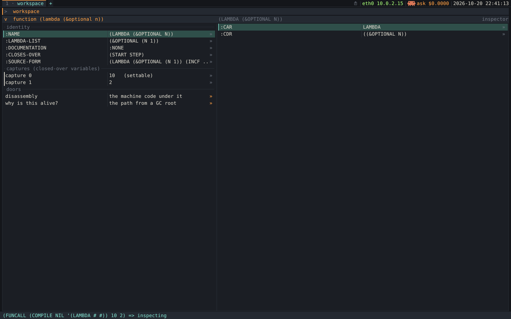

#+TITLE: What an inspector used to be able to do — and what ours could
#+STARTUP: showall

Sibling docs: [[file:code-browser.org][code-browser.org]] (the design this feeds — its =present= protocol is the
thing being extended) · [[file:background/learn-clos.org][background/learn-clos.org]] (the CLOS and =sb-mop= this
leans on) · [[file:processes.org][processes.org]] (the other "what would it cost us" analysis doc).

The read-only object viewer of modern IDEs is the /degenerate late form/ of the
inspector. Between roughly 1974 and 1990 "the Inspector" could write to memory, undo
the write, find every object pointing at an object, ask the garbage collector why
something was alive, list every instance of a class, break on a single slot, swap
identities, and re-enter a stack frame with edited arguments.

This doc catalogues those powers (from the history through [[#powers-catalogued][The powers, catalogued]]), then says which are reachable from a frozen
SBCL core running as PID 1 — each prototyped against =./sbcl= 2.6.8 before it was
built ([[#powers-built][The powers we built]]).

STATUS: *all of [[#powers-built][The powers we built]] ships* — every instance of a class ([[#every-instance-class][Every instance of a class (#6)]]), why is this alive
([[#still-alive][Why is this still alive? (#5, and the honest version of #4)]]), evaluate in the object's context ([[#evaluate-object-s-context][Evaluate in the object's context (#3)]]), settable debugger frame locals with
restart frame ([[#set-local-debugger-frame][Set a local in a debugger frame (#9) — and re-enter it]]), and the function/closure inspector ([[#function-leaf][A function is not a leaf (#14)]]). [[#runtime-arithmetic-did-compile][Runtime arithmetic did not compile in the guest (fixed)]] is a separate
finding: SBCL 2.6.8 miscompiled runtime arithmetic on CPUs without POPCNT (QEMU's
default), fixed at build time by [[file:../initramfs/logcount-fix.lisp][logcount-fix.lisp]].

* 1. Why the viewer is the degenerate form

The modern reading — an inspector is a /window that displays an object/ — is backwards.

On the systems below there was no inspector component as such. There was a
*self-describing image* — every object carried its type, every type knew how to print
itself, printing didn't throw the object away — plus a /uniform protocol/ for asking
an object what it was made of. The window was where that protocol became clickable.

So the question isn't "what did their inspector window have". It's *what did their
image let them ask* — and the answer is nearly anything, because image and tools were
made of the same stuff. An image that can describe itself can also let you change
what it just described.

* 2. The lineage

** 2.1 Interlisp and Interlisp-D (BBN/Xerox PARC, ~1974 onward)
:PROPERTIES:
:CUSTOM_ID: interlisp-interlisp-d
:END:

- *The Programmer's Assistant.* Warren Teitelman's *History List* recorded everything
  you did, side effects included, and =UNDO= retracted it. Inspector edits went through
  the same machinery, so *an inspector write was undoable*.
- *Name/value rows.* Interlisp-D's Inspector (Xerox 1100 "D-machines", surviving as
  Medley) replaced a clicked value in the live heap immediately.
- *Programs as list structure.* =EDITF= was a /structure editor/ over the conses that
  were the function; inspecting and editing a function were one act. That's the
  maximum form of the idea, and the one thing here we deliberately don't want ([[#deliberately-doing][What we are deliberately not doing]]).

** 2.2 The Lisp Machines — MIT CADR, LMI, TI Explorer, Symbolics Genera

The high-water mark; most of [[#powers-catalogued][The powers, catalogued]] comes from here. Two structural facts made it possible:

1. *The locative.* A first-class /pointer to a cell/ — the storage location, not the
   value. =(locf (aref a 3))= handed you an array element's cell to =setf= through
   later. The inspector displayed cells, so typing into a row stored into memory.
2. *Presentation types* (Dynamic Windows, later CLIM — [[#clim-idea-standardised][CLIM — the idea standardised]]). Output carried the object
   it came from, so anything printed anywhere stayed a live handle with a menu of the
   operations its type allowed.

Together: no dead text on screen and no read-only view of anything. Genera also
inspected non-data: a *process* (arrest it, inspect its stack), a *window*, a
*stream*, a *flavor* (the pre-CLOS object system: its component flavors and method
combination order), and a *stack frame* ([[#stack-frames-objects-big][Stack frames as objects — the big one]]).

** 2.3 Smalltalk-80, in parallel

The direct model for this project's browser. Its inspector's distinguishing feature is
a *code pane with =self= bound to the inspected object*: type an expression, it
evaluates in the object's context and can change it. Squeak and Pharo keep
=allInstances=, =pointersTo:=, "chase pointers", =become:= and the Morphic halo. [[#evaluate-object-s-context][Evaluate in the object's context (#3)]]
ports the code pane.

** 2.4 CLIM — the idea standardised
:PROPERTIES:
:CUSTOM_ID: clim-idea-standardised
:END:

The Common Lisp Interface Manager made Dynamic Windows portable. Two central concepts:

- *Presentation type.* Output is tagged with the object and the type it was presented as.
- *Presentation translator.* A rule for getting from a clicked presentation of type Y
  to the X a command wants — the source of the context menu on any displayed object.

Our =(present subject)= → drillable items and =(commands-for subject)= → applicable
commands is very nearly that pair, arrived at independently. CLIM's manual is a
catalogue of ideas tried against real users for a decade.

** 2.5 SLIME — what survived into the CL mainstream

- *Action buttons.* SLIME's inspector embeds them: =setf= a slot, make it unbound,
  clear a hash table; =M-RET= copies the object into the REPL.
- *=sldb= frames.* Inspect a frame's locals, =return-from-frame=, =restart-frame=
  (re-enter it, after recompiling the function if you like).
- *Over a socket.* All of it runs against a remote image. We have that transport too:
  [[file:../initramfs/net.lisp][net.lisp]], the REPL on :4005.

* 3. The powers, catalogued
:PROPERTIES:
:CUSTOM_ID: powers-catalogued
:END:

|  # | Power                                 | Where it came from        | In our image                  |
|----+---------------------------------------+---------------------------+-------------------------------|
|  1 | Write a slot (places, not values)     | Interlisp-D, locatives    | *shipped* (=inspect-places=)  |
|  2 | Undo the write                        | Interlisp Assistant       | possible; not designed        |
|  3 | Eval arbitrary code in the object     | Smalltalk                 | *shipped* — [[#evaluate-object-s-context][Evaluate in the object's context (#3)]]              |
|  4 | Who points at this object?            | Smalltalk, Lisp Machine   | subsumed by #5 — [[#still-alive][Why is this still alive? (#5, and the honest version of #4)]]         |
|  5 | Why is this still alive? (GC path)    | (modern SBCL)             | *shipped* — [[#still-alive][Why is this still alive? (#5, and the honest version of #4)]]              |
|  6 | Every instance of a class             | Smalltalk =allInstances=  | *shipped* — [[#every-instance-class][Every instance of a class (#6)]]              |
|  7 | The representation underneath         | Genera areas/storage      | possible (=room=, widetags)   |
|  8 | Behaviour, not just state             | Genera flavor inspector   | *shipped*                     |
|  9 | Stack frames as objects (set a local) | Genera, =sldb=            | *shipped* — [[#set-local-debugger-frame][Set a local in a debugger frame (#9) — and re-enter it]]              |
| 10 | Watchpoint on one cell                | Genera =Monitor Variable= | hard; a shim is possible — [[#deliberately-doing][What we are deliberately not doing]] |
| 11 | Identity surgery (=become:=)          | Smalltalk, forwarding     | no — [[#deliberately-doing][What we are deliberately not doing]]                       |
| 12 | Every printed object is a handle      | Dynamic Windows / CLIM    | *shipped* (=present=)         |
| 13 | Inspect a remote image                | SLIME, Genera             | transport exists, unwired     |
| 14 | A function/closure as a record        | Lisp Machine, Smalltalk   | *shipped* — [[#function-leaf][A function is not a leaf (#14)]]              |

** 3.1 Write, not read — the place rather than the value
:PROPERTIES:
:CUSTOM_ID: write-read-place-rather
:END:

A /value/ has no identity as a location: you can't write to "the string the object
holds", only to the *cell* holding it. An editing inspector must carry the cell along.

We do: [[file:../initramfs/model.lisp::defun inspect-places][model.lisp's =inspect-places=]] returns =(:label L :value V :set FN)=, and =FN=,
a closure over the place, *is* a locative. A Lisp Machine got it from hardware; we
synthesise it from a closure.

** 3.2 Undo

Interlisp's History List requires every mutation to record its inverse. We have it for
/code/: the change set (menu =c=) keeps the previous text of every Accepted
definition. Undo for /data/ is the same idea one level down — =inspect-places= already
hands over the old value and the setter — but nobody has designed the gesture.

** 3.3 Evaluate arbitrary code in the object's context

Smalltalk's =self=-bound code pane. [[#evaluate-object-s-context][Evaluate in the object's context (#3)]].

** 3.4 Who points at this object?

A *backwards* pointer query — scan the heap for everything whose slots contain an
object (Smalltalk's =pointersTo:=). It's the object-level twin of
[[file:../initramfs/registry.lisp][registry.lisp]]'s =senders=: "who mentions this name" vs "who holds this object". Done
by hand it runs into a real SBCL constraint; the better answer is #5 ([[#still-alive][Why is this still alive? (#5, and the honest version of #4)]]).

** 3.5 Why is this still alive?

Not "who points at it" but "what's the chain from a *GC root*" — something the
collector treats as live by definition (a global, a stack slot, the image's static
space). That's the actual debugging question. It's the one power that's *stronger in
modern SBCL than on a Lisp Machine*, and it's in our core. [[#still-alive][Why is this still alive? (#5, and the honest version of #4)]].

** 3.6 Every instance of a class

CLOS has no =allInstances=: instances aren't registered anywhere, so the MOP knows
everything about a class except who its instances are. A *heap walk* does — iterate
every allocated object and test its type. [[#every-instance-class][Every instance of a class (#6)]].

** 3.7 The representation underneath

Genera showed an object's *area* (a named heap region), address, storage type and size
in words. SBCL's =room.lisp= carries that on: a *widetag* is the header byte saying
what kind of object it is, and =sb-vm:map-allocated-objects= hands it over for every
object in a space. Worth having for teaching: an inspector that can't show a widetag
can't explain a bug that lives in the representation.

** 3.8 Behaviour, not just state

Inspect a function for its disassembly and source; a flavor for its components and
method-combination order. This is the browser's best-developed side: the dispatch
matrix, the effective-method onion, Senders/Implementors, the module index. Hence [[#powers-built][The powers we built]]'s
additions are all on the state side.

** 3.9 Stack frames as objects — the big one
:PROPERTIES:
:CUSTOM_ID: stack-frames-objects-big
:END:

In the Genera debugger a frame was an object: read its locals, *set* one, *return a
value* from it, or *restart* it — re-enter it with edited arguments against a
just-recompiled function. That changes what a debugger is: you fix the function,
restart the frame, and the computation continues as if it had never been wrong. Our
framebuffer debugger ([[file:../initramfs/fb-browser.lisp::defun run-debugger-fb][=run-debugger-fb=]]) walks frames with =sb-di=; [[#set-local-debugger-frame][Set a local in a debugger frame (#9) — and re-enter it]] makes
their locals settable and adds restart.

** 3.10 A watchpoint on one cell

Genera's =Monitor Variable= trapped a single location using a pointer type the
microcode checked on every reference — a breakpoint on a slot, set from the inspector.
We have no microcode; see [[#deliberately-doing][What we are deliberately not doing]].

** 3.11 Identity surgery

Smalltalk's =become:= swaps two objects' identities across every reference; the Lisp
Machine left a *forwarding pointer* in the old header. It's how you migrate live
instances after a class change. CLOS solves that narrower problem safely with
=update-instance-for-redefined-class=, which we get for free.

** 3.12 Every printed object is a handle

Ours via [[file:../initramfs/present.lisp][present.lisp]], specifically its =T= fallback method: any value reaching the
browser gets an inspector view, so drilling never stops at a wall of text.

** 3.13 Remote and persistent

SLIME inspects another image over a socket; Genera's =Save World= persisted an edited
heap. We have the socket ([[file:../initramfs/net.lisp][net.lisp]], :4005), unwired to the inspector. For persistence
we journal each Accept and keep the desk, but don't snapshot the heap
([[file:session-persistence.org][session-persistence.org]]).

* 4. Where our inspector stands

Before [[#powers-built][The powers we built]] we had the three structural powers — *#1, #8, #12*: places, behaviour, and
everything-is-a-handle. Having them makes the rest cheap: each addition is "a function
in [[file:../initramfs/model.lisp][model.lisp]], a row in [[file:../initramfs/present.lisp][present.lisp]], a gesture in [[file:../poc/shell.lisp][shell.lisp]]". [[#powers-built][The powers we built]] added #3, #5
(covering #4), #6, #9 and #14. Still open: #2, #7, #13; refused: #10, #11 ([[#deliberately-doing][What we are deliberately not doing]]).

* 5. The powers we built
:PROPERTIES:
:CUSTOM_ID: powers-built
:END:

Each was prototyped against =./sbcl= 2.6.8 on the host first; the numbers are host
measurements unless marked. A saved image is a *frozen heap*, so everything used must
already be in the core:

| Entry point                    | Package status | Defined in                                                              |
|--------------------------------+----------------+-------------------------------------------------------------------------|
| =sb-ext:search-roots=          | EXTERNAL       | [[file:../sbcl/src/code/traceroot.lisp::defun search-roots][=sbcl/src/code/traceroot.lisp=]]                                          |
| =sb-vm:map-allocated-objects=  | EXTERNAL       | [[file:../sbcl/src/code/room.lisp::defun map-allocated-objects][=sbcl/src/code/room.lisp=]]                                               |
| =sb-vm:list-allocated-objects= | EXTERNAL       | [[file:../sbcl/src/code/room.lisp::defun list-allocated-objects][=sbcl/src/code/room.lisp=]]                                               |
| =(setf sb-di:debug-var-value)= | =fboundp= ⇒ T  | [[file:../sbcl/src/code/debug-int.lisp::defun (setf debug-var-value)][=sbcl/src/code/debug-int.lisp=]] — *unsafe on an indirect variable*, [[#set-local-debugger-frame][Set a local in a debugger frame (#9) — and re-enter it]] |
| =sb-ext:make-weak-pointer=     | EXTERNAL       | core                                                                    |

None is a contrib, so none hits [[file:processes.org::#sb-posix-audit-nothing][processes.org, sb-posix — the audit, and why nothing was migrated]]'s rule about inline entry points
that can't be recompiled in the guest.

** 5.1 Every instance of a class (#6)
:PROPERTIES:
:CUSTOM_ID: every-instance-class
:END:

Don't walk the heap pushing matches into a list. =room.lisp='s own comment:

#+BEGIN_QUOTE
If the user-supplied TEST function conses at all, then the result is still very
arbitrary — including possible duplication of objects if we visit something and then
see it again after GC transports it higher.
#+END_QUOTE

=list-allocated-objects= handles this (two passes: count, then fill a preallocated
vector), provided =:test= doesn't cons. =typep= against a class doesn't.

#+BEGIN_SRC lisp
(defun all-instances (class)
  "Every live instance of CLASS in dynamic space."
  (let* ((c (if (symbolp class) (find-class class) class))
         (proto (ignore-errors (sb-mop:class-prototype c))))
    (remove proto (sb-vm:list-allocated-objects
                   :dynamic :test (lambda (x) (typep x c))))))
#+END_SRC

- *Filter the class prototype.* Without it the first version died with
  =The slot COMMON-LISP-USER::NAME is unbound in the object #<SHIP …>=. That =SHIP= is
  PCL's /class prototype/ (what =sb-mop:class-prototype= returns, so the MOP can answer
  questions needing /an/ instance): a live instance by every test, with unbound slots.
- *Cost.* A full walk of dynamic space: *0.09 s* on the host with ~281,000 conses
  live. A slower guest may want a "working…" status past ~0.3 s.

*Shipped:* [[file:../initramfs/model.lisp::defun all-instances][=all-instances=]] (the prototype filter and its reason in the docstring);
=subj-instances= and its =present= method in [[file:../initramfs/present.lisp][present.lisp]], reached from a class
view's *live instances* row.

** 5.2 Why is this still alive? (#5, and the honest version of #4)
:PROPERTIES:
:CUSTOM_ID: still-alive
:END:

A hand-rolled "who points at this" hits [[#every-instance-class][Every instance of a class (#6)]]'s constraint: testing an object's slots
means asking for them, and =sb-mop:class-slots= conses. Going below that to
=sb-kernel:%instance-ref= is unsafe with /raw slots/ (unboxed structure slots, where a
word is a double-float, not a pointer).

So ask *the garbage collector*: =search-roots= already knows the graph and answers the
sharper question, the chain from a root. Its argument must be a *weak pointer* — a
reference the collector may ignore — so that asking can't be what keeps the object
alive.

#+BEGIN_SRC lisp
(let ((wp (sb-ext:make-weak-pointer (second *fleet*))))
  (sb-ext:search-roots wp :criterion :oldest :print :verbose))
#+END_SRC

: Path to #<SHIP {1200F64FF3}>:
:  6       120046160F [ 262] a (COMMON-LISP:SIMPLE-VECTOR 437)
:  0         5013809F [   2] COMMON-LISP-USER::*FLEET*
:  0       1200F97E47 [   1] a cons = (#<SHIP {1200F64E03}> #<SHIP {1200F64FF3}>)
:  0       1200F97E57 [   0] a cons = (#<SHIP {1200F64FF3}>)

Read bottom-up: the ship is in a cons, in a cons, the value of =*FLEET*=, in a symbol
vector that's a root. That's already a browser trail, and its last hop is the direct
referrer — most of what #4 was for.

- *Paths as data.* =:print nil= returns a list of =(object . index)= pairs whose =car= is
  the live object, so every node is drillable.
- *How rooty a root.* =:criterion= is =:oldest= (easiest), =:pseudo-static=, or
  =:static= — only an image-backed object counts, the one to ask why something
  survived into the saved core.
- *Our own stack.* The browser holds the subject while you ask, so the answer may be
  "a thread stack" — our frames. That hop is labelled as such, not dressed up as data.

*Shipped:* [[file:../initramfs/model.lisp::defun retention-path][=retention-path=]] normalises the three hop shapes (=:STATIC=, a
thread-stack marker, =(HOLDER . SLOT)=) into plists, each carrying its holder;
=subj-retention= presents them; *Why is this alive?* is on every object's =commands-for=.

** 5.3 Evaluate in the object's context (#3)
:PROPERTIES:
:CUSTOM_ID: evaluate-object-s-context
:END:

The best addition on the page: it turns a fixed set of affordances into an open one.
Anything without a button, you can type. The CLOS version goes past Smalltalk — bind
=self= *and* every slot name as a place via =with-slots=, so =(list name hp)= reads and
=(incf hp 100)= writes, with no accessors.

#+BEGIN_SRC lisp
(defun eval-in-context (obj text)
  "READ TEXT in the object's home package and EVAL it with SELF bound to OBJ and
   every slot name bound as a place."
  (let* ((names (ignore-errors
                  (mapcar #'sb-mop:slot-definition-name
                          (sb-mop:class-slots (class-of obj)))))
         (*package* (or (ignore-errors
                          (symbol-package (class-name (class-of obj))))
                        *package*))
         (form (read-from-string text))
         (self (intern "SELF" *package*)))
    ;; The object is bound as a PARAMETER, never spliced into the form as a
    ;; literal — see the pitfalls below.
    (funcall (eval (if names
                       `(lambda (,self) (declare (ignorable ,self))
                          (with-slots ,names ,self ,form))
                       `(lambda (,self) (declare (ignorable ,self)) ,form)))
             obj)))
#+END_SRC

| Typed                     | Object               | Result                                       |
|---------------------------+----------------------+----------------------------------------------|
| =(list name hp)=          | a =standard-object=  | =("Nostromo" 3)= — slots read by bare name   |
| =(incf hp 100)=           | a =standard-object=  | =103=, and the slot really is 103            |
| =(class-of self)=         | a =standard-object=  | =#<STANDARD-CLASS SHIP>=                     |
| =(+ x y)= / =(setf x 41)= | a =structure-object= | =3= / the struct becomes =#S(POINT :X 41 …)= |
| =(length self)=           | a =cons=             | =3= — no slots, so =self= alone              |
| =(hash-table-count self)= | a =hash-table=       | =0=                                          |

=with-slots= works on a =structure-object= under SBCL, and slotless objects degrade
to a bare =self=. Pitfalls:

1. *Never splice the object in as a literal.* ``(let ((self ,obj)) …)`` breaks on a
   list: =(let ((self (1 2 3))) …)= reads =(1 2 3)= as a call — =illegal function call=.
   A lambda parameter avoids the question.
2. *Bind =*package*= for the READ, not just the EVAL.* Typing =hp= in =CL-USER= for a
   class in =LOL.SHELL= reads a different symbol, and =with-slots= never matches it.
   Binding the class name's home package makes bare slot names work.

*Shipped:* [[file:../initramfs/model.lisp::defun eval-in-context][=eval-in-context=]]; the gesture [[file:../poc/shell.lisp::defun eval-in-context-pane][=eval-in-context-pane=]] on *C-c C-e* in
every inspector pane, advertised by =commands-for=. It reuses three existing pieces:
the value prompt ([[file:../poc/shell.lisp::defvar *value-prompt*][=*value-prompt*=]], the overlay [[file:../poc/overlays.lisp::defun run-value-prompt][=run-value-prompt=]]),
[[file:../poc/shell.lisp::defun ws-eval][=ws-eval=]] (output captured, every =serious-condition= trapped so a bad form can't
take down PID 1), and [[file:../poc/shell.lisp::defun set-field][=set-field=]]'s shape — prompt, read, eval, apply, then
*re-present the object*, since =(incf hp 100)= mutating it is the point. The result
goes to the status line (Do it), not the trail; applying a /function/ is the exception
([[#function-leaf][A function is not a leaf (#14)]]).

** 5.4 Set a local in a debugger frame (#9) — and re-enter it
:PROPERTIES:
:CUSTOM_ID: set-local-debugger-frame
:END:

*What "a local" is to sb-di.* For every variable it kept debug info about, the
compiler records a /storage class plus offset/ (=SC+OFFSET=): which kind of storage
(general register, stack slot, unboxed double-float slot, …) and which one.

- *A standing frame.* A frame that isn't innermost is stopped /at a call/. x86-64 SBCL
  has no callee-saved registers, so everything live across the call is saved on the
  frame's stack (=SAVE-SC+OFFSET=). Setting a local writes that save slot — what the
  frame reads back when the call (=ERROR=, say) returns.
- *An escaped frame.* The innermost frame of an /internal/ error (=(car 5)=, a failed
  type check) was interrupted; its registers live in the signal context, and sb-di
  writes there instead.

Measured, one function per case, each signalling with =CERROR= so =CONTINUE= shows
whether the /frame/ — not just sb-di — saw the write:

| Case                                     | What sb-di shows                              | After set + CONTINUE    |
|------------------------------------------+-----------------------------------------------+-------------------------|
| =(debug 0)=                              | =ARG-0=, validity =:UNKNOWN=                  | not settable            |
| =(debug 1)= — *our image's default*      | the argument =X= only; a =LET= temp is absent | =x=: used, =(21 21)=    |
| =(debug 2)= and =3=                      | every local, =:VALID=                         | all used                |
| a =fixnum=-declared local (SC =ANY-REG=) | valid; a /string/ is accepted                 | =(+ n 1)= ⇒ 38663474160 |
| a =double-float= local                   | valid; =2.5d0= ok, ="str"= refused by sb-di   | used                    |
| closed over *and* set (a value cell)     | valid; written through the cell               | the closure sees it     |
| closed over, never set                   | valid; the frame's own copy                   | the closure does /not/  |
| closed over and used only by closures    | =:INVALID= in the frame                       | not settable            |
| an internal error's frame (escaped)      | valid; read from the signal context           | (not resumable)         |
| *an indirect variable*                   | valid                                         | *memory fault*          |

The default is =(debug 1)= although =examples.lisp= declaims =(debug 3)=: SBCL's =LOAD=
rebinds the policy per file, so the declaim ends with the file.

*Three traps, each guarded in the code:*

1. *The storage class decides what may be written.* A fixnum kept in =ANY-REG= is a raw
   tagged word; sb-di accepted a string there and the frame added 1 to its /address/.
   [[file:../initramfs/model.lisp::defun sc-value-type][=sc-value-type=]] maps storage class to Lisp type and [[file:../initramfs/model.lisp::defun set-frame-var][=set-frame-var=]] refuses a
   mismatch with a reason (=n is stored as a raw fixnum in this frame; "a string" is
   not one=). A type the compiler /derived/ for a boxed slot it can't know — the same
   hazard as SBCL's own debugger.
2. *SBCL's own setter faults on an indirect variable.* A dynamic-extent =FLET= reading
   its parent's =LET= holds a saved copy of the /parent's frame pointer/, and the debug
   info gives an =INDIRECT-SC+OFFSET= relative to it. The read path follows the
   pointer; [[file:../sbcl/src/code/debug-int.lisp::defun (setf debug-var-value)][=(setf debug-var-value)=]] writes the new value /over the pointer/. The
   next read was =Memory fault at 0xa8= — as PID 1, a kernel panic. SBCL's REPL
   =(setf (var 'acc) …)= uses the same setter. [[file:../initramfs/model.lisp::defun set-indirect-frame-var][=set-indirect-frame-var=]] mirrors the
   read path instead: =acc= := 100, then =(incf acc x)= in the parent returns 103.
   - *Upstream status.* A 30-line reproduction against stock 2.6.8 and a
     one-function fix to =set-compiled-debug-var-slot= (write through the parent
     frame pointer, as reading does) work when loaded into stock 2.6.8; not tested as a
     rebuilt SBCL, and not yet reported upstream. Until then =set-indirect-frame-var=
     stays.
3. *A copy is not a place.* A variable closed over but never assigned is /copied/ into
   each closure, so setting the frame's copy changes nothing a closure holds. That's
   Lisp semantics, not a bug, but it reads like one; the host test asserts it
   ("FIXED's closure keeps 14").

*Restart frame is nearly free.* SBCL's REPL debugger implements =RESTART-FRAME= with
two core functions: =sb-debug::frame-call= (the call read back out of the frame, with
the arguments it holds /now/) and =sb-debug::unwind-to-frame-and-call= (unwind to the
frame running every =UNWIND-PROTECT= cleanup, then call a thunk in its place). Set =x=
to 21, restart: =(:RESULT 42)=, the function called exactly twice. It needs an unwind
tag, which =(debug 1)= code has and =(debug 0)= code lacks, and it calls the /global/
definition — so a re-Accepted definition is what runs: Smalltalk's "fix it and restart".

*Shipped*, in model.lisp:

- [[file:../initramfs/model.lisp::defun frame-local-places][=frame-local-places=]] — each local as =(:name :value :set :why)=: a setter, or the
  reason there's none.
- =frame-var-unsettable-reason= — only =:VALID= variables, not one held only in a register.
- =set-frame-var= — the storage guard, the indirect write, and the value *read back*
  from the frame as its result.
- =eval-in-frame-context= — sb-di's =EVAL-IN-FRAME=, read in the function's home
  package, so the value typed for =y= may be =(* x 3)=, this frame's =x=.
- =frame-restart-refusal= and [[file:../initramfs/model.lisp::defun restart-frame][=restart-frame=]].

In fb-browser.lisp, a third Tab stop in the debugger lists the selected frame's locals
(settable in teal, unsettable dim). Enter or =C-c C-c= sets one (=dbg-set-local=), the
strip's header shows the value read back or the reason; =R= restarts the frame
(=dbg-restart-frame=). One set-and-read-back costs ~1–2 µs on the host.

*Tests:* [[file:../poc/frame-locals-test.lisp][poc/frame-locals-test.lisp]] (host, 15 checks, every assertable row above;
an indirect-write regression kills the test rather than failing it) and
[[file:../check-debugger.lisp][check-debugger.lisp]] (guest, 25, real keys: =x= 7 → 21 then CONTINUE ⇒ 42, the same
then =R= ⇒ 42, the indirect =acc= ⇒ 103 with the guest alive, a =(debug 0)= frame
refusing both with reasons).

** 5.5 A function is not a leaf (#14)
:PROPERTIES:
:CUSTOM_ID: function-leaf
:END:

Before this, a function fell to the =T= fallback of =inspect-places= and showed two
inert rows, =:value #<FUNCTION FOO>= and =:type FUNCTION=. But *a closure is a record
whose fields are the variables it closed over*, and opening one should show them.

*Some captures are places, some aren't.* SBCL boxes a captured variable in a
=VALUE-CELL= only when something /assigns/ it; a read-only capture is stored inline, and
=(SETF SB-KERNEL:%CLOSURE-INDEX-REF)= doesn't exist. The =(:label :value :set)= plist
expresses exactly that. On
=(lambda (start step) (lambda (&optional (bump 1)) (incf start (* step bump)) start))=:

| slot      | variable | boxed?     | settable |
|-----------+----------+------------+----------|
| capture 0 | =start=  | value-cell | *yes*    |
| capture 1 | =step=   | inline     | no       |

Writing 900 into capture 0 and calling the closure returns 902 — the locative move
([[#write-read-place-rather][Write, not read — the place rather than the value]]) on the object type most tooling shows nothing for.

In the booted machine, on =(make-counter 10 2)= from [[file:../initramfs/examples.lisp][examples.lisp]]:

/=capture 0= carries =(settable)= because SBCL boxed it; =capture 1= doesn't because
it's only read. Above them the identity rows, with =:CLOSES-OVER= naming both
variables as an unordered set; below, the four doors a function opens.
=./refresh-screenshot.sh --scene closure=./

- *Captures are labelled by position, not name.* =SB-DI:DO-DEBUG-FUN-VARS= yields
  names, but sorted alphabetically with the parameters mixed in. Sorting by storage
  offset fixes some cases and breaks others (a boxed capture lands in another storage
  class). Naming one wrongly would let you "edit =step=" and silently change =start=,
  so we don't guess:

  | closure                      | capture order            | debug vars as iterated   |
  |------------------------------+--------------------------+--------------------------|
  | =(rev zebra alpha)=          | =ZEBRA=, =ALPHA=         | =ALPHA=, =ZEBRA=         |
  | =(rev3 zulu yankee xray)=    | =ZULU=, =YANKEE=, =XRAY= | =XRAY=, =YANKEE=, =ZULU= |
  | =(revw zebra alpha)= (1 set) | =ZEBRA=, =ALPHA=         | =ALPHA=, =N=, =ZEBRA=    |

- *=:closes-over= has three guards.* The function must be a closure (a plain =DEFUN='s
  debug vars are its locals: =DRAW-ALIEN= once "closed over" =(A BPP DST FB RGBA …)=);
  uninterned symbols such as =#:.DEFAULTING-TEMP.= are dropped; and the count must match
  the capture slots, else =NIL=.
- *The doors.* SBCL records an anonymous closure's birthplace as
  =(LAMBDA (…) :IN MAKE-COUNTER)=, so =FUNCTION-SOURCE-NAME= recovers the enclosing
  =DEFUN= and the registry has its text: *source*, *senders*, =M-.= and =C-c C-c= work
  on a drilled closure. When =:IN= is a /string/ (a top-level lambda named after its
  file) there's no source door rather than a broken one.
- *No build paths on screen.* SBCL names a top-level lambda after its file's
  /absolute/ path on the build machine. =ABBREVIATE-FUN-NAME= shortens it to
  =initramfs/stage.lisp= — the module index's =directory/name= key — for display only.

*Shipped:* =value-cell-p=, [[file:../initramfs/model.lisp::defun closure-captures][=closure-captures=]], =function-closes-over=,
=function-source-name=, =abbreviate-fun-name=, =function-places= and the =FUNCTION=
clause of =inspect-places= in model.lisp; [[file:../initramfs/present.lisp::defmethod present ((f function))][=present ((f function))=]] and
=subj-disassembly= in present.lisp; =apply-function= / [[file:../poc/shell.lisp::defun apply-function-pane][=apply-function-pane=]] on
*C-c C-a*, which calls the closure with arguments you type and opens the result.
=render-frame.lisp function:NAME= renders the view without booting.

*Worked example.* The Workspace primer in [[file:../initramfs/present.lisp][present.lisp]] has two closure makers: a call
to the build-time =lol.examples:make-counter= and, last, a =COMPILE= of the same maker
at runtime (live since [[#runtime-arithmetic-did-compile][Runtime arithmetic did not compile in the guest (fixed)]]'s fix). Put point after either and =C-c C-i=: the same two
captures either way.

** 5.6 Runtime arithmetic did not compile in the guest (fixed)
:PROPERTIES:
:CUSTOM_ID: runtime-arithmetic-did-compile
:END:

*Symptom.* In the QEMU guest, compiling untyped generic arithmetic — =(+ x 1)=,
=(* x 2)=, =(< x y)=, =(1+ x)=, a =defun= doing any of them — died with
=Unhandled memory fault at #x1A=, and a typed =aref= on =(unsigned-byte 32)= signalled
=NIL is not of type SB-VM::SPECIALIZED-ARRAY-ELEMENT-TYPE-PROPERTIES=. Forms without
arithmetic, or with declared =fixnum= / =double-float= types, compiled. So =C-c C-c=
(=accept-source=) couldn't accept most real definitions, while =Do it= on a plain call
worked: SBCL's simple evaluator never reaches the compiler.

*Cause: SBCL 2.6.8 on a CPU without POPCNT.* QEMU's default CPU (qemu64) lacks it; the
laptop and typical developer machines have it, which is why real hardware and SBCL's
own tests never saw this.

- *The contract.* =LOGCOUNT= compiles to "POPCNT if the CPU has it, else call the
  assembly routine =LOGCOUNT=". The caller's VOP hardcodes =rdx-offset=
  (=sbcl/src/assembly/x86-64/arith.lisp=, the =def-it= macrolet): argument and answer
  in RDX. The routine takes "Lisp argument register 0".
- *The mismatch.* In 2.6.6 those registers were RDX RDI RSI
  (=sb-vm::*register-arg-offsets*= = =(2 7 6)=); in 2.6.8 they're RDI RSI RDX, =(7 6 2)=.
  The routine moved to RDI, its one caller stayed on RDX. Without POPCNT, =(logcount x)=
  returns =x= unchanged /and/ the routine overwrites RDI with a bit count.
- *The NIL.* The type printer tests "is 2^32 a power of two" as =(= (logcount 2^32) 1)=,
  hears no, prints =(unsigned-byte 32)= as =(mod 4294967296)=, and =find-saetp= has no
  entry by that name.
- *The fault.* =BIGNUM-LOGCOUNT= keeps the bignum's address in RDI across the call,
  then loads through the bit count (=memory fault at 0x11= in
  =SB-BIGNUM:BIGNUM-LOGCOUNT=). =#x1A= was a bit count used as an address. Untyped
  arithmetic reaches it because type derivation uses word- and bignum-sized bounds:
  =(type-specifier (specifier-type '(signed-byte 64)))= faults on its own.
- *How the CPU is asked.* Compiled code tests bit 1 of =[NIL+97]= (=CPU-FEATURE-BITS=,
  filled from CPUID by the C runtime). Clearing it by hand sends a host down the
  guest's path — a one-second reproduction in a plain =./sbcl=.

*Bisection*, each row measured:

| where                                                              | =(* x 2)= compiles? | =(unsigned-byte 32)= prints as |
|--------------------------------------------------------------------+---------------------+--------------------------------|
| the shipped =lisp-init=, run on the HOST (=unshare -rn=, menu =r=) | yes, =42=           | —                              |
| the guest, QEMU default CPU (qemu64)                               | *memory fault*      | =(MOD 4294967296)=             |
| the guest, *same* kernel and image, =-cpu max=                     | yes, =42=           | =(UNSIGNED-BYTE 32)=           |
| plain =./sbcl= core on the host, POPCNT bit cleared by hand        | *memory fault*      | =(MOD 4294967296)=             |
| host SBCL 2.6.6, POPCNT bit cleared by hand                        | —                   | =(UNSIGNED-BYTE 32)=           |

*Fix:* [[file:../initramfs/logcount-fix.lisp][logcount-fix.lisp]], first in =LISP_SOURCES=, rewrites the routine in place to
use RDX, the contract its caller relies on. RDI (7) and RDX (2) need no REX change, so
13 ModRM bytes change and no instruction changes length. It refuses anything that
isn't byte-for-byte the 2.6.8 routine, and at build time clears the POPCNT bit and
re-asks the questions that used to fail, so a non-working patch stops the build.
Patching =./sbcl= would be the upstream fix, but we carry no changes in that tree.

*Verified* in the guest by [[file:../check-compile.lisp][check-compile.lisp]] (qemu64; fails first if the CPU /has/
POPCNT): =(* x 2)= compiles and returns 42, =+ - < 1+= compile, the =AREF= probe
compiles, =accept-source= of =(defun zz-b (x) (* x 2))= returns =ZZ-B= and =(zz-b 21)= is
42. Against an image built without the fix, all but "the CPU lacks POPCNT" and "the
guest is still alive" fail.

*Ruled out* (don't re-search):

- *=build.sh= and tree shaking.* Row 4 is the untouched =sbcl.core=.
- *PID 1, =SBCL_HOME=, missing files, static-space placement, the kernel config.* Row
  3: same image, bzImage and mapping code; only the CPU differs.
- *Static-space call fixups for =GENERIC-*=.* The first hypothesis, read from =#x1A=
  as a tagged fixnum 13. The calls are fine; =#x1A= was a bit count.
- *SBCL's AVX2 routine variants.* They also swap on CPU features, but
  =restore-cpu-specific-routines= on the host reproduces nothing.
- *A NIL saetp table.* =sb-vm::*specialized-array-element-type-properties*= was never
  NIL; =find-saetp '(unsigned-byte 32)= works in the guest. The NIL was the lookup by
  the wrong name.

* 6. Lessons

The four powers cost roughly twice the first estimate, almost all of it [[#function-leaf][A function is not a leaf (#14)]], which
the estimate didn't contain. Every surprise was found by running a prototype, not by
reading code:

- *The model is the cheap part.* Three of the four model functions are under 20 lines;
  the work is guards and labels — the class prototype ([[#every-instance-class][Every instance of a class (#6)]]), our own stack in a
  retention path ([[#still-alive][Why is this still alive? (#5, and the honest version of #4)]]), unmappable capture names ([[#function-leaf][A function is not a leaf (#14)]]), the three frame-local traps
  ([[#set-local-debugger-frame][Set a local in a debugger frame (#9) — and re-enter it]]). =restart-frame= is about twenty lines because SBCL's debugger already had
  both halves.
- *Nothing may kill PID 1.* Every eval path uses a =serious-condition= handler that
  puts the error in the status line — not =ignore-errors=, which would swallow a
  condition we might want to debug. A bad form, a cancelled prompt and a non-function
  target each just produce a status message.
- *Verify visually without booting.* =sbcl --script poc/render-frame.lisp function:NAME=
  renders the view in about a second. It caught both cosmetic defects — an =…= outside
  the console font's 255 glyphs and the absolute build path in a title — which no
  headless test would.

* 7. What we are deliberately not doing
:PROPERTIES:
:CUSTOM_ID: deliberately-doing
:END:

- *Watchpoints (#10).* No microcode, so no cell-level trap. A shim for
  =standard-object= only — replace a slot's accessor generic function with one that
  signals first — catches only accesses /through/ the accessor, missing =slot-value=
  and =with-slots= ([[#evaluate-object-s-context][Evaluate in the object's context (#3)]]'s included). A watchpoint with silent holes is worse than none.
- *=become:= (#11).* =update-instance-for-redefined-class= solves the real problem
  (migrating instances after a class change) without identity surgery.
- *Structure editing of code ([[#interlisp-interlisp-d][Interlisp and Interlisp-D (BBN/Xerox PARC, ~1974 onward)]]).* We keep captured *source text* in
  [[file:../initramfs/registry.lisp][registry.lisp]] and Accept it with =C-c C-c=: the text carries comments and formatting,
  and this project is didactic before it's clever.
- *Undo of data writes (#2).* Wanted and mechanically straightforward given
  =inspect-places=; open until someone designs the gesture.
