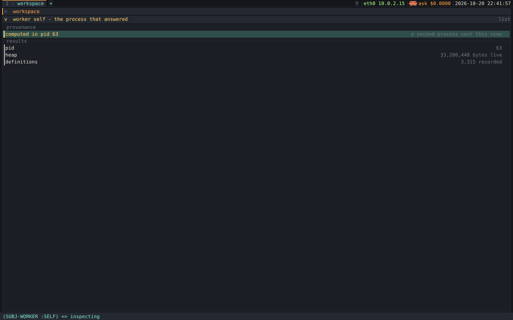

#+TITLE: Concurrent components that share graphical resources
#+STARTUP: showall

How a second process can put something on the environment's screen, what each
way costs, and the parts that are built. It also holds the =sb-posix= audit ([[#sb-posix-audit-nothing][sb-posix — the audit, and why nothing was migrated]]),
whose conclusion — change nothing — is a rule every future dependency has to
clear:

#+begin_quote
*Code calling a library must be recompilable inside the guest, not merely
runnable there.* Anything =declaim inline= over groveled alien structs fails,
because =save-lisp-and-die= keeps the compiled code and drops the compile-time
alien types. That's why =sb-posix= isn't shipped ([[#sb-posix-audit-nothing][sb-posix — the audit]]).
#+end_quote

Related: [[file:framebuffer.org][framebuffer.org]] (how one process owns =/dev/fb0=), [[file:input.org][input.org]] (how it
reads the mouse), [[file:code-browser.org::#drill-down-protocol-present][code-browser.org, The drill-down protocol — one =present=, everything browsable]] (the =present= protocol all of this turns on).

*Status.*
- *[[#worked-example-shot-worker][The worked example: a one-shot worker]] BUILT* — [[file:../initramfs/worker.lisp][worker.lisp]]: a second process contributes a view, one-shot.
- *[[#live-worker-handles-pipe][A live worker: handles, (:invalidate h), a pipe in the poll]] BUILT* — [[file:../initramfs/worker-live.lisp][worker-live.lisp]]: a child whose view stays live (handles,
  =(:invalidate h)=, a pipe in the poll). Owed: the child's closures crossing (a
  remote inspector is read-only).
- *[[#accept-tries-definition-child][Accept tries a definition in a child first]] BUILT* — [[file:../initramfs/sandbox.lisp][sandbox.lisp]]: Accept tries a definition in a child first. Owed:
  catching a definition that's wrong to /call/ rather than to load.
- *[[#sb-posix-audit-nothing][sb-posix — the audit, and why nothing was migrated]] DONE* — the audit; it shipped the rule above and one pollfd bug fix.
- *The sections before the worked example are analysis.* Where code exists, the code is truth.

A different kind of liveness sits beside [[#live-worker-handles-pipe][A live worker: handles, (:invalidate h), a pipe in the poll]]: [[file:../initramfs/runs.lisp][runs.lisp]]'s run panes stream a
child's /text/ output through a reader thread and a 100 ms tick ([[file:containers.org::#run-panes][containers.org, Run panes]]).
Lines from any program versus views from our own image; each shape fits what it
carries.

* 1. The invariant: exactly one process writes to /dev/fb0
:PROPERTIES:
:CUSTOM_ID: invariant-exactly-process-writes
:END:

"Could separate processes present data inside the environment without
reimplementing something the size of X?" The question splits in two:

- *A peer sends a view* — labels, kinds, drillable targets. Our toolkit draws it.
  Cheap ([[#scenario-peer-sends-view][Scenario A — a peer that sends a VIEW]]).
- *A peer sends pixels*, having drawn itself. We composite. Expensive for reasons
  beyond line count ([[#scenario-b-peer-sends][Scenario B — a peer that sends PIXELS]]).

Both rest on one constraint. =present-fb= keeps =/dev/fb0= open and =pwrite(2)=​s the
canvas from Lisp memory, one call per full frame ([[file:../poc/fb.lisp][poc/fb.lisp]], [[file:framebuffer.org][[[file:framebuffer.org::#done-blit-single-copy][framebuffer.org, DONE: the blit is a single copy]]]]).
There's no lock, no ownership, no arbitration:

- *Two writers both succeed.* Their rows interleave.
- *Neither can tell.* There's no expose event and no damage notification. A
  framebuffer is shared mutable memory with no protocol attached.

** The kernel console was the first second writer

The kernel console (fbcon) used to paint text over the browser's pixels. The fix
wasn't sharing: it was =KD_GRAPHICS= — "stop drawing, I own this now" — with an
=unwind-protect= to hand it back. That's =with-graphics-console= in [[file:../poc/fb.lisp][poc/fb.lisp]];
[[file:framebuffer.org][framebuffer.org]] explains the console side.

The same rule holds inside the image. =*fb-canvas*= is a special in
[[file:../initramfs/fb-browser.lisp][fb-browser.lisp]] so the debugger — entered mid-loop from a =handler-bind= handler
(not =*debugger-hook*=, which nothing sets), with the stack still standing — draws
into the same canvas instead of becoming a second writer.

#+begin_quote
*Exactly one process ever writes to =/dev/fb0=.*
#+end_quote

So the question is never "how do two processes draw", but *how much does the
non-drawing process send to the one that draws*:

| What the peer sends                   | Who owns the screen            | Cost                           |
|---------------------------------------+--------------------------------+--------------------------------|
| a *view* — labels, kinds, targets     | the environment                | ~350 lines ([[#scenario-peer-sends-view][Scenario A — a peer that sends a VIEW]])                |
| a *pixel buffer* + damage rects       | the environment, as compositor | ~450 lines + 4 invariants ([[#scenario-b-peer-sends][Scenario B — a peer that sends PIXELS]]) |
| *nothing* — it takes the whole screen | the peer, temporarily          | near zero                      |

The third row is the forgotten one. If only one thing is visible at a time you
need no compositor: hand over the framebuffer and take it back when the peer
exits, as a VT switch does. The screencast player works this way, lending the
screen to the host's MPlayer ([[file:screencast.org][screencast.org]]).

* 2. Scenario A — a peer that sends a VIEW
:PROPERTIES:
:CUSTOM_ID: scenario-peer-sends-view
:END:

** Why =present= is not a pixel protocol

X is enormous because *the client owns the pixels*. The wire must then carry
drawing primitives, a window hierarchy, expose events, input routing, resource
lifetimes and an extension mechanism to patch the model.

Our =view= struct takes the opposite side; its docstring in [[file:../initramfs/present.lisp][present.lisp]] says
"What (present subject) returns — *a description, never pixels*." A view is
labels, kinds, groups and targets: s-expressions. The peer sends a view and *our*
toolkit renders it with our font, palette, scrolling and Spotter, so a remote view
looks native because it /is/ rendered natively. It's [[file:code-browser.org::#drill-down-protocol-present][code-browser.org, The drill-down protocol — one =present=, everything browsable]]'s rule
read across a process boundary: content declares what it affords, the shell
disposes.

** The child is the same image

=spawn-worker= in [[file:../initramfs/process.lisp][process.lisp]] re-execs =/sbin/lisp= with a role argument, and
=init-toplevel= in [[file:../initramfs/supervisor.lisp][supervisor.lisp]] branches on it. The only Lisp executable in
=initramfs.sbcl.list= is =/sbin/lisp=, so "another process" here means *another
copy of ourselves*.

That's why A is cheap. The child already has =present.lisp=, =model.lisp= and the
registry; it can call =(present subject)= and print the result. The renderer
doesn't care where a view came from: =item->row= in [[file:../poc/shell.lisp][shell.lisp]] ("the whole
boundary between the two layers") reads only =label=, =detail=, =kind=,
=disposition= and =group= — plain data.

** The four things that need designing
:PROPERTIES:
:CUSTOM_ID: four-things-need-designing
:END:

1. *Subjects must not travel; handles must.* Drilling is =open-pane= →
   =(present subject)=. Named =subj-*= wrappers would serialise, but live objects
   leak in too — classes, packages, generic functions, and through the
   =(present (x t))= inspector fallback, any value at all. So: a =subj-remote=
   holding (connection, handle), the child keeping an integer→subject table.
2. *Two slots are closures and can't cross* — =item.edit= (the inspector's setter)
   and =command.action=. Making them declarative tags the child resolves would
   now cost a migration, because =run-command= in [[file:../poc/shell.lisp][shell.lisp]] calls actions from
   the right-button menu and the halo.
3. *=EQ= identity breaks.* The shell compares subjects with =EQ= (the
   beside-toggle and the preview cache). Freshly =read= structs are never =EQ=, so
   the preview would reopen every frame. Intern =subj-remote= by (connection,
   handle).
4. *Liveness is a push, not a command.* The child sends =(:invalidate handle)=;
   the shell re-presents if that subject is on screen. Poll wakes on data rather
   than a timer, so idle stays zero-CPU.

Points 1, 3 and 4 are built in [[#live-worker-handles-pipe][A live worker: handles, (:invalidate h), a pipe in the poll]]. Point 2 is side-stepped: the closures are
dropped at the boundary, so a remote inspector is read-only.

** Transport and security for a foreign peer
:PROPERTIES:
:CUSTOM_ID: transport-security-foreign-peer
:END:

The built workers use a pipe pair, because the child is ours ([[#live-worker-handles-pipe][A live worker: handles, (:invalidate h), a pipe in the poll]]). A peer we did
/not/ start would need a socket. What exists for that:

- *AF_UNIX* — =CONFIG_UNIX=y= ([[file:kernel-config.org][kernel-config.org]]), =sb-bsd-sockets= in the heap,
  =/tmp= a tmpfs.
- *An fd in the event loop* — the =*fb-services*= hook ([[#live-worker-handles-pipe][A live worker: handles, (:invalidate h), a pipe in the poll]]).
- *A connect/retry idiom* — [[file:../host-client/qmp.lisp][host-client/qmp.lisp]], liftable wholesale.

The network REPL is plaintext, unauthenticated remote =eval= into PID 1
([[file:networking.org][networking.org]]). A presentation channel must not extend that: AF_UNIX rather
than TCP (scoped by the filesystem), =*read-eval*= nil, keyword-only message
heads, validated shapes, and =with-standard-io-syntax= so =*print-circle*=,
=*print-length*= and =*package*= can't corrupt the wire. A connection that *can't
eval* is worth building that way from the first line.

* 3. Scenario B — a peer that sends PIXELS
:PROPERTIES:
:CUSTOM_ID: scenario-b-peer-sends
:END:

** Hosting is solved; the protocol isn't the cost

The *stage* ([[file:code-browser.org::#stage-dispatch-happening-done][code-browser.org, The Stage — dispatch, happening  (DONE)]]) already has the five mechanisms a foreign
surface needs: its own body class (=pane-body=), a pane that changes without input
plus a deadline to serve it, click routing into pane-local coordinates, key
routing into the pane, and a subject that keeps it drillable and
Spotter-reachable. A =:foreign= view kind is those five with a socket where
=step-stage= is.

[[file:../poc/x11.lisp][poc/x11.lisp]] is ~310 lines because an X /client/ hands the server one finished
image ([[file:x11.org][x11.org]]); the complexity lives in the server. If the peer renders into its
own buffer and sends damage rectangles (the Wayland model), you drop:

- *The graphics pipeline* — GCs, every =Poly*= request, core fonts, pixmaps,
  colormaps and visuals.
- *Expose* — the biggest single deletion; with client-owned buffers nothing is
  ever "destroyed, redraw it".
- *Server-side windows* — the hierarchy, substructure redirect, and with them
  ICCCM and EWMH; atoms, properties, grabs, XKB.
- *Patch extensions* — RENDER, Composite, DAMAGE, MIT-SHM.

You keep, under any model: surface lifetime, focus policy, the resize handshake,
buffer release semantics (or you composite half-drawn frames), surface-local input
coordinates and a repaint scheduler. "Wayland is simpler than X" is a claim about
protocol surface, not compositor work: =tinywl= is tiny because wlroots does the
work, and we'd be writing the wlroots part (minus GPU, multi-output, xdg-shell and
seat multiplexing).

** Transport options

- *RGBA bytes over AF_UNIX* — reachable, and the one to pick. Compare with what's
  already paid: =present-fb= writes a full canvas per frame as one =pwrite(2)=.
- *A tmpfs file both sides mmap* — needs new FFI: =sb-posix:mmap= isn't available
  ([[#sb-posix-audit-nothing][sb-posix — the audit, and why nothing was migrated]]), so a =define-alien-routine "mmap"= against glibc, about fifteen lines. You
  still need an out-of-band "frame ready" signal and double-buffering, because
  the peer can be preempted or run concurrently mid-paint. One copy traded for a
  synchronisation protocol.
- *SCM_RIGHTS fd passing* — not reachable. =sendmsg=/=recvmsg=/=cmsg= appear
  nowhere in =sb-bsd-sockets=, and =sb-posix= doesn't wrap them. Hand-rolling
  =struct msghdr= gains nothing over mmap.

** The cost that isn't lines

- *Semantic view:* ~350 lines, *zero new invariants*, content browsable — items
  drill, symbols are Spotter targets, =present= composes.
- *Compositor:* ~450 lines, *four permanent invariants*, content *opaque* — a
  rectangle the browser can never inspect, search or drill into.

A foreign surface as a pane has no items, so =↵= and the arrows do nothing and
=commands-for= has nothing to offer. It'd be the first pane that's not a view of a
subject, breaking an unwritten corollary of [[file:code-browser.org::#framebuffer-x-question-answered][code-browser.org, Framebuffer or X? — the question, answered]]: /everything on
screen is drawn by us from a description./ Under Morphic a foreign surface would be
an ordinary morph. But there's no client to serve: every executable in the image
is ours, so the first "foreign" client would be another copy of =/sbin/lisp=. The
compositor becomes worth building only when a genuinely foreign graphical binary
must draw into the environment.

* 4. Input: two processes and one mouse

Both ways a peer could get the device are bad:

- *Shared fd, inherited through fork.* One open file description, one queue. Each
  24-byte =input_event= goes to *exactly one* reader, so the two processes steal
  packets and each sees about half the motion.
- *Separate =open()= of =/dev/input/eventN=.* evdev gives each open its own ring
  buffer and broadcasts every event to all of them. Both see everything — and both
  act on it.
- *=EVIOCGRAB=* is the kernel's arbitration: take a device exclusively. We don't
  use it; nothing competes for a device here.
- *The cursor is software.* =draw-cursor= composites an arrow into the canvas.
  Two processes doing that draw two cursors, each erasing the other's.

So *the peer has no eyes and no hands*: it never opens evdev or =/dev/fb0=. The
parent owns input and output, decides focus, and forwards semantic events; the peer
replies with views. It's [[#invariant-exactly-process-writes][The invariant: exactly one process writes to /dev/fb0]]'s one-owner rule applied to input.

The harder version is already solved inside one process: =fbb-wait= polls the
console tty /and/ the keyboard's evdev node — two views of one keyboard, for
different information, because a bare Ctrl produces no byte ([[file:input.org][input.org]]).

* 5. Memory: fork, exec, and what copy-on-write does not buy
:PROPERTIES:
:CUSTOM_ID: memory-fork-exec-copy
:END:

- *We fork AND exec.* =spawn-worker= and the workers use =run-program=. The
  copy-on-write mapping lives only between the two calls; =execve= discards it.
  COW buys essentially nothing.
- *The image isn't duplicated either.* =/sbin/lisp= lives in the initramfs, a
  tmpfs, whose pages /are/ the page cache. Both processes map the same physical
  frames for text and the core's read-only spaces.
- *The heap isn't shared.* Dynamic space is private and gets written; SBCL's GC
  uses write-protected pages plus a SIGSEGV handler as its write barrier. Sharing
  decays as the child works.
- *A bare =fork()= is where COW would pay.* The child inherits the whole live heap
  copy-on-write, so it can =present= the parent's live objects with zero transfer.

Two catches for a bare fork:

- *SBCL's post-fork fixups.* =sb-posix:fork= isn't a thin wrapper: it stops the
  finalizer thread, disposes dead thread structs, calls the runtime's
  =sb_posix_after_fork= in the child and restarts the finalizer in both. Every
  step is a runtime or =SB-IMPL= / =SB-THREAD= internal, so the sequence can be
  reproduced without the contrib — but it must be copied exactly.
  [[file:session-persistence.org::#fork-without-sb-posix][session-persistence.org, Fork without =sb-posix=]] has the verified recipe and what each shortcut
  breaks.
- *One thread only.* =sb-posix:fork= refuses with more than one thread running
  ("Cannot fork with multiple threads running."). The image runs several (the net
  REPL, =netd=, =lol-watch=, the =kmsg= reader, …), so a fork must stop them first.
  That turns the classic fork-in-a-threaded-program deadlock into an immediate,
  legible error.

Using =sb-posix:fork= / =waitpid= themselves wouldn't break live editing: they
don't expand into groveled structs, and in the guest =(compile nil '(lambda ()
(sb-posix:waitpid -1 1)))= succeeds. The cost of that route is the contrib's image
size ([[#sb-posix-audit-nothing][sb-posix — the audit, and why nothing was migrated]]).

To measure sharing, use =report-memory= in [[file:../initramfs/meminfo.lisp][meminfo.lisp]] (Lisp heap, process RSS,
the kernel's resident image, the whole machine). Summing RSS across processes
double-counts shared pages; the gap between machine-wide used memory and the RSS
sum /is/ the sharing.

* 6. sb-posix — the audit, and why nothing was migrated
:PROPERTIES:
:CUSTOM_ID: sb-posix-audit-nothing
:END:

The project's habit is =define-alien-routine= against the glibc the image already
links; [[file:networking.org][networking.org]] and [[file:input.org][input.org]] are largely /about/ the constants and struct
layouts that forces you to confront. The audit asked the other way round: *is
=sb-posix= better than some of that alien code?* The answer is no, for a reason
specific to this project.

** The general rule this establishes

#+begin_quote
A library is usable here only if code calling it can be *recompiled inside the
guest*, not merely run there. Anything =declaim inline= over groveled alien
structs fails that test, because =save-lisp-and-die= keeps the compiled code and
drops the compile-time alien types.
#+end_quote

- *Stricter than "does it fit".* It applies to every future dependency — a
  parser, anything the agent work pulls in.
- *Plain call wrappers pass.* In the guest, =(sb-posix:getpid)= returns 1 and
  =(compile nil '(lambda () (sb-posix:waitpid -1 1)))= succeeds.
- *Cost of the contrib.* One =require= line and *+672 KiB* of image (tag #24:
  43,848,952 → 44,537,208 bytes, +1.57%). termios must stay hand-rolled
  regardless.
- *What a probe must avoid.* Before =logcount-fix.lisp=, the guest couldn't compile
  untyped arithmetic at all ([[file:inspector-history.org::#runtime-arithmetic-did-compile][inspector-history.org, Runtime arithmetic did not compile in the guest (fixed)]]). A "does it recompile?"
  probe needs a body the guest can compile anyway, plus a trivial lambda as a
  control, or it blames the library for something else.

** The audit, site by site

Every =define-alien-routine= in the image against what =sb-posix= 2.6.8 provides
(checked in =sbcl/contrib/sb-posix/=):

| Site                                                | What it does                             | In sb-posix?                                                     | Verdict                                  |
|-----------------------------------------------------+------------------------------------------+------------------------------------------------------------------+------------------------------------------|
| =line-editor.lisp= termios                          | hand-counted offsets into a 60-byte blob | *yes* — groveled =struct termios= + every constant               | looked like the one clear win; see below |
| =fb-browser.lisp= =poll= + pollfd array             | hand-built 8-byte slots                  | *no* — no =poll=/=select=/=epoll= at all                         | stays, by necessity                      |
| =process.lisp= =reboot(2)=                          | =extern-alien "reboot"=                  | *no*                                                             | stays                                    |
| =dhcp.lisp= =setsockopt= (SO_RCVTIMEO)              |                                          | *no* — and =sb-bsd-sockets= has no receive-timeout option either | stays                                    |
| =net.lisp= / =fb.lisp= / =fb-browser.lisp= =ioctl=  | thin wrapper each                        | yes, but *thin*                                                  | stays — see below                        |
| =net.lisp= =socket=                                 |                                          | =sb-bsd-sockets='s job                                           | stays                                    |
| =fb.lisp= / =fb-browser.lisp= =open=/=read=/=close= |                                          | yes                                                              | stays — marginal                         |
| /new capability/ =fork=, =waitpid=, =mmap=          | not used                                 | *yes*, with real added value                                     | deferred with [[#memory-fork-exec-copy][Memory: fork, exec, and what copy-on-write does not buy]]                         |

** termios: the one that looked like a win

The termios code treats =struct termios= as an opaque 60-byte block and patches
hand-counted offsets: =c_lflag= at 12, =c_cc= at 17, VTIME at =c_cc[5]=, VMIN at
=c_cc[6]=. All correct for x86-64 glibc, silently wrong anywhere else.

The migration was written and tested. Its constants matched the old ones exactly
(=ICANON= 2, =ECHO= 8, =ISIG= 1, =TCSANOW= 0, =VTIME= 5, =VMIN= 6). On the host it
was strictly better — no =make-alien=/=free-alien= pair, no patching through an
uninitialised buffer on a non-tty — and it passed on a real pty and booted with raw
mode working. *Then, in the guest:*

#+begin_src lisp
  (compile nil '(lambda () (with-raw-mode (0) :x)))   ; => NIL, failed
  (compile nil '(lambda () (sb-posix:tcgetattr 0)))   ; => NIL, failed
#+end_src

=sb-posix:tcgetattr= is =declaim inline=, so compiling a call expands a body that
refers to groveled alien structs, whose type information doesn't survive
=save-lisp-and-die=. Calls compiled at build time run fine; new ones can't be
compiled. You could no longer =C-c C-c= anything in [[file:../initramfs/line-editor.lisp][line-editor.lisp]] — and an
image that edits its own source is the project's thesis ([[file:code-browser.org::#source-code-image][code-browser.org, The source code is NOT in the image (the keystone problem)]]). It
was reverted; the hand-rolled version recompiles in the guest:

#+begin_example
  => (:WITH-RAW-MODE-RECOMPILES :YES :RAW-WORKS :OK)
#+end_example

** The ioctl callers stay, on purpose

=sb-posix:ioctl= is deliberately thin — =(fd cmd &optional arg)= with an alien
pointer. You'd still define =SIOCSIFADDR= and pack =ifreq= by hand. Migrating saves
one line per file, and those constants and layouts /are/ the documentation in
[[file:networking.org][networking.org]] and [[file:input.org][input.org]].

** A bug the audit turned up

=fbb-wait= and =fbb-ready-p= wrote a pollfd's =fd= field with =(logand fd #xff)= —
the low byte of a 4-byte =int=. With a pipe's read end forced to fd 300 and data
waiting, the old code polled fd 44 and got =POLLNVAL=; the fix returns =POLLIN=. Both
sites now share one =%put-pollfd= macro in [[file:../initramfs/fb-browser.lisp][fb-browser.lisp]], so they can't drift
— which matters once the poll holds pipes and sockets, not single-digit device
nodes.

The workers ([[#worked-example-shot-worker][The worked example: a one-shot worker]]–[[#accept-tries-definition-child][Accept tries a definition in a child first]]) keep the rule: =sb-unix= reads and writes, =run-program=,
=wait-until-fd-usable= and web-cdp.lisp's hand-rolled =fcntl=, no =sb-posix=.

* 7. The worked example: a one-shot worker
:PROPERTIES:
:CUSTOM_ID: worked-example-shot-worker
:END:

[[file:../initramfs/worker.lisp][worker.lisp]] is [[#scenario-peer-sends-view][Scenario A — a peer that sends a VIEW]] running: a second process contributes a view, and no pixels
cross. ~210 lines, because it does the easy half (see "What it does not do").

** Run it

The Workspace primer carries the first two forms; =C-c C-i= (Inspect it) after one
opens it as a pane:

#+begin_src lisp
  (subj-worker :self)         ; proof a different process answered: compare pids
  (subj-live :ticker)         ; the LIVE one (see "A live worker"): it keeps changing, no key pressed
  (subj-worker :signallers)   ; the whole-image sweep; each row drills (not in the primer)
  (show-worker :self)         ; the same thing printed, for the REPL (not in the primer)
#+end_src

A =provenance= row names the pid that did the work, then the results follow as
ordinary =item=​s: the concept palette, list widget and scrollbar apply without
knowing the rows came off a pipe. =commands-for= offers "Run again".

/The view a second process sent back, rendered by this one./
/=./refresh-screenshot.sh --scene worker=/

The environment is PID 1 and the work happened in pid 25. That's the whole claim,
in one row.

** Choosing the job

A good first job has a view that's *already plain data*, work that wants to
happen elsewhere, and a reason the child must be *the same image*.

- *=job-signallers=* walks every recorded definition's source for signalling calls
  (=map-recorded-forms= over the whole image). CLOS can't answer that, so it's
  derived from source — useful and expensive. It returns symbols and strings, and
  needs the registry, which only a child of this image has.
- *=job-self=* is the smoke test: pid, heap, definition count.

** Why not the stage

The stage ([[file:code-browser.org::#stage-dispatch-happening-done][code-browser.org, The Stage — dispatch, happening  (DONE)]]) looks like the obvious candidate and is the
worst one:

1. *Its data is live pointers.* =(present (subj-stage s))= returns the live =stage=
   struct by reference ([[file:../initramfs/stage.lisp][stage.lisp]]). =draw-stage-body= calls =stage-resize= on it,
   and =draw-stage-sprite= reads body slots and calls =lol.examples:name= on a CLOS
   instance. It would need a wire format for the sprite set first.
2. *It doesn't need isolation.* =tick-live-stage= in [[file:../initramfs/fb-browser.lisp][fb-browser.lisp]] wraps
   =step-stage= in =handler-bind= inside a =restart-case=, so the debugger opens
   on a standing stack. In a screenless child, the debugger would have to be
   shipped across as data.
3. *It's the worst case for the transport.* 33 ms frames mean the channel is never
   quiet, so poll-on-data buys nothing.

"Most convincing to watch" and "most suited to the mechanism" are different
questions.

** Three decisions

1. *The child is the same image.* =run-program "/sbin/lisp" ("job" …)=, a =job=
   role in =init-toplevel=. No client library: the client is us.
2. *A pipe, not a socket.* =run-program :output :stream= is free: no AF_UNIX, no
   accept loop.
3. *Names travel, not subjects.* The child sends symbols; the parent rebuilds real
   subjects, so a row computed elsewhere drills into /this/ image's condition view.
   Enough while every subject has a name.

On the host there's no =/sbin/lisp=, so =call-worker= runs the job in-process and
*says so in the view*. That keeps [[file:../poc/render-frame.lisp][render-frame.lisp]] working.

** What it does not do

It stays synchronous on purpose, the simplest correct shape; the next two
sections are built beside it.

- *No liveness or handles* — one answer, names only. [[#live-worker-handles-pipe][A live worker: handles, (:invalidate h), a pipe in the poll]].
- *No =EQ= interning* — nothing is re-presented, so [[#scenario-peer-sends-view][Scenario A — a peer that sends a VIEW]]'s trap can't fire. [[#live-worker-handles-pipe][A live worker: handles, (:invalidate h), a pipe in the poll]].
- *No isolation benefit* — a crashed child is a closed pipe, reported as "the
  worker said nothing". Isolation pays at Accept: [[#accept-tries-definition-child][Accept tries a definition in a child first]].

* 7½. A live worker: handles, (:invalidate h), a pipe in the poll
:PROPERTIES:
:CUSTOM_ID: live-worker-handles-pipe
:END:

[[file:../initramfs/worker-live.lisp][worker-live.lisp]] is the half of [[#scenario-peer-sends-view][Scenario A — a peer that sends a VIEW]] that needs designing. The child keeps running
and keeps its own objects; the parent shows views of them, and when the child's
state changes the pane follows *with no key pressed*.

#+begin_src lisp
  (subj-live :ticker)   ; a child that changes once a second; one row drills into
                        ; the child's own job object, which has no name
  (subj-live :sweep)    ; the one-shot worker's whole-image sweep, in batches: rows arrive as found
#+end_src

=C-c C-i= on either opens it as a pane; the first is in the Workspace primer.

** The protocol

The child is this image again, argv =("serve" NAME)=, stdin and stdout both pipes.
Messages are READable forms ended by a NUL byte — the framing [[file:../initramfs/web-cdp.lisp][web-cdp.lisp]] uses
for Chrome's DevTools pipe, with s-expressions where Chrome has JSON. A frame with
any other head is dropped unread:

| Direction      | Message           | Meaning                                          |
|----------------+-------------------+--------------------------------------------------|
| child → parent | =(:hello :pid N)= | I am up, and this is my pid                      |
| parent → child | =(:present H)=    | present your subject number H                    |
| child → parent | =(:view H DATA)=  | here it is, as plain data                        |
| child → parent | =(:invalidate H)= | H may have changed — ask if you care             |
| child → parent | =(:error TEXT)=   | a job that does not exist, or a step that failed |
| parent → child | =(:quit)=         | goodbye (closing the pipe means the same)        |

=DATA= is a view with every live thing taken out: title, kind, selection, text, and
per row the label, detail, kind, group, disposition — and a *handle* where the
subject was.

** Handles

Every subject the child shows is filed in a table on its side; the parent gets an
integer and wraps (connection, handle) in a =subj-remote=. Presenting one sends
=(:present H)=. So the ticker's last row leads to the child's own =live-ticker=
struct, shown by the child's own inspector — an object with no name.

The same subject must get the same handle, or every refresh mints new numbers:

- *Named wrappers* (=subj-condition=, =subj-defn=) are rebuilt by every =present=.
  =server-handle= keys them by (type . slot values) under =EQUAL= when every slot
  is plain data.
- *Anything else* is keyed by =EQ=, so a =present= method that wants a stable handle
  must return the same object each time. =live-ticker= keeps its
  =(subj-object self)= in a slot for that reason.

The table only grows; a child serves one pane and is quit when that pane goes.

** Liveness pushes a name, not a view

On a change the child sends =(:invalidate H)=. The parent fetches only if H is *on
screen* — the focused trail, its side panes, and the nav-split preview while it
previews a selection there. The child sends at most one invalidate per handle until
asked again.

So a hidden live tab costs one message and then silence, and catches up the moment
it's focused (=worker-live-run= asks for every stale handle on screen each turn).
Measured in the guest: 4 s with the ticker hidden, zero frames drawn and zero views
fetched.

** The pipe is a poll slot

=*fb-services*= in =fb-browser.lisp= is the hook for "something other than input
wakes the loop": per service, =:fd=, =:timeout= and =:run= functions. [[file:../initramfs/web.lisp][web.lisp]]
registers Chrome's pipe, the terminals their pty masters, and the live workers
=:workers=:

- *=:fd=* — every live child's output pipe (read end, =O_NONBLOCK=).
- *=:run=* — drain each pipe without blocking, refresh the panes whose views
  arrived, ask for what's stale and on screen, let go of children nobody shows.
- *=:timeout=* — -1, except while a child waits out its idle grace.

The loop still sleeps until a key, a click or a child writing. Unlike [[file:../initramfs/runs.lisp][runs.lisp]]'s
reader thread and 100 ms tick, a view that changes once a minute costs one wake a
minute.

- *A child that dies* hangs up its end; =poll(2)= reports =POLLHUP=, =:run= reads 0
  bytes and closes the connection, and the fd leaves the poll set at once (an fd at
  EOF stays "ready" forever and would make the loop busy). The pane keeps the last
  view; its provenance row says the worker exited.
- *A child no pane shows* for =+worker-idle-seconds+= (5) gets =(:quit)=, its pipes
  closed, and is reaped (=process-alive-p= is a =waitpid= with =WNOHANG=). Closing
  the tab is how you let a worker go.

** Interning, and threads

=remote-subject= hands out one =subj-remote= per (connection, handle), forever. A
live update replaces the pane's /view/, not the pane or its subject: same pane, same
subject, same selection (clamped), new rows. Asserted in the guest after many
updates: =(eq *zz-pane* (current-pane))=.

Two threads can touch a connection: the browser's loop and whoever presents a
remote subject (from the net REPL, another thread). Each connection's reads and
writes run under its own lock, its tables are synchronized, and =subj-live= fetches
the first view before publishing the connection to the loop. Two readers on one
pipe would each get half the frames.

** Design decisions

1. *A pipe pair, not AF_UNIX.* The child is ours: =run-program :input :stream
   :output :stream= gives both directions with no listening socket and no file in
   =/tmp= anyone else could connect to. A socket earns its place only for a peer we
   didn't start.
2. *Closures don't cross.* =item-edit= and =item-action= are dropped, so a remote
   inspector is read-only ([[#scenario-peer-sends-view][Scenario A — a peer that sends a VIEW]], point 2).
3. *Views that aren't rows don't cross either.* =:list= and =:inspector= cross as
   rows, a text view as read-only text (=:reference=). A view whose renderer reads
   live =:data= — the dispatch matrix, the stage — is replaced by a line saying so.

** Pitfalls

- *Shared =CL-USER= names collide.* The close function was first called
  =conn-close=; [[file:../initramfs/http.lisp][http.lisp]], loaded later, has a one-argument =conn-close= that
  silently replaced it ("workers: invalid number of arguments: 3", and killed
  children went unnoticed). Renamed =worker-close=. Every image module shares
  =CL-USER=, so a generic verb-noun name waits for a later file to collide.
- *The nav-split preview is a cache.* It survives a tab switch, so counting it as
  "on screen" unconditionally made a hidden ticker redraw every second. It counts
  only while it previews a visible pane's selection. The host test can't see this:
  nothing draws there.

** Tests

- *Host:* [[file:../poc/worker-live-test.lisp][poc/worker-live-test.lisp]] (25 checks): the wire (a frame split across
  reads, NUL and newline inside strings, an unknown head, =#.=, EOF), then the
  ticker and the sweep with the "child" a /thread/ over two real pipes — the host
  fallback, which says so in the provenance row.
- *Guest:* [[file:../check-worker.lisp][check-worker.lisp]] (39 checks; sections E–J), with *no key sent* —
  the script never opens QMP. The ticker advances 4 in 4 s with 4 repairs; a drilled
  object's =TICKS= moves 6 → 9 in 3 s; hidden, 0 frames and 0 fetches; killed,
  =:EXITED= and out of the poll; the live sweep reads 1,200 of 2,447 definitions in
  its first 1.5 s and ends with the one-shot sweep's 15 condition types; no
  connection or zombie left 9 s after the pane closes. (Tag #27, qemu64.)

* 7¾. Accept tries a definition in a child first
:PROPERTIES:
:CUSTOM_ID: accept-tries-definition-child
:END:

=C-c C-c= compiles a definition into the running image, which is PID 1. A compile or
type error is a condition that =accept-pane= catches. What a handler can't catch is
a form that never returns, or takes its process with it — and both run at /load/
time, exactly when Accept runs them:

#+begin_src lisp
  (defparameter *table* (loop))           ; PID 1 frozen: no key is ever answered
  (defvar *x* (sb-ext:exit :abort t))     ; PID 1 exits, and the kernel panics
#+end_src

=accept-source= ([[file:../initramfs/registry.lisp][registry.lisp]]) first calls =*accept-sandbox*= — before even the
=READ=, since a =#.= in the text is code too. [[file:../initramfs/sandbox.lisp][sandbox.lisp]] sets it to
=sandbox-try-accept=: re-exec the image as =("try")=, send =(:accept TEXT PACKAGE)=
over [[#live-worker-handles-pipe][A live worker: handles, (:invalidate h), a pipe in the poll]]'s NUL-framed wire, and wait up to =*sandbox-seconds*= (10). The child
Accepts in its own heap and answers =(:accepted NAME)= or =(:error TEXT)=.

| The child …                   | PID 1 …                      | Why                                                                                                                       |
|-------------------------------+------------------------------+---------------------------------------------------------------------------------------------------------------------------|
| answered =:accepted=          | accepts it                   | it loaded somewhere first                                                                                                 |
| answered =:error=             | accepts it *anyway*          | PID 1 survives errors, and the child may lack state PID 1 has (a class defined with Do it earlier); refusing is a false alarm |
| died (pipe closed, no answer) | *refuses* (=accept-refused=) | it would have died too                                                                                                    |
| did not answer in time        | *refuses*, kills the child   | it would have hung                                                                                                        |

The sandbox refuses *only* what PID 1 couldn't have survived. That's also why the
child doesn't first replay the session's earlier Accepts: a missing definition can
only cause an error, which is let through anyway, and replaying would rerun every
earlier Accept's side effects per trial.

- *Every caller is covered* — =C-c C-c= in a source pane, the Workspace, a Lisp file
  pane, the agent's define tool, and boot replay of the journal
  ([[file:session-persistence.org][session-persistence.org]]), so a replayed definition that would kill PID 1 is
  refused like a typed one.
- *Cheap enough to be on by default.* 0.02–0.04 s per trial in the guest; the
  child's pages are already in the page cache ([[#memory-fork-exec-copy][Memory: fork, exec, and what copy-on-write does not buy]]). The status line says
  =Accepted: greet   (tried first in pid 56)=.
- *Switch it off* with =(setf *accept-sandbox* nil)=, for a definition the sandbox
  refuses that you mean anyway.
- *The trial keeps nothing.* The child binds =*accept-hooks*= (and =*accept-sandbox*=)
  to nothing. Those hooks are PID 1's — the change journal is one — and running
  them in the trial journalled every Accept twice.

** What it does not catch

- *Wrong to call, fine to load.* Redefine =draw-pane-expanded= with an infinite loop
  and the trial passes — nothing calls it in the child — and the next repair hangs
  PID 1. The child has no screen, input or event loop. Catching it would mean the
  child running the /caller/, a headless frame as [[file:../poc/render-frame.lisp][render-frame.lisp]] does on the
  host. Not attempted.
- *Evaluations.* Do it / Print it / Inspect it / Debug it evaluate rather than
  define, and Debug it exists to stop /in PID 1/ with the stack standing.

** Tests

=check-worker.lisp= section K, in the guest: =(defun zz-sand …)= accepted after a
trial in another pid and callable; =(defparameter *zz-hang* (loop))= refused after
4 s and never bound; =(defvar *zz-die* (sb-ext:exit :abort t))= refused with the
trial recorded as =:DIED= while PID 1 still answers the next probe; a read error let
through. =check-compile.lisp='s =accept-source= checks pass with the sandbox on.
